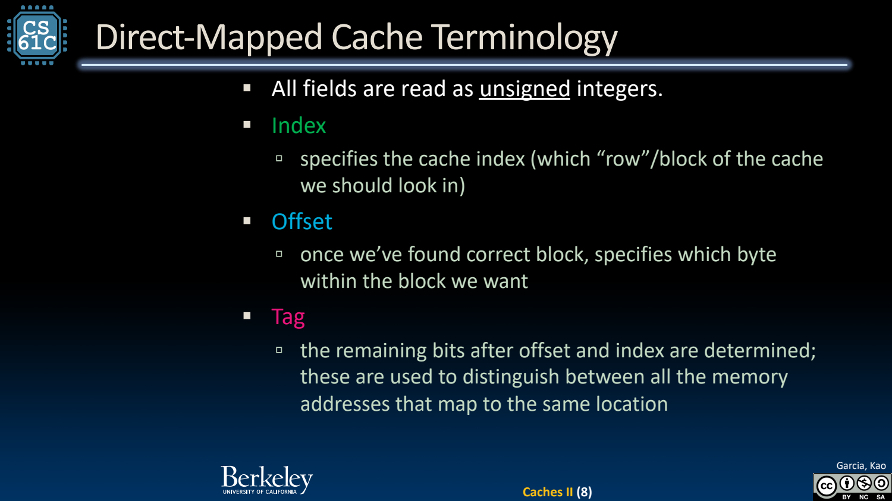
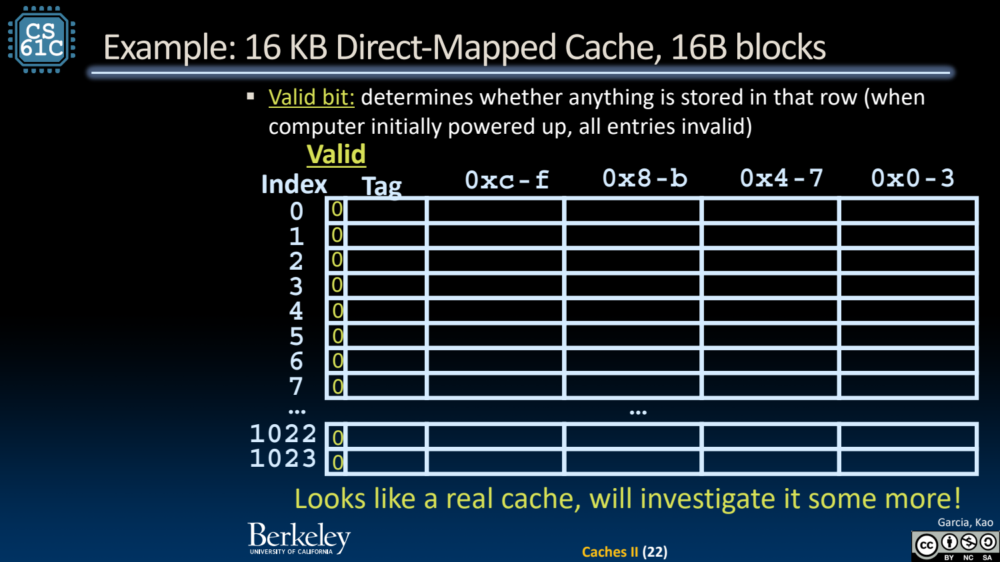

- Direct-mapped：每个内存块只有一个候选位置
	- [Slides 3–7](../Slides/CS61C%20202FFa%20L25%20Caches%20II.pdf#page=3)
	- 给定内存块编号，按 cache 行数取模决定位置；查询只查一行，硬件简单，但多个块可能争同一位置。
	- Cache line/block 是存取与管理单位；CPU 要一个 byte/word 时，miss 往往从下层搬整个块。

- 地址拆分 T/I/O：低位先决定块内位置
	- [Slides 7–13](../Slides/CS61C%20202FFa%20L25%20Caches%20II.pdf#page=7)
	- 若地址宽 A、数据容量 C bytes、块大小 B bytes，直接映射行数为 C/B；二次幂配置下 offset=$\log_2B$，index=$\log_2(C/B)$，tag=A-index-offset。
	- Offset 选块内 byte，Index 选候选行，Tag 区分映到该行的不同内存块；三者不是任意字段命名。
	- 例：8B cache、2B block、32-bit 地址 → offset=1、index=2、tag=29。
	- 

- Hit 必须同时满足 Valid 与 Tag Match
	- [Slides 14–22](../Slides/CS61C%20202FFa%20L25%20Caches%20II.pdf#page=14)
	- valid=0 表示没有可用条目，不能因为 tag bits 碰巧相同就算命中；valid=1 且 tag 匹配才可从 offset 取数据。
	- Miss 需要取块并更新 tag/valid，若有旧块则可能替换；写回缓存中的 dirty 还会影响替换动作，下一讲展开。
	- 

- 容量与状态：题目里的 C 通常只是 data bytes
	- [Slides 9、20–22](../Slides/CS61C%20202FFa%20L25%20Caches%20II.pdf#page=9)
	- 16 KiB cache、16B block 有 1024 行，所以 offset=4、index=10；若地址 32 bits，tag=18。
	- 总硬件位数还要加 tag、valid、dirty 与替换信息，不能把 data capacity 直接当作芯片所有存储开销。

- Hit Rate 与 Miss Penalty 的口径
	- [Slides 18–23](../Slides/CS61C%20202FFa%20L25%20Caches%20II.pdf#page=18)
	- 命中率是命中次数/访问次数，miss rate=1-hit rate；hit time 包括查找判定，miss penalty 是未命中的额外服务代价。
	- 初始化 invalid 不等于“每次换程序都清空所有 cache”；实际是否保留条目还取决于物理/虚拟标记与系统管理，图示先按冷 cache 起步。
