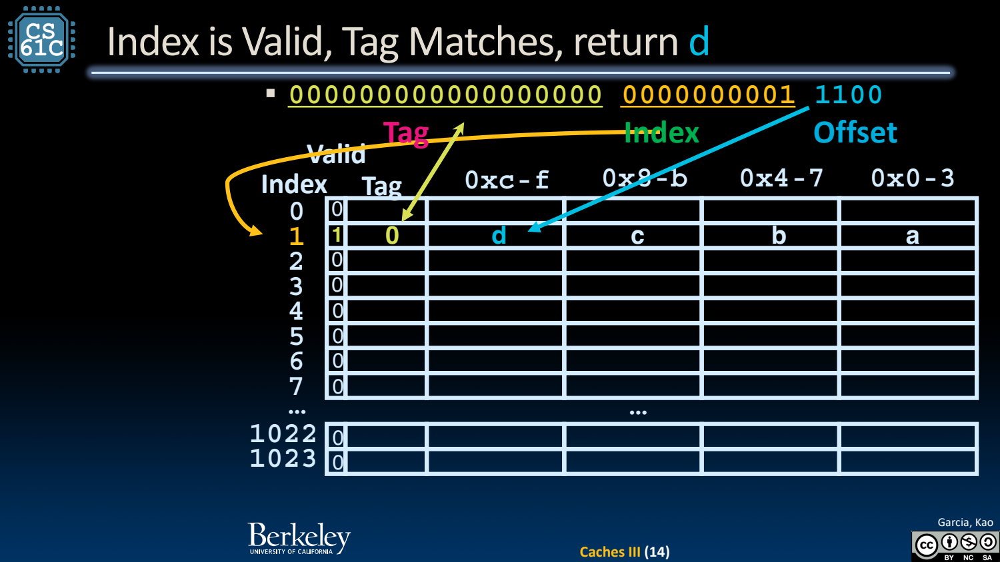
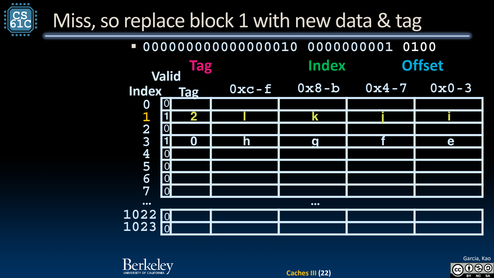
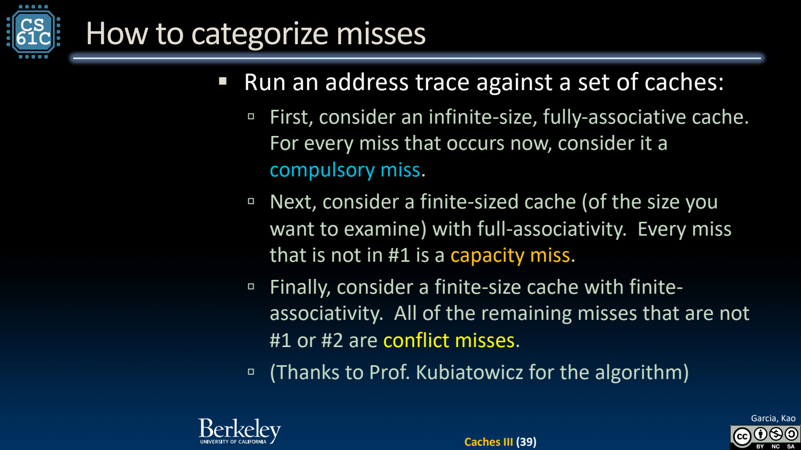

- 逐地址追踪：每一步都记录状态变化
	- [Slides 3–25](../Slides/CS61C%202024Fa%20L26%20Caches%20III.pdf#page=3)
	- 本讲 16 KiB、16B block、直接映射、32-bit 地址示例拆分为 tag/index/offset=18/10/4。
	- 顺序访问 0x14、0x1C、0x34、0x8014：前两者同块，0x34 去另一行，0x8014 与 0x14 冲突；冷 cache 下是 miss/hit/miss/miss。
	- 判断完 hit/miss 还要更新 cache，再处理下个地址，不能把所有访问都独立套在初始状态上。
	- 
	- 

- Write-through / Write-back：何时同步下层
	- [Slides 27–28](../Slides/CS61C%202024Fa%20L26%20Caches%20III.pdf#page=27)
	- Write-through 更新 cache 并把写传播下层；write-back 先改 cache 并设 dirty，替换脏块时才写回。
	- Dirty 表示 cache 的副本比下层新；不表示数据本身有错。读 miss 的替换也可能因此触发旧块写回。
	- Write-allocate / no-write-allocate 是另一个问题：写 miss 时是否先把块装入，不能与 through/back 混为同一轴。

- Block Size：空间局部性与可驻留块数的交换
	- [Slides 29–31](../Slides/CS61C%202024Fa%20L26%20Caches%20III.pdf#page=29)
	- 更大块可预取相邻数据、降低部分 compulsory misses，但在固定 C 下减少块数，可能增加冲突/容量压力，还增大搬运代价。
	- 最佳 B 取决于访问模式与下层带宽/延迟；不是块越大，AMAT 就必定越小。

- 3C：按历史与对照缓存分类
	- [Slides 32–39](../Slides/CS61C%202024Fa%20L26%20Caches%20III.pdf#page=32)
	- **Compulsory**：首次访问该内存块；**Capacity**：同容量全相联对照 cache 也留不住；**Conflict**：有限映射带来、而对照中没有的额外 miss。
	- 分类需对照一致访问轨迹、容量与替换约定；不能仅看“valid=0”就断言首次访问，也不能把所有 tag mismatch 都一概叫 conflict。
	- 

- Fully Associative：去掉位置限制，不去掉容量限制
	- [Slides 35–40](../Slides/CS61C%202024Fa%20L26%20Caches%20III.pdf#page=35)
	- 每个块可放任意行，没有 index bits，查询要在多候选 tag 中匹配；减少映射冲突，但比较器/选择硬件更多。
	- 容量有限仍会淘汰；“全相联没有 conflict”不意味着“全相联永远命中”。
