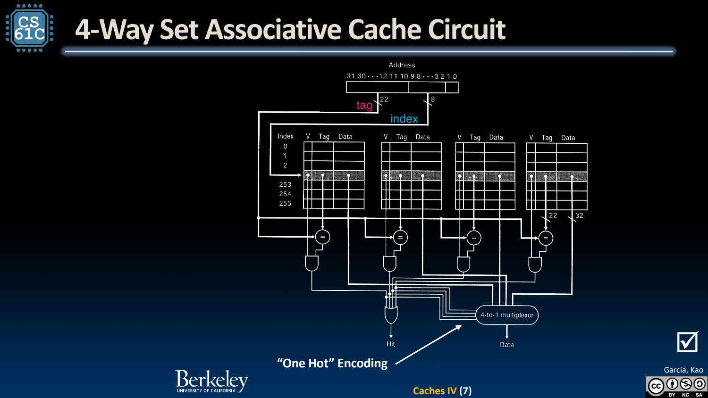
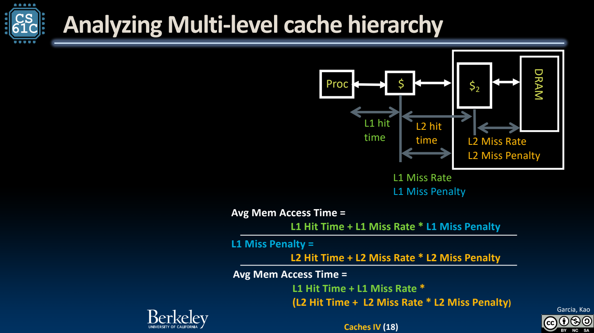
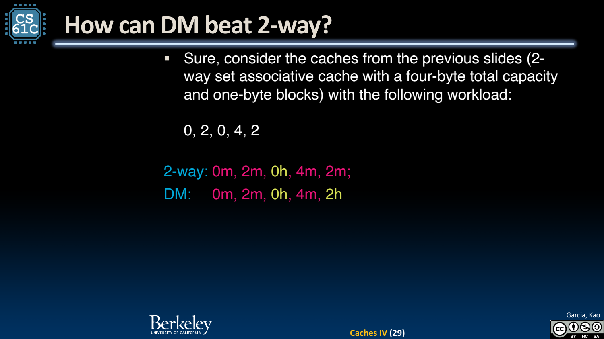

- N-way Set-associative：先找 set，再比 N 个 tag
	- [Slides 3–7](../Slides/CS61C%202024Fa%20L27%20Caches%20IV.pdf#page=3)
	- 总行数为 C/B，N-way 的 set 数为 **C/(BN)**；offset=$\log_2B$，index=$\log_2[C/(BN)]$，剩余为 tag。
	- 直接映射是 N=1，全相联是只有一个 set；增加相联度提供更多位置，但也增加比较/选择成本，可能影响 hit time。
	- 

- Replacement：只在对应候选集合中选牺牲块
	- [Slides 9–13](../Slides/CS61C%202024Fa%20L27%20Caches%20IV.pdf#page=9)
	- 优先使用无效 way；都有效时用 LRU、随机或其他策略。LRU 依据最近访问历史，hit 也要更新次序。
	- 若 write-back 的牺牲块 dirty，先写回再替换；替换状态要按 set 分别维护，不能给所有 set 共用一个错误的局部 LRU 队列。

- AMAT：命中快与缺失少要一起算
	- [Slides 15–23](../Slides/CS61C%202024Fa%20L27%20Caches%20IV.pdf#page=15)
	- 一级模型：**AMAT = Hit Time + Miss Rate × Miss Penalty**，单位必须一致，penalty 应是命中路径之外的额外代价。
	- 两级模型：$T_1+m_1(T_2+m_2P_{mem})$，其中 $m_2$ 是到达 L2 的访问中再次 miss 的局部比例。
	- 例：1 cycle、5% L1 miss，L2 为 5 cycles/15% miss，DRAM penalty=200 → AMAT=**2.75 cycles**；无 L2 时为 11 cycles。
	- 

- 更高相联不保证每条轨迹更好
	- [Slides 28–29](../Slides/CS61C%202024Fa%20L27%20Caches%20IV.pdf#page=28)
	- 同容量但不同 set 划分/替换的 cache，可能保留不同块；课件轨迹 `0,2,0,4,2` 中，某些直接映射结果反而优于 2-way LRU。
	- 应比较特定 workload 的实际 AMAT/性能，不是只依据“可放位置更多”给每个有限轨迹排序。
	- 

- 把参数优化放回完整系统
	- [Slides 20–30](../Slides/CS61C%202024Fa%20L27%20Caches%20IV.pdf#page=20)
	- 容量、块大小、相联度、写策略、多级层次互相作用；L1 常优先低命中延迟，较低层兼顾容量与减少 DRAM 请求。
	- Cache 思想也用于文件、网络与软件记忆化，但每种场景的有效性、更新和替换规则需要单独设计。
