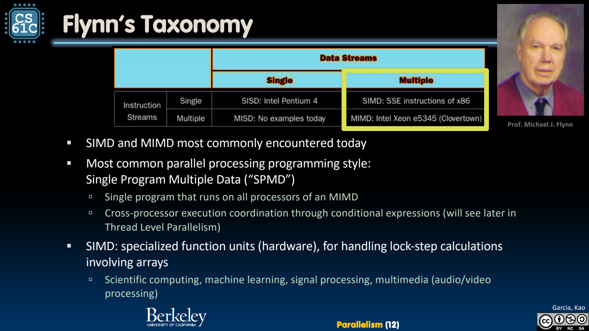
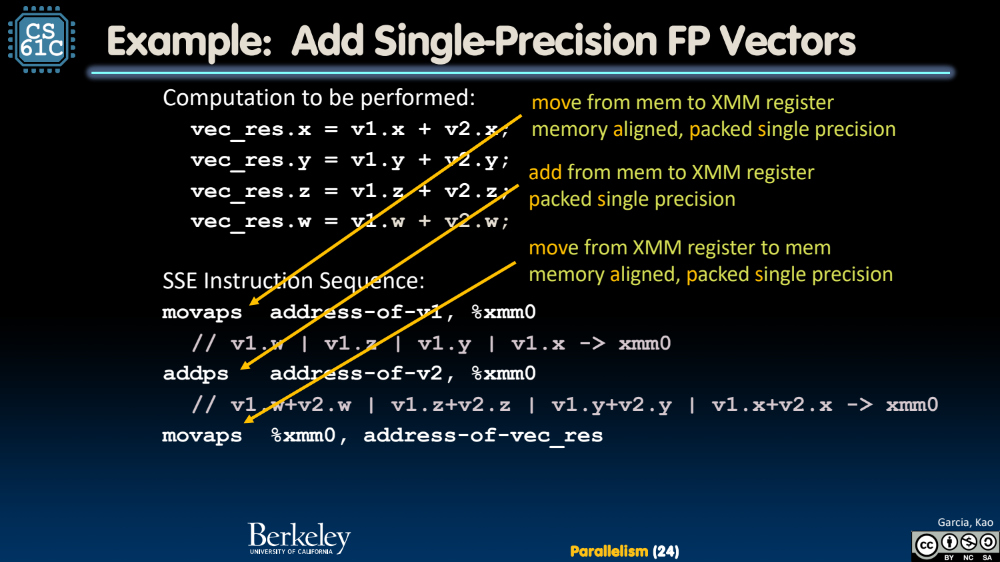
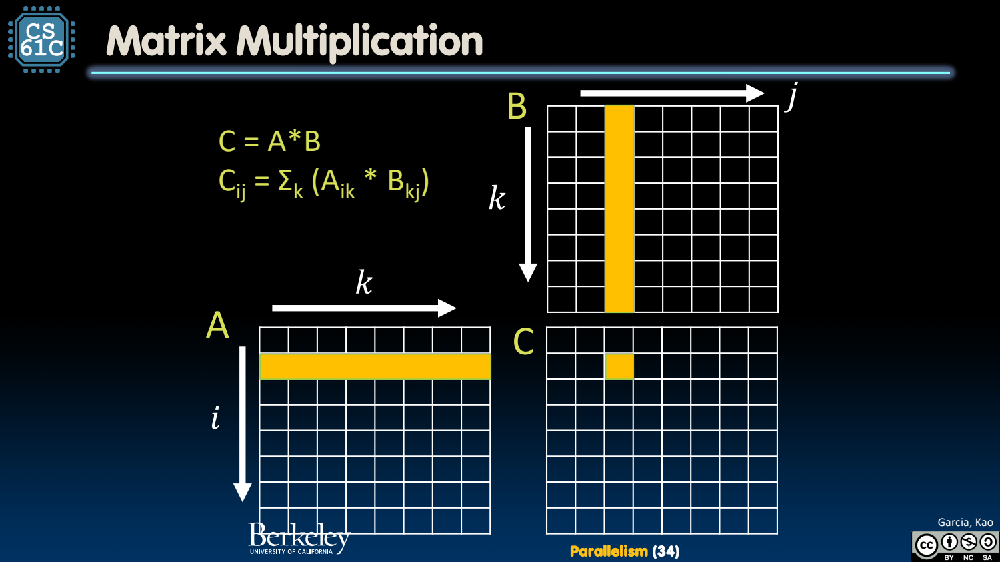

- 并行存在于软件与硬件两个维度
	- [Slides 3–11](../Slides/CS61C%202024Fa%20L28%20Parallelism.pdf#page=3)
	- Flynn 按指令流/数据流区分 SISD、SIMD、MISD、MIMD；现代系统常在不同层级组合 SIMD 与 MIMD。
	- **SPMD** 是多处理器运行同一程序、各自处理不同数据的编程风格，不等于硬件只能执行同一条指令的 SIMD。
	- 有并发软件不代表硬件真的同时执行；硬件有并行资源，也不代表串行程序自动充分利用。
	- 

- Data-Level Parallelism：一条操作处理多份同类数据
	- [Slides 13–23](../Slides/CS61C%202024Fa%20L28%20Parallelism.pdf#page=13)
	- 数组逐项加法、乘法等可把多个元素打包进向量寄存器，用一条 SIMD 指令处理多个 lanes。
	- SSE/AVX 是课件的 x86 示例，RISC-V 向量扩展采用自己的机制；不能把某款固定向量宽度当成整个 RISC-V 的规定。
	- 

- Intrinsics：表达机器能力，但仍要满足内存约束
	- [Slides 20–25](../Slides/CS61C%202024Fa%20L28%20Parallelism.pdf#page=20)
	- Intrinsic 让 C/C++ 显式调用某些向量操作，通常与底层指令相关；编译器也可能自动向量化，不是所有场景都必须手写 intrinsics。
	- 需处理对齐、尾部不足一个向量、数据依赖与目标 ISA 支持；内存带宽跟不上时，更多 lanes 未必按比例加速。

- 矩阵乘法：算术量、数据布局与重用一起决定性能
	- [Slides 28–44](../Slides/CS61C%202024Fa%20L28%20Parallelism.pdf#page=28)
	- $C_{ij}=\sum_kA_{ik}B_{kj}$，N×N 稠密乘法约 $2N^3$ FLOPs；FLOPs 是运算量，FLOP/s 才是速度，不能混用。
	- 行/列主序影响连续访问方向，向量化与数据重用影响有效吞吐；课件用小矩阵演示 load、broadcast、multiply 与 add。
	- 

- 测量与 Amdahl：加速必须落到整段任务
	- [Slides 4、25、33–36](../Slides/CS61C%202024Fa%20L28%20Parallelism.pdf#page=4)
	- 保持输入、结果精度、线程数与计时口径一致；课件 Python/C/SIMD 跑分属于特定实现，不代表所有 Python 库都逐元素解释执行。
	- 若 10% 工作串行，其余加速 8 倍，整体只有约 $1/(0.1+0.9/8)=4.71$ 倍；优化局部峰值不能越过剩余瓶颈。
