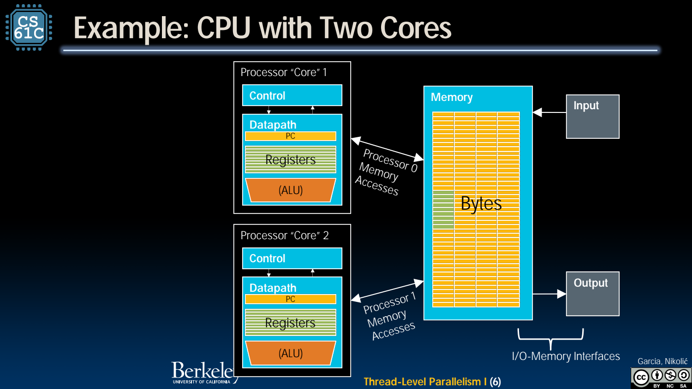
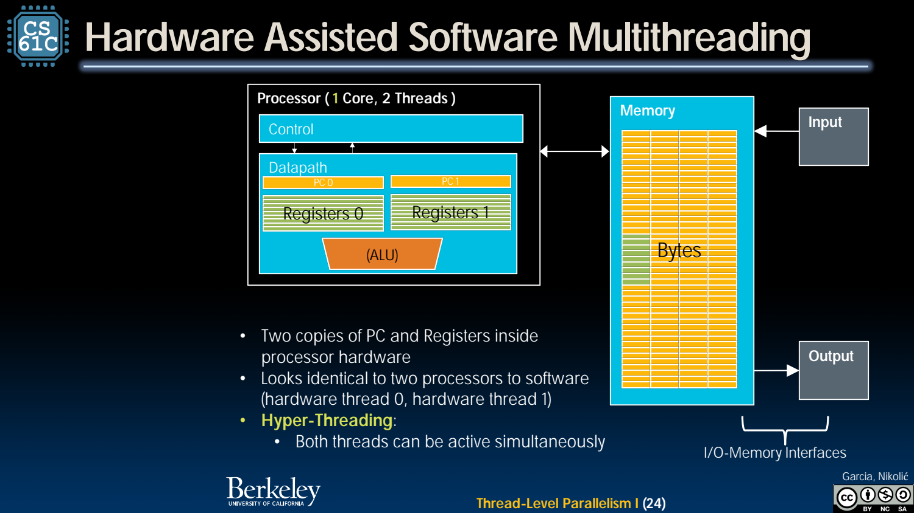

- 从单流加速转向多条执行流
	- [Slides 3–14](../Slides/CS61C%202024Fa%20L29.pdf#page=3)
	- 提高频率、降低 CPI、增加并行任务是不同路径；功耗与依赖约束让单流提升困难，因此多核和专用单元变得重要。
	- 多核可增加吞吐，但单线程若没有拆分或系统协助，不会因为 CPU 核数翻倍就自动减半运行时间。

- Core：独立执行状态，部分层级共享
	- [Slides 5–12](../Slides/CS61C%202024Fa%20L29.pdf#page=5)
	- 不同 core 通常有独立 PC、寄存器与执行资源，并可能拥有私有 cache；DRAM、末级 cache 和互连等资源可共享。
	- 共享地址空间方便通过数据通信，也引入一致性、同步与带宽竞争，不能把它想成无成本共享一个理想数组。
	- 

- Process / Thread：程序与执行流不是同一个概念
	- [Slides 16–21](../Slides/CS61C%202024Fa%20L29.pdf#page=16)
	- 线程有自己的 PC/寄存器执行状态，通常有独立栈；同进程线程共享代码、堆与许多进程资源，仍需明确共享数据的访问规则。
	- OS 将软件线程映射到硬件上下文，线程可能运行、等待或被切换；“并发存在”不保证每条线程同时拥有一个物理核。

- Hardware Multithreading / SMT：共享执行单元以提高利用率
	- [Slides 23–29](../Slides/CS61C%202024Fa%20L29.pdf#page=23)
	- 多个硬件线程各有架构状态，复用部分执行资源；当一个流等待时，其他流可能利用空位，SMT 也可在同周期执行来自不同流的工作。
	- 逻辑 CPU 数可以大于物理核数；这不是每个逻辑线程都得到一整套独占 ALU/cache，性能收益取决于资源互补和竞争。
	- 

- 并行的上限仍取决于程序与系统
	- [Slides 19、30–31](../Slides/CS61C%202024Fa%20L29.pdf#page=19)
	- 共享状态、任务粒度、负载不均、内存瓶颈与同步会限制扩展；更多线程还可能增加开销。
	- 课件里的芯片、频率和性能比例是历史例子，应学习资源关系，而非把数字当成当前硬件配置保证。
