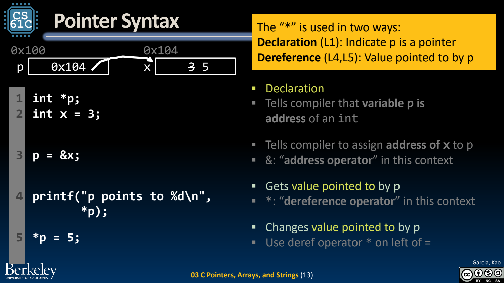
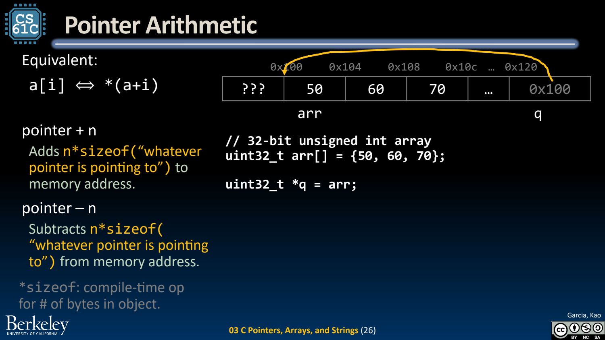
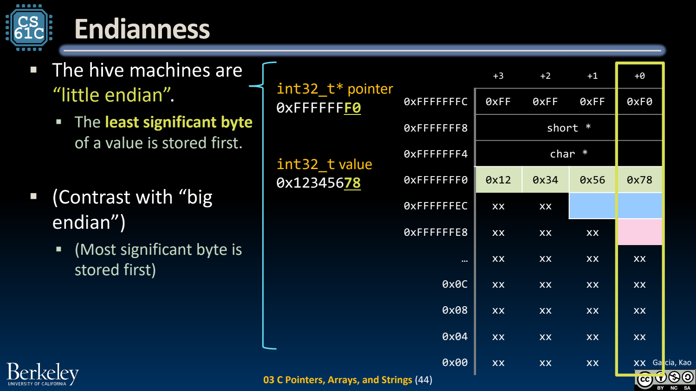

- Pointer：保存地址的值
	- [Slides 7–23](../Slides/CS61C%202024Fa%20L03%20C%20Pointers%20Arrays%20Strings.pdf#page=7)
	- `int *p` 声明指向 int 的指针，`&x` 取地址，`*p` 访问所指对象；声明里的 `*` 与表达式里的解引用要分清。
	- `p = &x` 改变 p 保存的地址，`*p = 5` 改变目标对象。指针参数仍按值传递，但可经其修改调用者的数据。
	- NULL、未初始化指针、已失效对象的地址都不能解引用；错误不一定立即崩溃，更不能以未崩溃证明合法。
	- 

- 数组与指针运算：单位是元素，不是裸字节
	- [Slides 25–39](../Slides/CS61C%202024Fa%20L03%20C%20Pointers%20Arrays%20Strings.pdf#page=25)
	- `a[i]` 等价于 `*(a+i)`；若元素宽度为 w bytes，指针加 i 对应地址前进 $iw$ bytes。
	- 数组在许多表达式中退化为首元素指针，但**数组不等于指针对象**；对真实数组做 sizeof 与对形参指针做 sizeof 结果含义不同。
	- 合法指针运算需处于相应数组范围内；尾后指针可用于比较/遍历终点，不可解引用。传数组给函数通常还要显式传长度。
	- 

- C String：字符数组加一个终止字节
	- [Slides 40–41](../Slides/CS61C%202024Fa%20L03%20C%20Pointers%20Arrays%20Strings.pdf#page=40)
	- `char s[] = "abc";` 包含 a、b、c、`\0` 四个字节；strlen 返回 3，不包括终止符，sizeof s 则是整个数组容量。
	- 字符串函数依赖合法终止与足够目标空间；strncpy 也不保证在截断时补终止符，不能只因名字带 n 就认为完全安全。
	- 区分可写字符数组与字符串字面量；经指针修改字面量是未定义行为。

- Byte Addressing、Endianness 与 Alignment
	- [Slides 43–46](../Slides/CS61C%202024Fa%20L03%20C%20Pointers%20Arrays%20Strings.pdf#page=43)
	- 小端把最低有效字节放在最低地址；`0x12345678` 的地址递增字节顺序为 `78 56 34 12`。它不改变数值内部位权。
	- 对齐限制取决于 ISA、ABI 与实现；struct 可能插入 padding，因此 sizeof struct 不一定是字段大小之和。
	- 课程图按 RV32 解释指针与 word；不要把“word 永远等于地址宽度”推广到所有体系结构。
	- 

- 读指针代码时同时画三样东西
	- [Slides 9–17、33–39](../Slides/CS61C%202024Fa%20L03%20C%20Pointers%20Arrays%20Strings.pdf#page=9)
	- 分别画变量/指针所在位置、指针保存的地址、地址上的对象内容；不要把“指针变量”和“它指向的值”合成一个格子。
	- 每次访问确认类型、边界与生命周期；后续的内存管理还会增加“谁负责释放”的问题。
