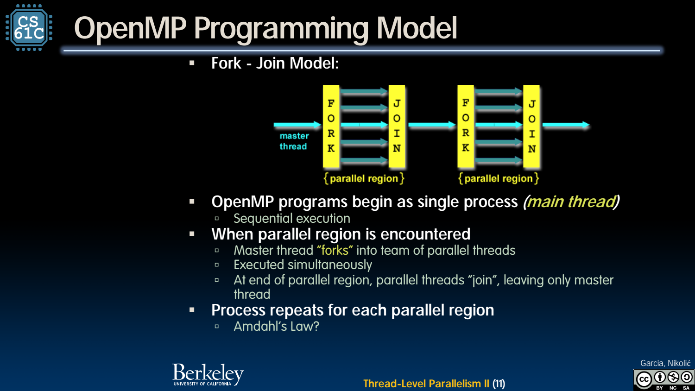
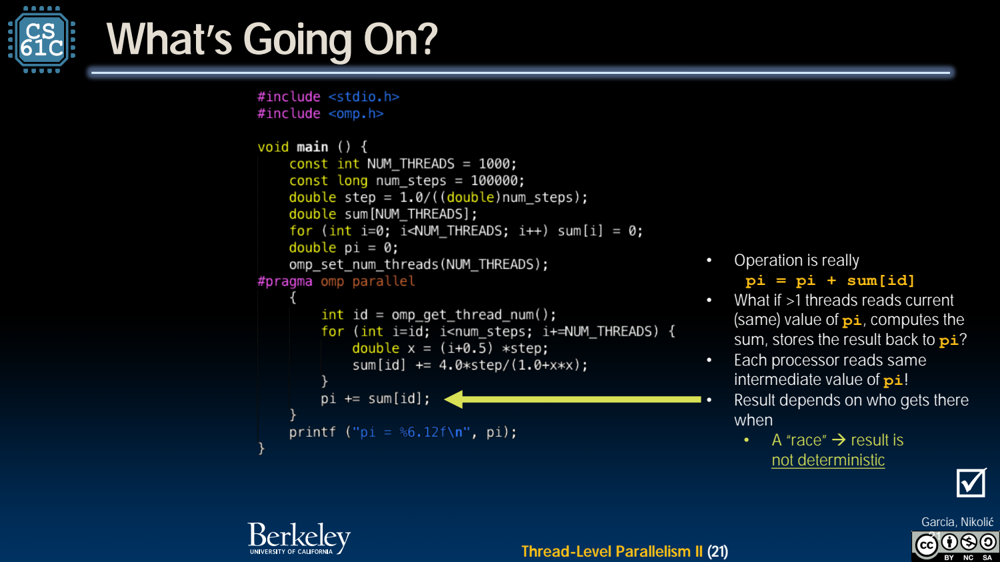

- OpenMP：给共享内存程序加入并行区域
	- [Slides 7–12](../Slides/CS61C%202024Fa%20L30.pdf#page=7)
	- 用编译指令与运行库表达并行，例如 `#pragma omp parallel for` 分配循环迭代；需要编译器和运行时支持，并非只加一行注释就会自动加速。
	- **Fork-join**：初始单线程进入并行区域形成线程组，完成后汇合；实现可复用线程池，不必每次真的创建 OS 线程。
	- 

- 循环独立性：能拆迭代，不代表数据就互不影响
	- [Slides 7–18](../Slides/CS61C%202024Fa%20L30.pdf#page=7)
	- 独立数组元素可分块或交错分配，目标是负载均衡与合理局部性；迭代间依赖需要重新设计算法或加入同步。
	- 共享变量与线程私有变量必须区分；每线程局部累积通常比每个元素都争同一全局总和更合适。

- π 的数值积分：用简单任务观察并行开销
	- [Slides 14–20](../Slides/CS61C%202024Fa%20L30.pdf#page=14)
	- 将 $\int_0^1 4/(1+x^2)\,dx$ 用离散采样近似，每线程处理部分采样点，再合并局部和。
	- 精度由步长/浮点累计等决定；加线程主要改变执行方式，不会自动让积分近似更准确，归约顺序还可能改变末位结果。

- Race：读—改—写不是原子步骤
	- [Slides 20–26](../Slides/CS61C%202024Fa%20L30.pdf#page=20)
	- `pi += local` 会读旧 pi、相加、写回；多个线程交错可能丢失更新。一次测试得到正确答案，不代表没有 data race。
	- 更准确地说，冲突访问缺少所需同步/happens-before 关系才是问题，不要求肉眼看到两个操作“完全同时”。普通 C 共享变量的数据竞争可造成未定义行为。
	- 

- 修复不只是“加一个普通 int lock”
	- [Slides 23–27](../Slides/CS61C%202024Fa%20L30.pdf#page=23)
	- `while(lock); lock=1;` 的检查与设置分开，两个线程仍可能一起进入；volatile 也不能提供互斥或原子性。
	- 使用 OpenMP reduction、atomic、critical 或正确锁原语表达同步；临界区越大，串行部分越多，需要在正确性基础上减少共享写入。
