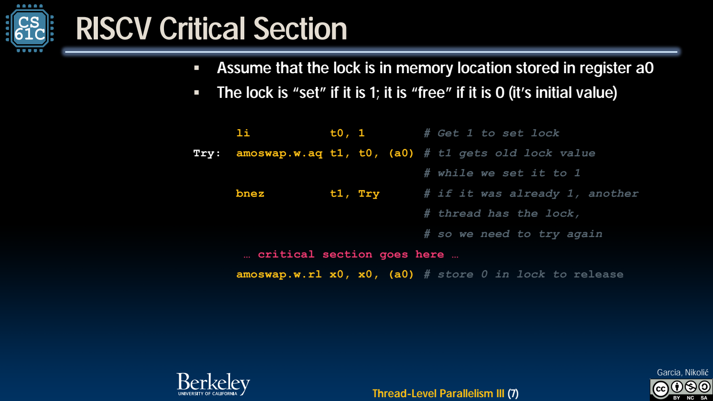
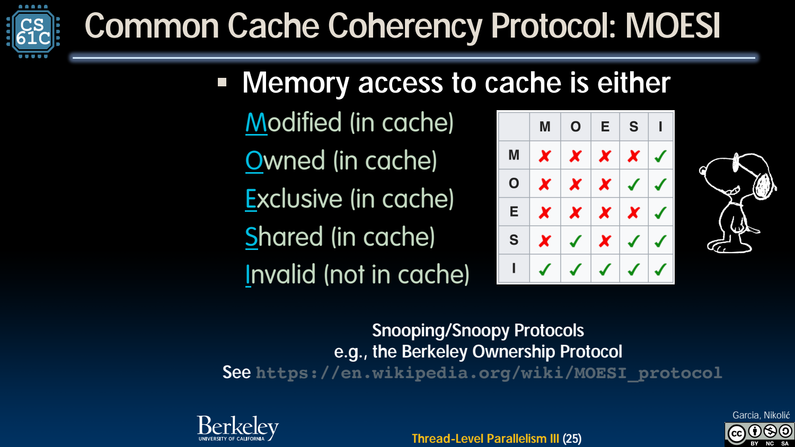
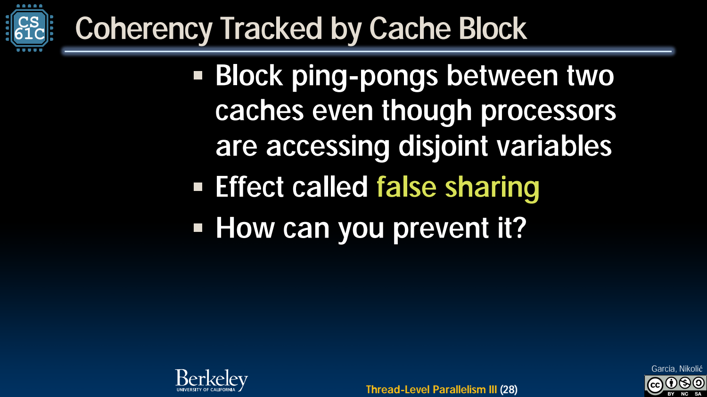

- Atomic RMW：把检查与获取合成不可分割操作
	- [Slides 3–8](../Slides/CS61C%202024Fa%20L31.pdf#page=3)
	- 原子 read-modify-write 能避免两个线程同时把锁视为“空闲”；RISC-V AMO 可返回旧内存值并提交新值。
	- AMO 需要相应的原子指令扩展，不属于仅有 RV32I 的基础整数集；与前半程教学 CPU 的支持范围应区分。
	- 课件用 `amoswap.w.aq` 获取锁、release 语义释放：既要独占锁变量，还要让临界区内存访问满足可见性/顺序要求。
	- 

- Higher-level Synchronization：选对语义
	- [Slides 9–13](../Slides/CS61C%202024Fa%20L31.pdf#page=9)
	- critical 保证互斥，atomic 约束支持的原子更新，barrier 等待参与线程到齐，reduction 合并线程局部结果；它们不是彼此可任意替换的关键字。
	- 多个锁获取顺序不一致可造成 deadlock；统一锁顺序、缩小持锁范围等有助于避免循环等待。
	- 测性能要用一致的 wall-clock 口径，不能把所有线程 CPU 时间之和当成任务响应时间。

- Cache Coherence：共享内存需要各核副本协调
	- [Slides 15–26](../Slides/CS61C%202024Fa%20L31.pdf#page=15)
	- 多核私有 cache 可能同时保存某块副本；一个核写入后，其他副本不能继续被当作最新值无条件使用。
	- MESI/MOESI 等协议记录 Modified、Exclusive、Shared、Invalid 及 Owned 状态，通过失效/传递等协调副本。
	- Coherence 关注同一地址的写入传播与顺序，不自动保证多个不同地址上的全部访问都符合程序所需同步。
	- 

- False Sharing：变量不同，也可能争同一 cache line
	- [Slides 27–30](../Slides/CS61C%202024Fa%20L31.pdf#page=27)
	- 不同核写不同变量，若变量位于同一 coherence block，所有权仍可能来回转移，形成 cache-line ping-pong。
	- 这可能没有逻辑上的同变量 data race，却显著损失性能；可用分块、调整布局/填充、每线程局部累积再归约等缓解。
	- 

- 正确性与性能分开验证
	- [Slides 3–13、29–31](../Slides/CS61C%202024Fa%20L31.pdf#page=3)
	- 锁/原子先保证语义，coherence 负责硬件副本；“有缓存一致性”不等于“共享计数器可以不加同步”。
	- 性能还受锁竞争、false sharing、带宽与 NUMA 等影响；测不同线程数，识别何时扩展开始递减。
