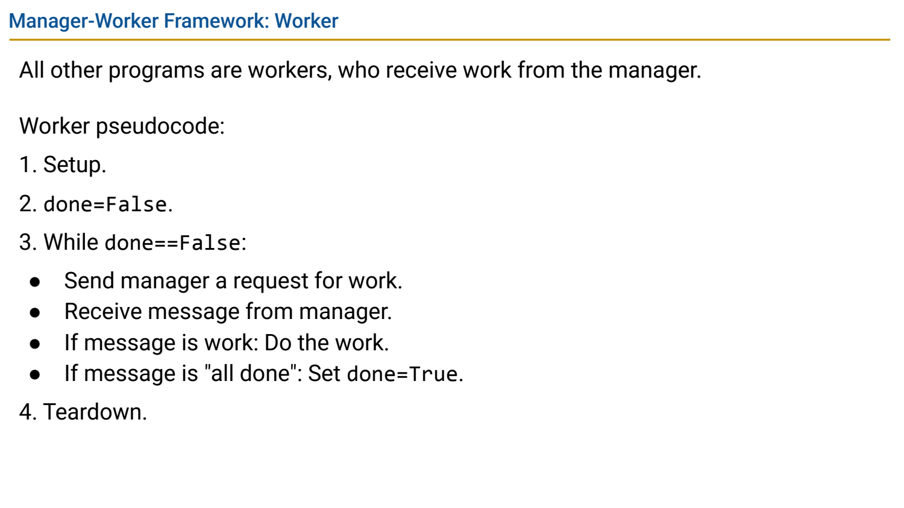
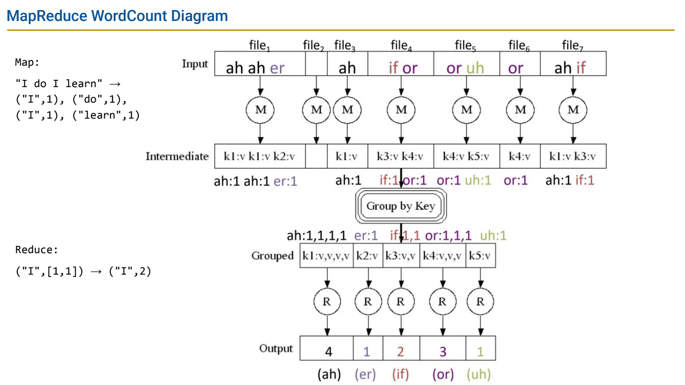
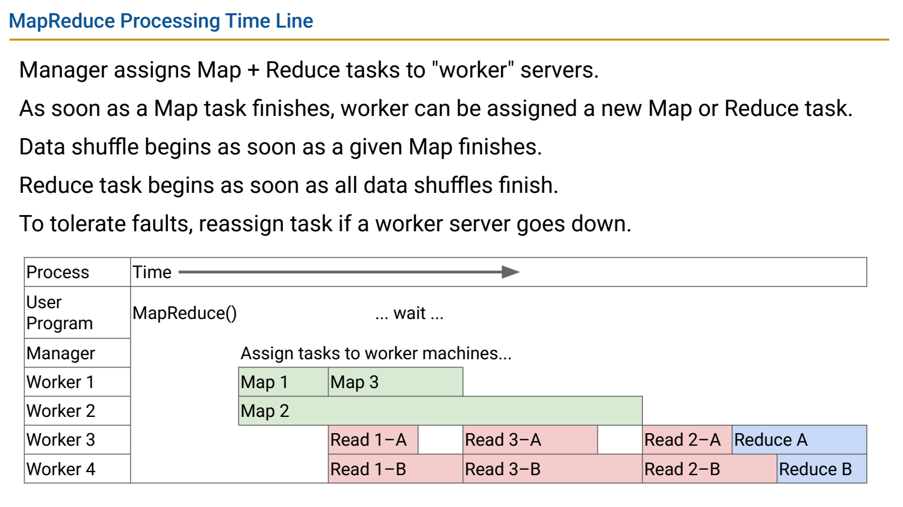

- 从共享内存到分布式协作
	- [Slides 3–13](../Slides/%5B61C%20FA24%5D%20Lecture%2032%20-%20Distributed%20Computing%20and%20MapReduce.pdf#page=3)
	- 多程序/多机器通过消息合作，不再假设直接共享同一内存；网络有延迟、带宽限制与失败，节点也可能独立宕机。
	- 局部状态、任务是否完成、消息是否到达都需协议确认；不能把单机锁的写法原样搬到网络上。
	- Fall 2024 此讲明确侧重分布式概念，不把更早课程的 MPI 语法当成这份 Slides 的核心要求。

- Manager-Worker：动态分配减少长尾等待
	- [Slides 15–19](../Slides/%5B61C%20FA24%5D%20Lecture%2032%20-%20Distributed%20Computing%20and%20MapReduce.pdf#page=15)
	- Manager 保管可运行任务，worker 完成后申请下一项；任务时长不均时，比预先每台固定分同样数量更易平衡。
	- 消息尽量小，必要时传数据位置而非反复搬整个输入；也需考虑 manager 瓶颈、依赖任务与失败后的重试。
	- 

- MapReduce：中间 key 将独立工作重新分组
	- [Slides 21–31](../Slides/%5B61C%20FA24%5D%20Lecture%2032%20-%20Distributed%20Computing%20and%20MapReduce.pdf#page=21)
	- Map 将输入 pair 转成中间 key/value；**Shuffle/Group** 把相同 key 汇到一起；Reduce 对一个 key 的值集合做聚合。
	- WordCount：每个词产生 `(word,1)`，随后按词汇总。它不是简单把整个数据集随便 map 一次再求一个全局和。
	- 

- 调度、Shuffle 与容错是系统的实质成本
	- [Slides 24–32](../Slides/%5B61C%20FA24%5D%20Lecture%2032%20-%20Distributed%20Computing%20and%20MapReduce.pdf#page=24)
	- Map 完成部分后可开始传输中间结果；某 reducer 完整聚合需等齐相关输入。数据倾斜会让少量 key 成为慢任务。
	- 失败可重派任务，但重执行要考虑副作用/幂等性，不能只因为“重试”就声称任意程序自动容错。
	- 

- Spark：更灵活的数据流，不只是更短语法
	- [Slides 34–40](../Slides/%5B61C%20FA24%5D%20Lecture%2032%20-%20Distributed%20Computing%20and%20MapReduce.pdf#page=34)
	- flatMap 展开每个输入产生的多个项，map 逐项转换，reduceByKey 按键聚合；课件用 Python API 展示复用分布式执行模型。
	- 缓存中间数据可支持迭代任务，但历史“快若干倍”依赖具体 workload、内存容量与实现，不是固定性能保证。
