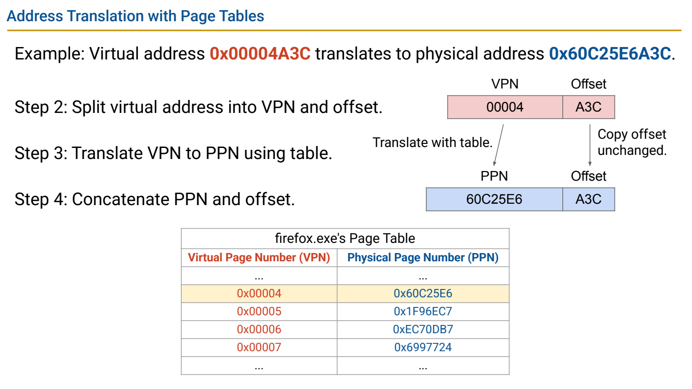
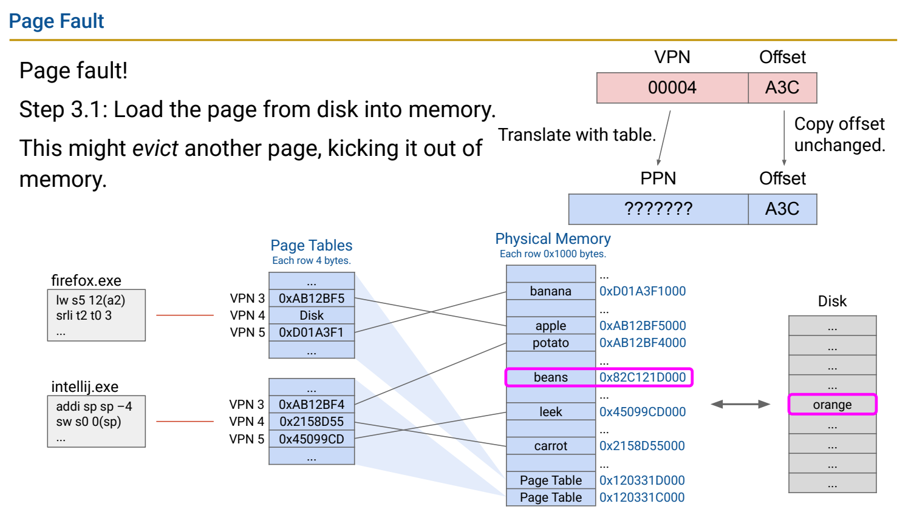
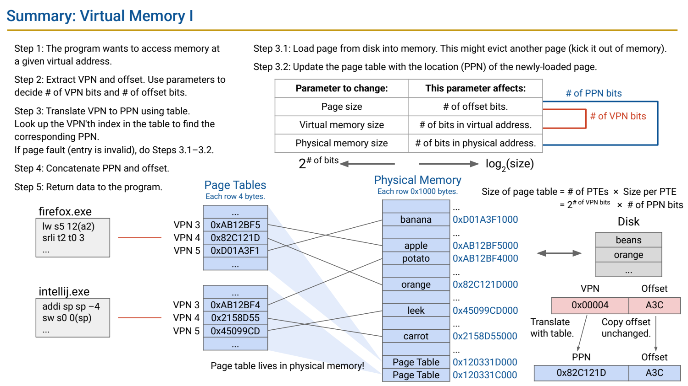

- Virtual Memory：每个进程看到自己的地址空间
	- [Slides 4–14](../Slides/%5B61C%20FA24%5D%20Lecture%2033%20-%20Virtual%20Memory%20I.pdf#page=4)
	- 相同虚拟地址可在不同进程映射到不同物理页，隔离彼此的数据；也可有意映到同一物理页，实现共享。
	- 应用主要操作 VA，内存系统最终访问 PA。OS 管理映射，MMU/相关硬件通常完成正常访问的快速翻译，不是每次 load 都由 OS 函数执行。

- 分页：只翻译页号，页内 Offset 保留
	- [Slides 16–33](../Slides/%5B61C%20FA24%5D%20Lecture%2033%20-%20Virtual%20Memory%20I.pdf#page=16)
	- 页面大小 $P=2^p$ bytes：VA 拆成 VPN 与低 p-bit offset，页表把 VPN 映射到 PPN，PA 拼接 PPN 与原 offset。
	- 例如 4 KiB pages 保留低 12 bits；VA 0x00004A3C 的 VPN=4、offset=0xA3C。地址宽度不同只改变页号位数，不改变该页内偏移。
	- 

- Page Table：放在内存里的映射与权限元数据
	- [Slides 23–40](../Slides/%5B61C%20FA24%5D%20Lecture%2033%20-%20Virtual%20Memory%20I.pdf#page=23)
	- 概念单级页表可用 VPN 作数组下标，PTE 存 PPN 与状态/权限等；页表保存映射，不保存整页程序数据。
	- 平坦页表大小约 $2^{VA\ bits-p}\times PTE\ bytes$。32-bit VA、4KiB page、4B PTE → **4 MiB**；不能只按 PPN 最少位数忽略实际条目格式。

- Page Fault 与 Demand Paging：未驻留页按需处理
	- [Slides 42–59](../Slides/%5B61C%20FA24%5D%20Lecture%2033%20-%20Virtual%20Memory%20I.pdf#page=42)
	- 页不在当前可访问物理映射中时可触发缺页；OS 可分配/装入页面、必要时替换脏页、更新映射，再重新执行访问。
	- 课件用“页在磁盘”解释缺页；真实缺页还可能是首次分配、写时复制、非法地址/权限等，**invalid 不等于一定有一页磁盘数据可读**。
	- Demand paging 只为实际访问建立所需驻留内容；反复换页可能出现 thrashing，虚拟容量更大不代表访问像 DRAM 一样快。
	- 

- 保护、共享与替换：分页不只是扩充容量
	- [Slides 57–64](../Slides/%5B61C%20FA24%5D%20Lecture%2033%20-%20Virtual%20Memory%20I.pdf#page=57)
	- PTE 权限限制读/写/执行；共享只读代码页可节省物理空间，数据页则需按程序语义安排共享与隔离。
	- 常用 write-back 避免每次写都更新后备存储，dirty 记录是否需要回写；并非每个匿名页都必须在磁盘上有固定原件。
	- 
