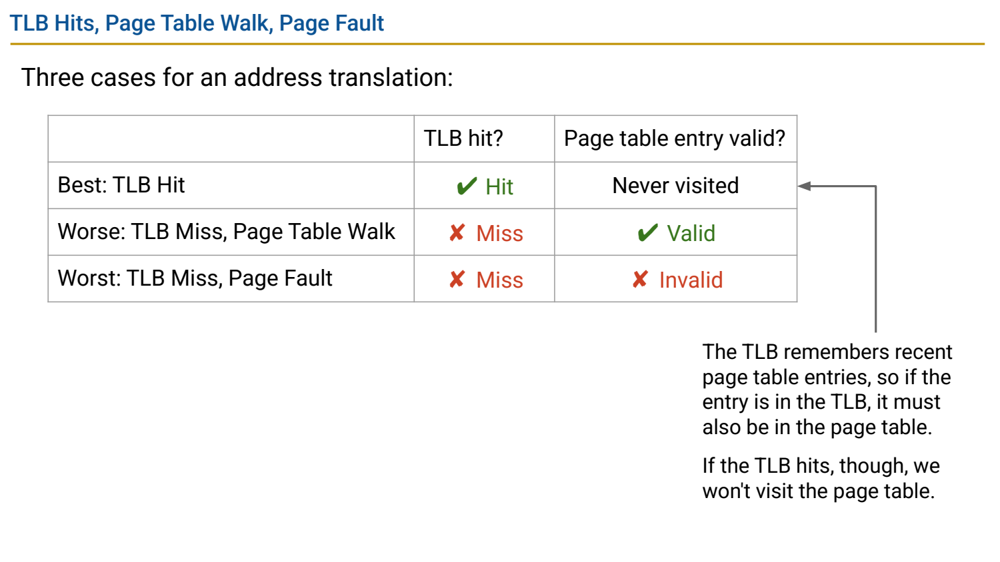
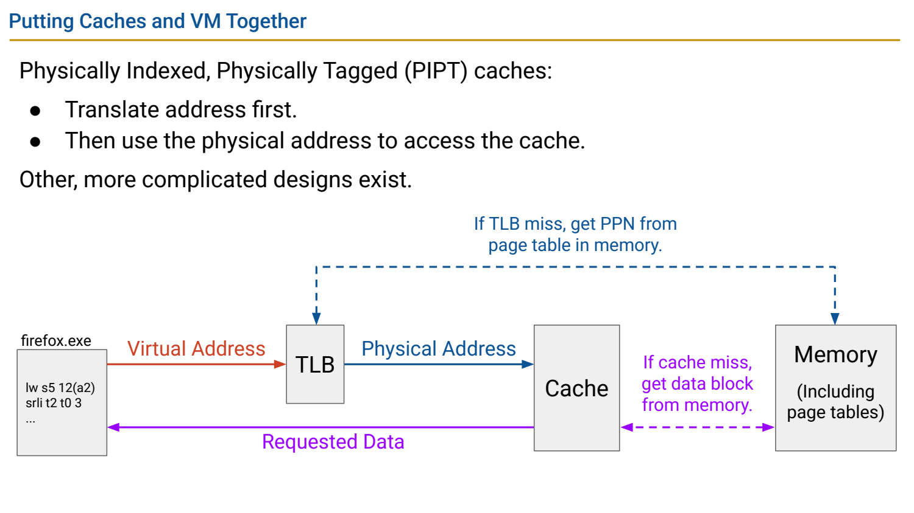
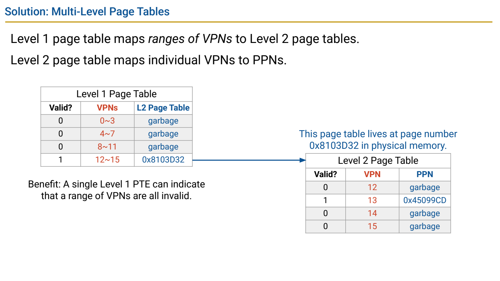

- TLB：缓存翻译，不缓存程序数据本身
	- [Slides 3–8](../Slides/%5B61C%20FA24%5D%20Lecture%2034%20-%20Virtual%20Memory%20II.pdf#page=3)
	- TLB 缓存近期 VPN→PPN 与权限等信息，避免每次访问都走页表；TLB reach≈条目数×页大小（同页大小的简化模型）。
	- TLB miss 不等于 page fault：映射可能仍在页表中且页面已驻留。课件的全相联/条目数只是示例，实际可多级、组相联并分指令/数据。
	- 上下文切换需避免使用其他进程的映射，可失效条目或使用 ASID 等标记，不应理解为任何 CPU 永远只有一个 TLB 且每次全清空。

- 区分三个层次的 Hit/Miss
	- [Slides 10–21](../Slides/%5B61C%20FA24%5D%20Lecture%2034%20-%20Virtual%20Memory%20II.pdf#page=10)
	- TLB hit：取得翻译并检查权限；TLB miss/PTE 可用：page walk 后回填；PTE 无法满足访问：进入缺页/异常处理。
	- 翻译成功后数据仍可能 cache miss；数据 cache 命中也不能自动绕过权限检查。教材三情形先忽略了某些保护异常。
	- 

- PIPT 示例：翻译与取数据是两项工作
	- [Slides 17–21](../Slides/%5B61C%20FA24%5D%20Lecture%2034%20-%20Virtual%20Memory%20II.pdf#page=17)
	- Physically Indexed, Physically Tagged cache 用 PA 的 index/tag 查询；模型中先翻译，再查数据 cache。
	- 页内 offset 与 cache block offset 的字段大小/用途不同，不能因为都叫 offset 就混为一个位域。
	- 实际系统也有重叠翻译与 cache 查询等设计，图示先建立顺序模型；page walk 的元数据也可通过内存层次加速。
	- 

- Multi-level Page Tables：利用映射稀疏性省空间
	- [Slides 24–37](../Slides/%5B61C%20FA24%5D%20Lecture%2034%20-%20Virtual%20Memory%20II.pdf#page=24)
	- 将 VPN 拆成多级索引，上层条目指向下级表，只为用到的地址区间分配子表，避免平坦表为大量未用 VPN 占空间。
	- 代价是冷 TLB 下可能多次访问页表；TLB 命中可摊薄这个成本。具体层数、有效地址位与 canonical 规则由架构规定，不是“所有 64-bit 地址高 16 位都为 0”。
	- 

- Trap / OS：从硬件事件转入受控的软件处理
	- [Slides 39–47](../Slides/%5B61C%20FA24%5D%20Lecture%2034%20-%20Virtual%20Memory%20II.pdf#page=39)
	- 同步 exception 由当前执行引起，interrupt 来自外部/异步事件；硬件记录原因与返回位置、切到处理入口，OS 保存必要状态并处理。
	- Page fault 可能修复后重试，非法访问可能终止进程；不能无条件跳过出错指令。定时中断还可触发上下文切换，保存/恢复执行与映射状态。
	- 内核态是 CPU 特权执行模式，不是“所有带 OS 名字的进程都始终在内核态”。
