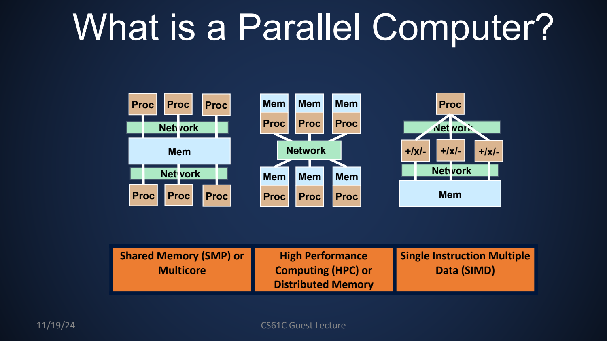
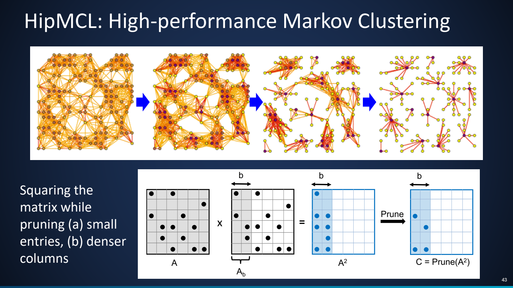
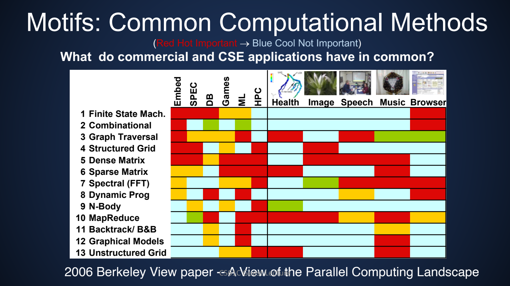

- HPC：让大问题、长过程与极端尺度可计算
	- [Slides 2–15](../Slides/cs61c-fa24-lec35-slides.pdf#page=2)
	- Guest Lecture 由 Aydın Buluç 讲授，围绕气候、物理、基因组等应用解释为何需要并行计算。
	- 问题可能太大、太小、太快、太慢、太危险或太复杂，难以直接实验；模拟提供与理论和实验互补的研究工具。
	- 并行既追求算力，也为容纳超过单机容量的数据；互连与 locality 常决定大量处理器能否有效合作。
	- 

- 如何读超算指标：Peak 不等于应用吞吐
	- [Slides 16–28](../Slides/cs61c-fa24-lec35-slides.pdf#page=16)
	- FLOP 表示浮点运算，FLOP/s 表示速率；需要同时报告精度、benchmark、实测/理论峰值、功率与内存等条件。
	- TOP500 / Gordon Bell 等分别从特定基准和科学应用角度展示系统能力，不能把一个排名当成所有任务的统一顺序。
	- 课件列到 2024 年的机器与排行榜仅作历史案例，不作为当前最快系统或采购建议。

- 从 Simulation 到 Data Analytics 与 Machine Learning
	- [Slides 29–48](../Slides/cs61c-fa24-lec35-slides.pdf#page=29)
	- 科学计算既要解方程，也要处理大量、嘈杂、异构的实验数据，机器学习进一步增加训练与数据流需求。
	- 数据增长与通信成本让“有更多运算单元”不够：必须安排分区、稀疏结构与重用，减少不必要的数据移动。

- Genomics 案例：应用问题落到通用计算内核
	- [Slides 37–44](../Slides/cs61c-fa24-lec35-slides.pdf#page=37)
	- 蛋白相似性搜索与图聚类可转成稀疏矩阵操作；HipMCL 的迭代包含矩阵扩展与剪枝，许多应用因此依赖 SpGEMM。
	- 稀疏问题的实际成本取决于非零模式与中间填充，不只取决于矩阵边长；负载平衡和通信也比稠密规则矩阵更复杂。
	- 

- Motifs：跨领域寻找相似结构，再匹配硬件
	- [Slides 49–55](../Slides/cs61c-fa24-lec35-slides.pdf#page=49)
	- Dense/Sparse Linear Algebra、图遍历、网格、FFT、N-body、MapReduce 等模式在不同学科反复出现。
	- 先识别计算与通信模式，再选并行分解/数据布局；科学计算还需要领域知识、数值方法、算法与系统工程协作。
	- 
