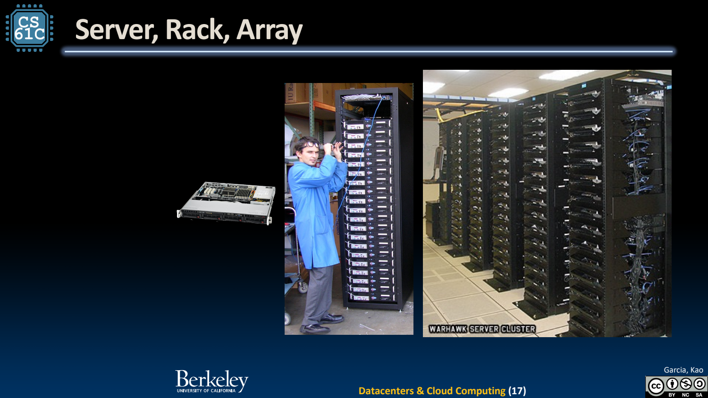
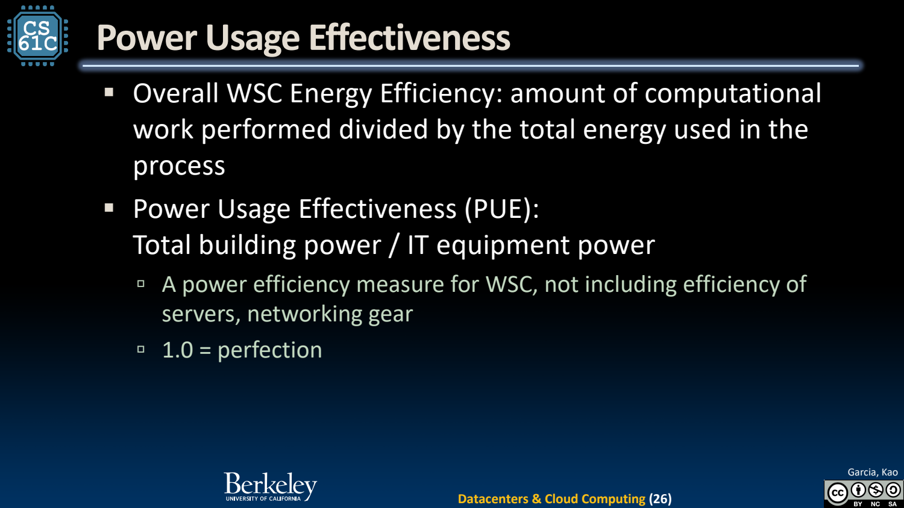

- Warehouse-scale Computer：把整座机房看作一台计算机
	- [Slides 4–13](../Slides/CS61C%202024Fa%20L37%20Datacenters.pdf#page=4)
	- 大量服务器经网络连接，共同提供在线请求和批处理能力；目标不仅是单核快，还包括总成本、可靠性、能耗与可扩展性。
	- 云提供弹性资源与服务接口，但抽象背后仍是物理机器、网络、存储和调度；分布式并不免除数据放置与失败处理。

- Server → Rack → Array：每扩大一层，通信条件会变
	- [Slides 14–21](../Slides/CS61C%202024Fa%20L37%20Datacenters.pdf#page=14)
	- 同服务器内存、同 rack 网络、跨 rack 传输有不同延迟/带宽，任务与数据位置会影响完成时间。
	- 把计算放近数据可减少通信；复制可增加可用性与读吞吐，却带来更新与一致性成本。
	- 

- Latency 与 Throughput：服务系统要同时考虑
	- [Slides 20–24](../Slides/CS61C%202024Fa%20L37%20Datacenters.pdf#page=20)
	- 在线用户关心响应时间，批处理更关心总完成量；扩大批量或提高利用率可能改善吞吐，却恶化排队和尾部延迟。
	- 负载随时间变化，容量冗余应对峰值/失败；不能按全天平均请求量假设系统任何时刻都足够。

- Energy Proportionality 与 PUE
	- [Slides 25–29](../Slides/CS61C%202024Fa%20L37%20Datacenters.pdf#page=25)
	- 空闲服务器仍耗电，低利用率集群不一定同比省电；整合任务、关闭空闲资源与高效冷却都可能影响能耗。
	- **PUE = 机房总能耗 / IT 设备能耗**，理想下界接近 1。它衡量基础设施开销，不直接等于有用任务/焦耳，也不代表低碳程度。
	- 

- 读历史数据中心案例的方式
	- [Slides 10、16、21、30–32](../Slides/CS61C%202024Fa%20L37%20Datacenters.pdf#page=10)
	- 课件云实例价格、服务器配置、网络与功率比例有具体年代，不应直接用于当前成本预算。
	- 可迁移的是分析框架：数据移动、并行度、容错、负载变化和能量共同决定仓库级系统效果。
