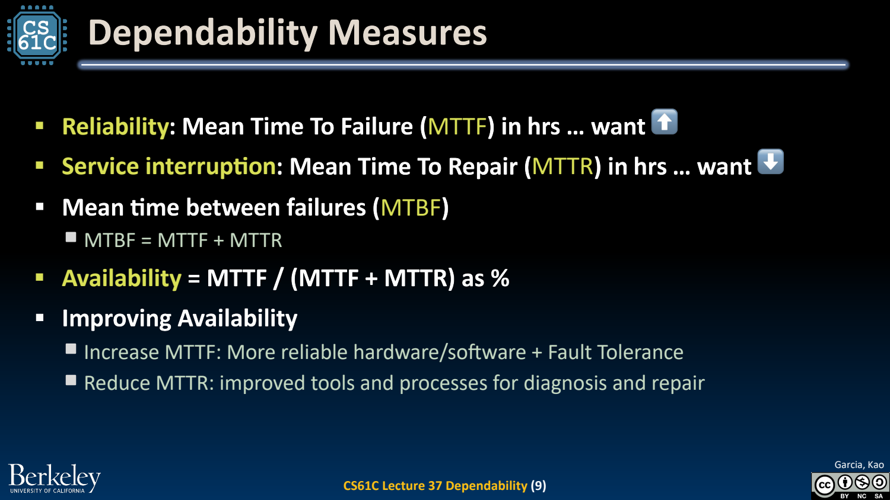
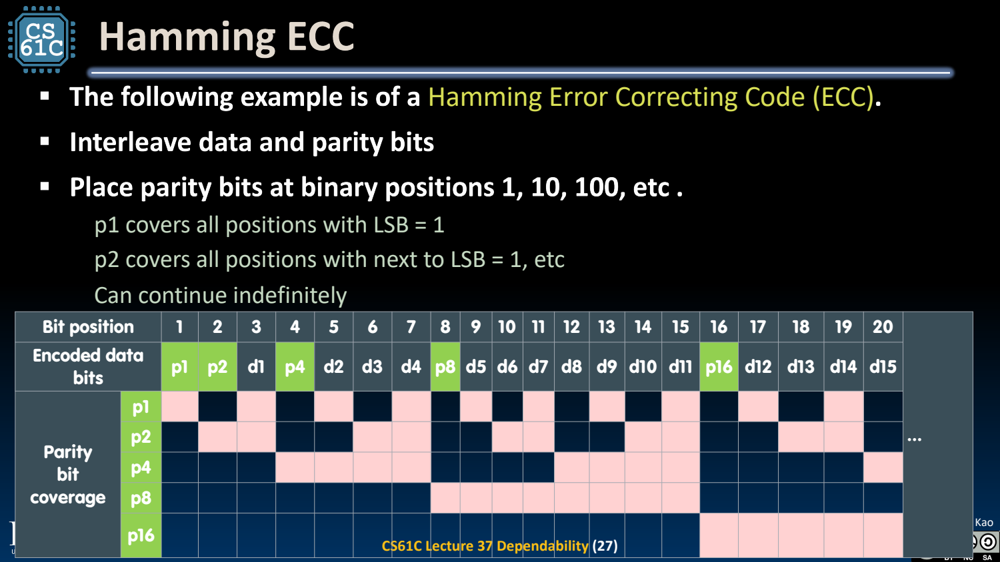
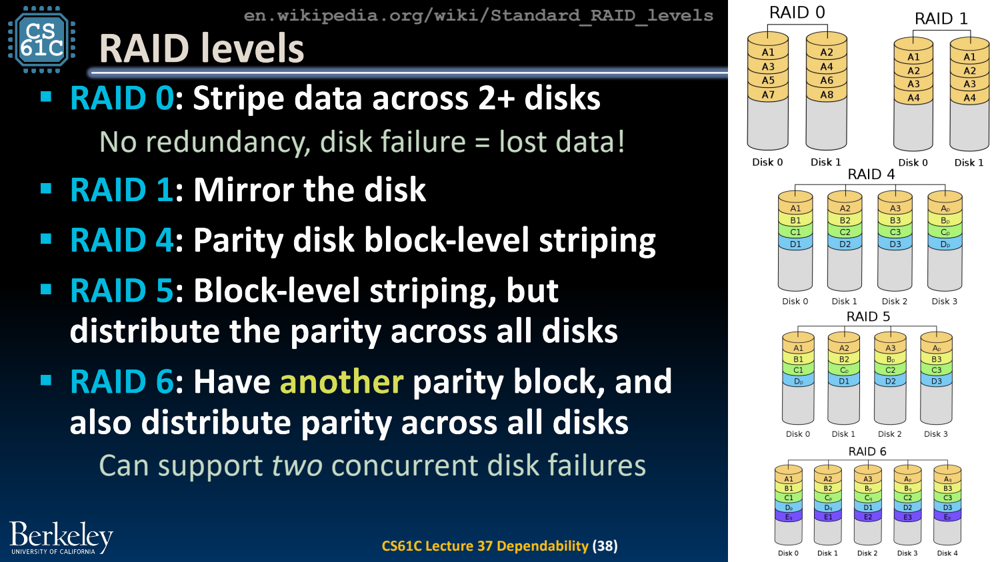

- Dependability：故障发生后，服务还能否满足约定？
	- [Slides 3–11](../Slides/CS61C%202024Fa%20L38%20Dependability.pdf#page=3)
	- Fault 是潜在原因，error 是内部错误状态，failure 是对外服务偏离要求；一个 fault 不一定立刻造成 failure。
	- Reliability 关注持续正确服务，availability 关注可用时间比例。简化可修复模型：**$A=MTTF/(MTTF+MTTR)$**。
	- 提高 MTTF 或降低恢复时间 MTTR 都有价值；堆高一部分可靠性，仍可能被单点故障/共同原因限制。
	- 

- 冗余与 Hamming Distance
	- [Slides 4–8、13–22](../Slides/CS61C%202024Fa%20L38%20Dependability.pdf#page=4)
	- 空间冗余增加副本/校验，时间冗余重试/重复计算；需考虑代价以及错误是否独立，不能假设三个完全相同副本永不一起犯错。
	- 最小码距 $d_{min}$ 至少 t+1 可检测最多 t 位错误，至少 2t+1 可纠正最多 t 位错误。
	- 单 parity 码距 2，可检测奇数位翻转，不能定位错误且可能漏掉偶数位翻转；“一个 parity 能检测所有错误”是错的。

- Hamming ECC：用 syndrome 定位单比特错误
	- [Slides 18–28](../Slides/CS61C%202024Fa%20L38%20Dependability.pdf#page=18)
	- 把校验位放在 1、2、4、8…位置，让各校验覆盖对应位置编号位为 1 的集合；失败校验组合形成 syndrome。
	- m 个数据位配 r 个校验位需满足 **$2^r\ge m+r+1$**，为无错与各单比特错误保留状态。
	- 普通 Hamming 码实现单错纠正；再加总 parity 可形成 SECDED（单错纠正、双错检测）。不能把双错 syndrome 当成单错位置盲目翻转。
	- 

- RAID：不同冗余策略服务不同失效目标
	- [Slides 33–35](../Slides/CS61C%202024Fa%20L38%20Dependability.pdf#page=33)
	- RAID0 只有条带无冗余；RAID1 镜像；RAID5 用分布 parity 容忍一个盘失效；RAID6 增加第二类独立校验，支持两个盘失效恢复。
	- 容量、写放大、重建时间与失败期间性能都有代价；多盘同源故障、误删、勒索/软件错误不由条带 parity 自动解决。
	- 

- 可靠系统还需要恢复与验证
	- [Slides 29–36](../Slides/CS61C%202024Fa%20L38%20Dependability.pdf#page=29)
	- ECC、复制和 RAID 不是备份的替代品；它们只覆盖设计中假设的错误模型，还需测试故障检测、降级与恢复流程。
	- 原文件名为 L38，页脚沿用“Lecture37 Dependability”；此处按文件名编 Lecture38，避免与 Datacenters 混淆。
