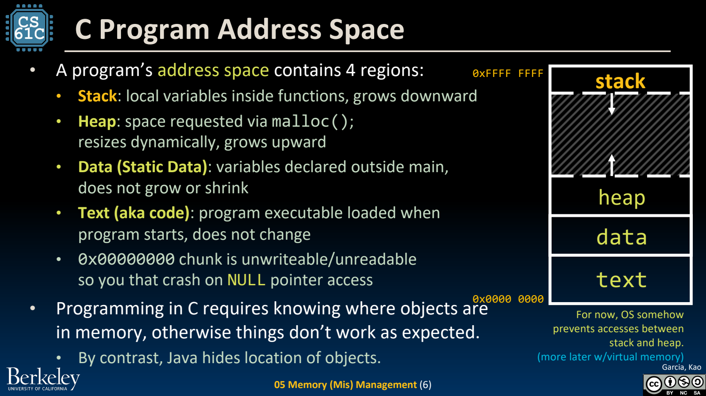
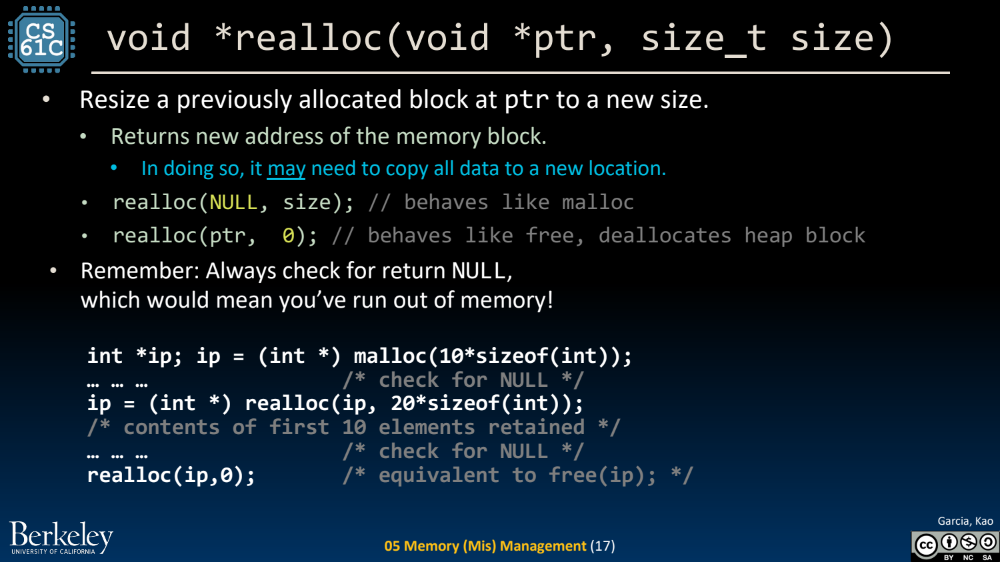
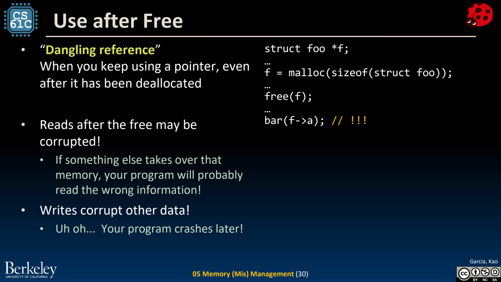

- 程序地址空间：存储位置决定生命周期
	- [Slides 3–12](../Slides/CS61C%202024Fa%20L04%20C3%20Memory.pdf#page=3)
	- 简化进程布局分为 code/text、静态数据、heap、stack。方向与位置是教学模型，实际还存在只读数据、映射区和地址随机化等。
	- 自动局部对象随作用域/调用结束而失效；静态存储持续更久，动态分配对象由显式管理决定释放时机。
	- sizeof 返回字节数，常在编译期确定，但 C 的变长数组等存在运行时情形，不能把所有 sizeof 都当成常量。
	- 

- Stack Frame：函数退出不再拥有原局部空间
	- [Slides 9–12](../Slides/CS61C%202024Fa%20L04%20C3%20Memory.pdf#page=9)
	- 调用时保存局部状态与返回所需信息，返回后栈空间可复用；返回局部数组地址不会让数组活得更久。
	- “字节还没被覆盖”不代表对象生命周期仍有效；悬空指针读写可能在很晚以后才暴露错误。

- malloc / free / realloc：显式管理动态空间
	- [Slides 14–17](../Slides/CS61C%202024Fa%20L04%20C3%20Memory.pdf#page=14)
	- malloc 分配未初始化存储，需要检查失败；按元素数量分配时还应防止 `n * sizeof *p` 溢出。成功对象最终只释放一次。
	- realloc 成功可能搬迁并使旧地址/别名失效；非零新大小分配失败时旧块仍保留，应先用临时指针接收结果，不能直接覆盖唯一拥有指针。
	- free(NULL) 合法；释放后把一个变量置 NULL 并不能修复其他悬空别名。零大小 realloc 的边界不应照课件简写跨标准依赖。
	- 

- 四类典型错误：越界、泄漏、重复释放、释放后访问
	- [Slides 19–37](../Slides/CS61C%202024Fa%20L04%20C3%20Memory.pdf#page=19)
	- Memory Leak：失去最后一个管理地址，动态块仍未释放；Use-after-free：继续使用已释放存储；Double-free：同一分配被释放多次。
	- 数组越界与错误长度可能破坏邻接对象、分配器元数据或返回状态；C 运行时不会自动替你维护完整边界信息。
	- Valgrind、sanitizer 与调试器帮助定位问题，但检测到的只是覆盖到的执行路径，不是正确性证明。
	- 

- Heap Allocator：快、节省空间、减少碎片之间折中
	- [Slides 39–43](../Slides/CS61C%202024Fa%20L04%20C3%20Memory.pdf#page=39)
	- 分配器维护空闲块，需要查找、切分、合并，并记录元数据；外部碎片是空闲空间不连续，内部碎片是分配块内的浪费。
	- First-fit、best-fit 等策略有不同开销与碎片特征；程序员应避免不必要的细粒度分配，但不能假设某种策略永远最好。
	- 对照 [C++ 的 RAII](../../CS106L/Lectures/Lecture15%20RAII%20and%20Smart%20Pointers.md)：它把释放责任放到类型生命周期；C 则通常要明确设计清理路径与所有权约定。
