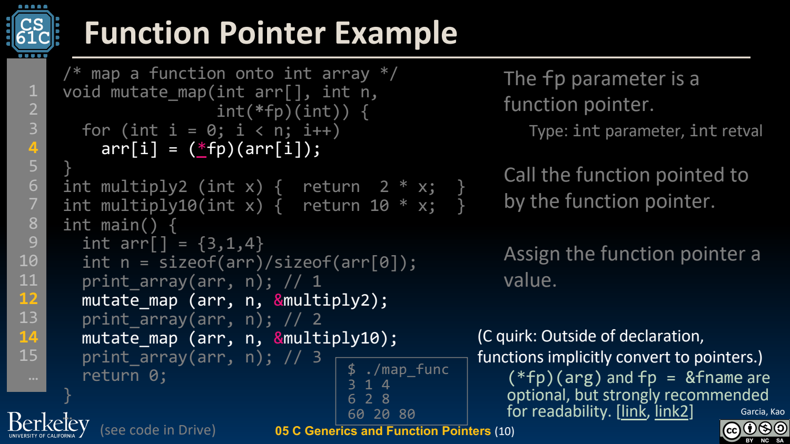
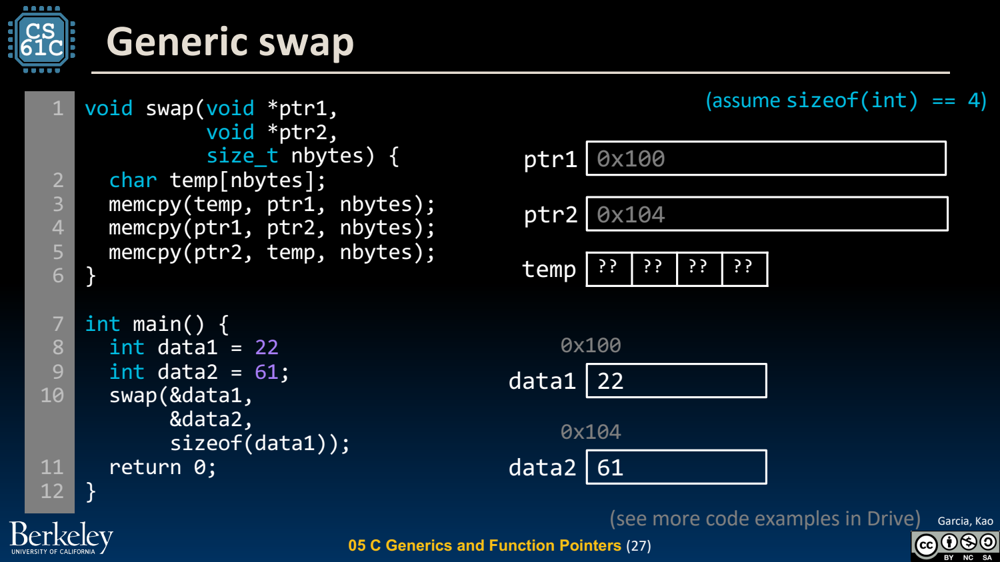

- 函数指针：把行为也作为参数
	- [Slides 3–10](../Slides/CS61C%202024Fa%20L05%20C3%20Generics%20Function%20Pointers.pdf#page=3)
	- `int (*fp)(int)` 表示指向“接收 int、返回 int 的函数”的指针；括号决定它不是返回指针的函数声明。
	- `fp(x)` 与 `(*fp)(x)` 均可调用；map/filter/sort 可把遍历框架与具体操作分开，实现 C 中的高阶接口。
	- 函数签名必须兼容；不能把任意函数地址强转后假装具有另一套参数/返回约定。
	- 

- void*：擦去具体对象类型，不代表丢掉约束
	- [Slides 11–20](../Slides/CS61C%202024Fa%20L05%20C3%20Generics%20Function%20Pointers.pdf#page=11)
	- void* 可携带对象地址，但不知道对象宽度，不能直接按标准 C 规则解引用或做元素步进；必须由接口补充类型/大小信息。
	- 例如泛型 swap 需要两个地址和 nbytes；泛型数组操作还需要元素数量、stride 与回调约定。
	- void* 与函数指针不是任意可互换的统一地址类型；缺少静态类型保护时，调用者责任更大。

- memcpy / memmove：按字节复制，不是按字段理解对象
	- [Slides 24–28](../Slides/CS61C%202024Fa%20L05%20C3%20Generics%20Function%20Pointers.pdf#page=24)
	- memcpy 要求源/目标不重叠；memmove 允许重叠，语义上像先保存再写回，不要求实现真的分配临时数组。
	- 不能从课件经验推断 memcpy 在任何平台都一定更快。先满足语义，再依据实际实现与输入测量。
	- 图中 VLA 临时数组的 swap 适合理解步骤，但大 nbytes、重叠参数和 VLA 支持都要额外考虑，不能当成无条件通用库实现。
	- 

- 泛型数组：先换成字节指针，再计算偏移
	- [Slides 29–35](../Slides/CS61C%202024Fa%20L05%20C3%20Generics%20Function%20Pointers.pdf#page=29)
	- 可用 `unsigned char*` 按对象表示逐字节访问，第 i 个元素起点是 `base + i * elem_size`；访问前先确认长度与容量有效。
	- 把地址算对还不够：目标类型对齐、对象表示、有效类型与生命周期都可能限制后续解引用。
	- 按字节交换指针字段只交换地址，不会自动深拷贝指向的对象或解决所有权。

- 接口设计比强制转换更重要
	- [Slides 35–38](../Slides/CS61C%202024Fa%20L05%20C3%20Generics%20Function%20Pointers.pdf#page=35)
	- 标准库 malloc、memcpy、qsort 等都使用这类接口思想：指针表达位置，大小表达边界，回调表达行为。
	- 每次写强转先问：编译器失去的信息在哪里重新得到保证？若答案只是“我觉得这里是 int”，通常还缺约束或测试。
