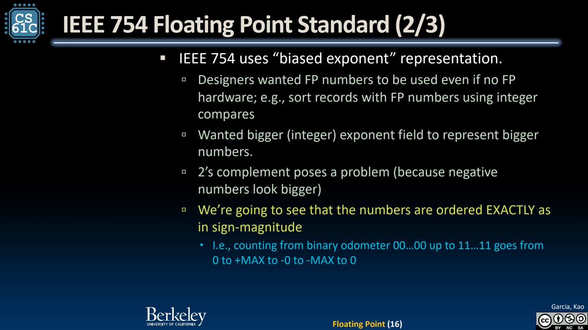
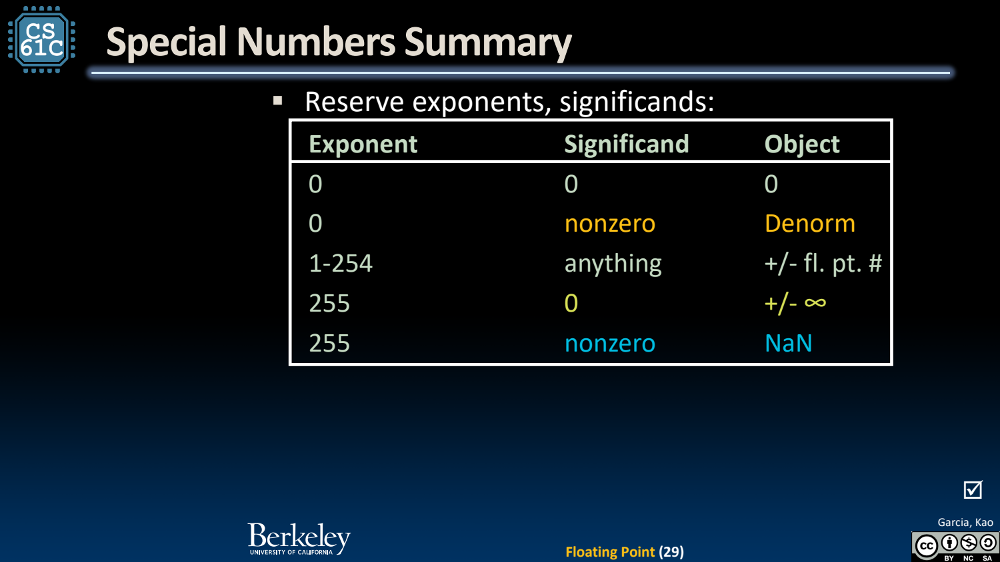
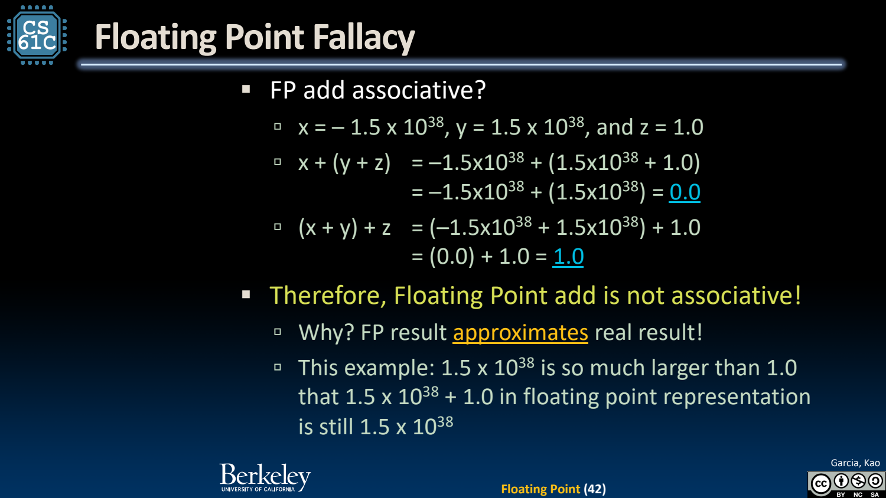

- 二进制小数与科学计数法
	- [Slides 4–14](../Slides/CS61C%202024Fa%20L06%20Float.pdf#page=4)
	- 小数点后位权是 $2^{-1},2^{-2},\ldots$；有限十进制小数不一定有有限二进制展开，例如 0.1 通常需要近似。
	- 浮点用符号、指数、有效数把有限位数分配到很大范围，不是对实数的精确无限表示。
	- 与定点相比，浮点改善动态范围，但精度与相邻数间距随指数改变。

- IEEE binary32：1 + 8 + 23
	- [Slides 15–22](../Slides/CS61C%202024Fa%20L06%20Float.pdf#page=15)
	- 正规数为 **$(-1)^s(1+F/2^{23})2^{E-127}$**，其中 $1\le E\le254$；隐藏的前导 1 使正规数拥有 24 位有效精度。
	- 指数按 bias=127 编码；“指数位直接排序”只适用于适当范围与符号解释，完整浮点位串不是无条件等同无符号整数顺序。
	- 不要把 fraction 的 23 位与完整 significand 的精度混为一谈。
	- 

- 零、Subnormal、Infinity、NaN
	- [Slides 23–33](../Slides/CS61C%202024Fa%20L06%20Float.pdf#page=23)
	- $E=0,F=0$ 为有符号零；$E=0,F\ne0$ 为 subnormal：$(-1)^s(F/2^{23})2^{-126}$，没有隐藏前导 1。
	- $E=255,F=0$ 为正负无穷；$E=255,F\ne0$ 为 NaN。NaN 的比较有特殊行为，例如 NaN 不等于自身。
	- Subnormal 填补零附近的间隙；binary64、FP16、BF16 等通过字段宽度取舍范围、精度和硬件成本。
	- 

- 舍入与误差：实数代数规则不一定保留
	- [Slides 35–46](../Slides/CS61C%202024Fa%20L06%20Float.pdf#page=35)
	- 有限精度运算要舍入；常见默认是 round-to-nearest, ties-to-even，不能把每个中间结果视为精确实数。
	- 浮点加法**不满足结合律**；大量级与小量级相加可能吞掉后者，重排求和或并行归约可能改变结果。
	- 相对误差与绝对误差需结合尺度分析，不能拿固定 epsilon 解决所有比较；接近零和大数场景的要求不同。
	- 

- 加法步骤与整数转换
	- [Slides 47–51](../Slides/CS61C%202024Fa%20L06%20Float.pdf#page=47)
	- 浮点相加可概括为对齐指数、有效数相加、规格化、舍入，并处理溢出/特殊值；它不是普通整数加法换个显示方式。
	- 数值转换与重新解释相同比特不同；浮点转整数还受范围限制，超出 C 可表示范围不能假设自动饱和或模回绕。
	- 做数值程序时同时报告精度、累积方式和允许误差，而不只比较运算次数。
