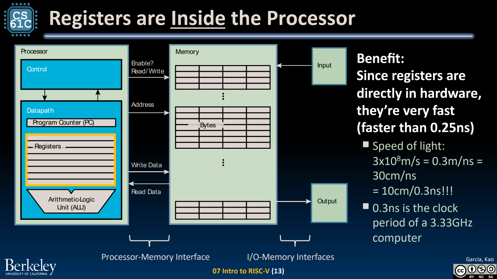
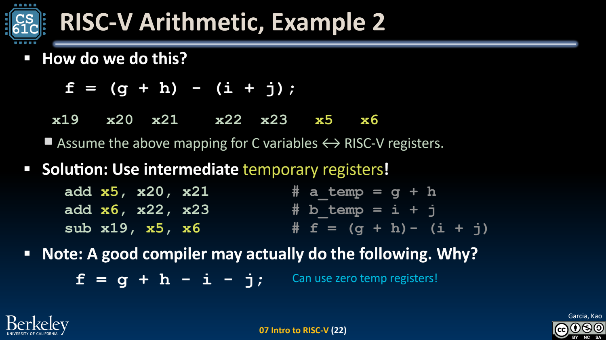

- ISA 是软硬件契约，不是内部电路图
	- [Slides 3–9](../Slides/CS61C%202024Fa%20L07%20Intro%20RISC-V.pdf#page=3)
	- RISC-V 定义指令、寄存器和可见行为；RISC 的简单规则化设计旨在便于硬件实现与编译器组织，不是要求每个高层操作只对应一条指令。
	- 本课程重点为 **RV32I**：通用寄存器宽 32 bits。后续图中的固定 32-bit 指令是该教学子集，不是所有扩展指令长度都固定。

- 寄存器与存储：快，但数量有限
	- [Slides 10–16](../Slides/CS61C%202024Fa%20L07%20Intro%20RISC-V.pdf#page=10)
	- RV32I 有 x0–x31，x0 读出总为 0、写入结果被丢弃；其余寄存器可保存位模式，具体含义来自指令解释。
	- 主要整数运算从寄存器取操作数；内存数据先 load、运算后再 store。变量到寄存器的分配由编译器/汇编程序管理。
	- 

- add / sub：目标在前，两个源在后
	- [Slides 17–23](../Slides/CS61C%202024Fa%20L07%20Intro%20RISC-V.pdf#page=17)
	- `add rd,rs1,rs2` 令 rd 得到两个源的和；`sub` 的源顺序不能交换。RV32I 结果保留低 32 位，不因有符号溢出自动抛异常。
	- `f=(g+h)-(i+j)` 可分为两个 add 与一个 sub，中间结果放临时寄存器；一个 C 语句可翻译为多条指令。
	- 

- addi 与零寄存器：让常见常量操作便宜
	- [Slides 24–27](../Slides/CS61C%202024Fa%20L07%20Intro%20RISC-V.pdf#page=24)
	- `addi rd,rs1,imm` 使用符号扩展的 12-bit 立即数，范围 $[-2048,2047]$；减常数可用其负值，不存在对应基础指令 subi。
	- 复制与小常数加载可借 x0：`addi rd,rs,0`、`addi rd,x0,k`。更大常数需多条指令或 li 伪指令。

- 读汇编的固定顺序
	- [Slides 28–31](../Slides/CS61C%202024Fa%20L07%20Intro%20RISC-V.pdf#page=28)
	- 先写每个寄存器代表的值/地址，再逐条更新目标；不要把寄存器编号当成内存地址或 C 类型。
	- 理解指令计算正确后，再讨论寄存器复用与优化；接下来 load/store 会把地址与值的区别变得更重要。
