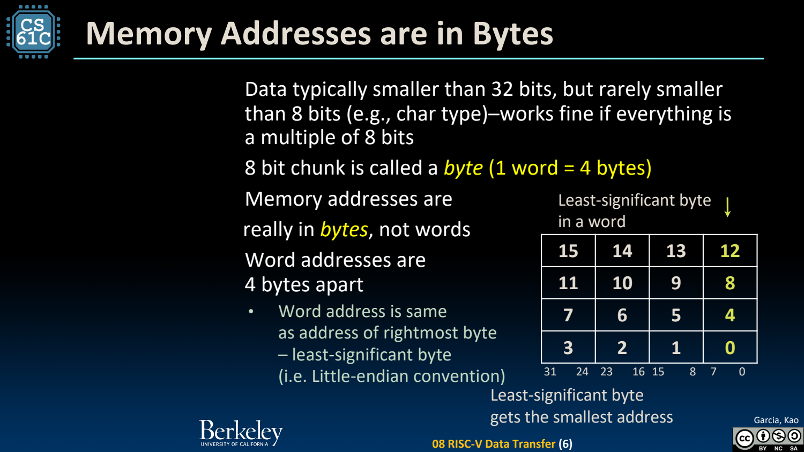
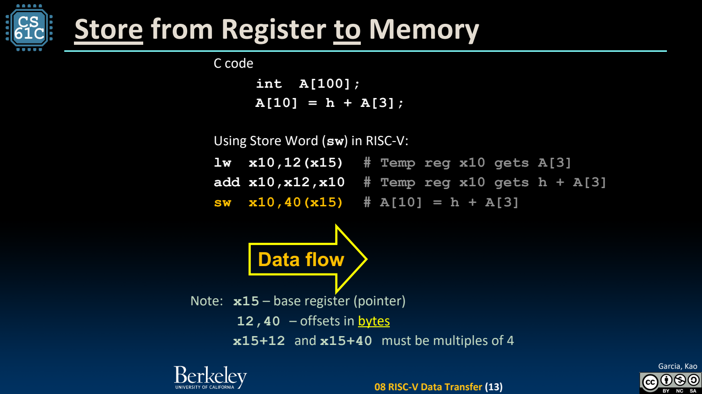

- 内存按字节寻址，RV32 word 是 4 bytes
	- [Slides 4–9](../Slides/CS61C%202024Fa%20L08%20Data%20Transfer.pdf#page=4)
	- 地址每增加 1 指向下一 byte，而不是下一个 word；32-bit 数组第 i 项通常在 `base + 4*i`。
	- 小端序把 word 的最低有效 byte 放在最低地址。字节序影响多字节值的存储顺序，不改变地址递增的定义。
	- 

- Load：从内存搬入寄存器
	- [Slides 11–13](../Slides/CS61C%202024Fa%20L08%20Data%20Transfer.pdf#page=11)
	- `lw rd,imm(rs1)`：地址为寄存器 rs1 的值加符号扩展立即数，读出一个 word 放到 rd。
	- 若 x15 为 int 数组首地址，`lw x10,12(x15)` 取 A[3]。立即偏移以 bytes 为单位，不能直接填下标 3。

- Store：地址与待写数据是两个输入
	- [Slides 12](../Slides/CS61C%202024Fa%20L08%20Data%20Transfer.pdf#page=12)
	- `sw rs2,imm(rs1)` 把 rs2 的低 32 位写到目标地址，不产生寄存器返回值；rs1 保存基址，rs2 保存数据。
	- `A[10]=h+A[3]` 可先 load A[3]、add h、再 store 到 base+40。汇编不是自动理解数组类型，而是显式计算地址。
	- 

- Byte Loads：lb 与 lbu 的区别在高位
	- [Slides 13–14](../Slides/CS61C%202024Fa%20L08%20Data%20Transfer.pdf#page=13)
	- lb 将 8-bit 值符号扩展，lbu 零扩展；例如 byte=0xFF，读入 RV32 后分别得到 0xFFFFFFFF 与 0x000000FF。
	- sb 只存源寄存器最低 byte；写入前不会给内存附加“有符号”标签。以后 load 的指令决定如何扩展。

- 常见错误：复制地址不等于复制地址上的内容
	- [Slides 15–16](../Slides/CS61C%202024Fa%20L08%20Data%20Transfer.pdf#page=15)
	- 实现 `*x=*y` 需从 y 指向位置 load，再向 x 指向位置 store；只移动 x/y 寄存器是在改指针值。
	- 检查有效地址、访问宽度、对齐与对象边界。课程的自然对齐模型是常见安全起点，非对齐处理并非所有实现都相同。
