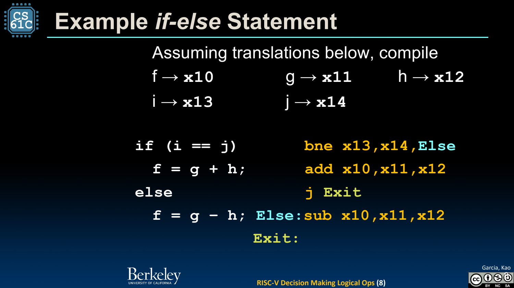
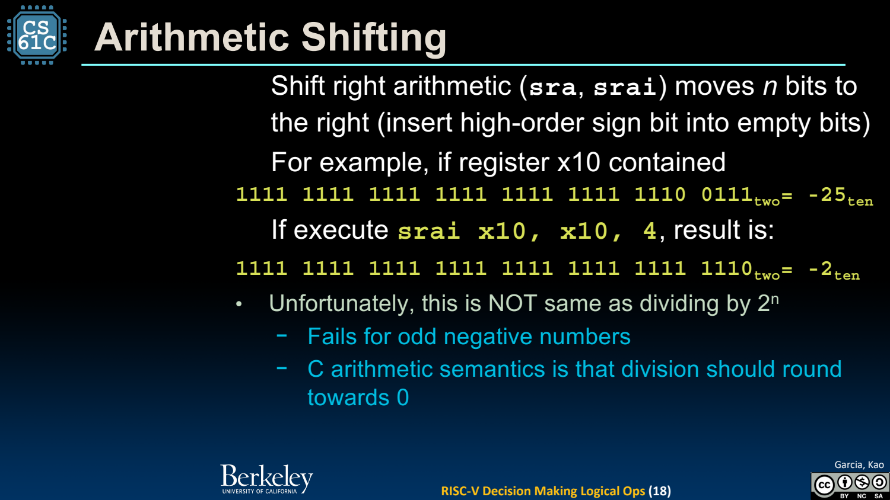

- 分支把判断变成下一条 PC 的选择
	- [Slides 5–9](../Slides/CS61C%202024Fa%20L09%20Decision%20Making%20Logical%20Ops.pdf#page=5)
	- beq/bne 比较相等/不等；blt/bge 做有符号比较，bltu/bgeu 做无符号比较。同样位模式可能得到不同大小关系。
	- if 常用反向条件跳过代码；if-else 还要在 then 结束后跳过 else，避免顺序落入两个分支。
	- 

- 循环：初始化、条件、循环体、更新、回跳
	- [Slides 10–11](../Slides/CS61C%202024Fa%20L09%20Decision%20Making%20Logical%20Ops.pdf#page=10)
	- for/while 都可拆成标签与分支；数组遍历可维护地址寄存器并按元素宽度递增。
	- 检查终止条件与更新位置，特别是 `<` 与 `<=`、signed 与 unsigned；汇编不再提供数组边界检查。

- 按位运算与 Mask：处理字段而不是布尔短路
	- [Slides 14–16](../Slides/CS61C%202024Fa%20L09%20Decision%20Making%20Logical%20Ops.pdf#page=14)
	- and/or/xor 及其 immediate 版本操作每一位；提取低 byte 可用 `andi rd,rs,255`。
	- 按位 NOT 可写 `xori rd,rs,-1`；这不是逻辑非 `!x`。基础指令没有单独 not，汇编器可提供相应伪指令。

- 移位：符号扩展和舍入方向都要看清
	- [Slides 17–18](../Slides/CS61C%202024Fa%20L09%20Decision%20Making%20Logical%20Ops.pdf#page=17)
	- sll/slli 左侧移出位被丢弃，右补 0；srl/srli 右移左补 0；sra/srai 右移复制符号位。
	- 负数算术右移趋向向负无穷的缩放结果，不等于 C 中向零截断的有符号整数除法，例如 -25 右移 4 得 -2，而 -25/16 为 -1。
	- 

- PC、存储程序与 Pseudoinstructions
	- [Slides 20–24](../Slides/CS61C%202024Fa%20L09%20Decision%20Making%20Logical%20Ops.pdf#page=20)
	- 课程 RV32I 顺序执行通常 PC+=4，分支/跳转改用目标地址；指令与数据都以 bits 存储，由取指过程解释。
	- mv、li、j、nop 等伪指令是汇编便利写法，可能展开成一条或多条真实指令；不能按源文件行数无条件计算机器指令数。
