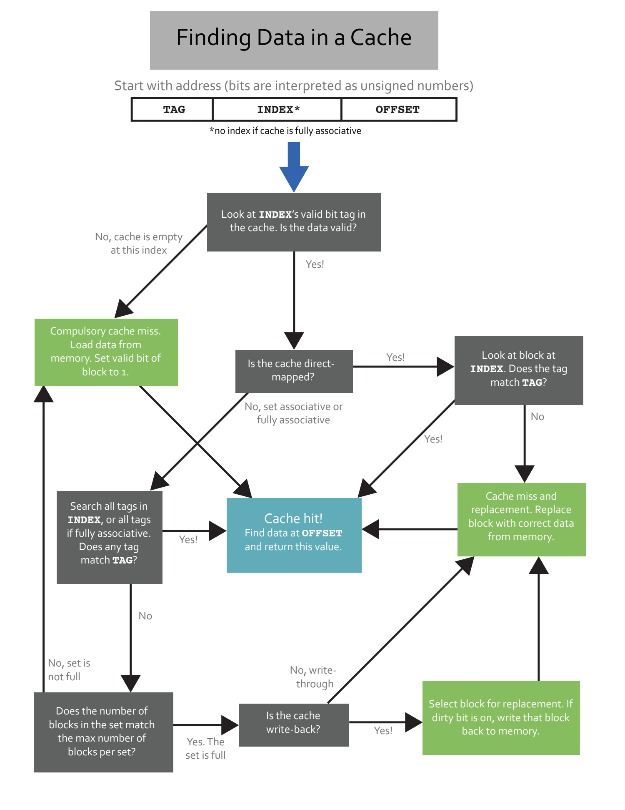

- 一页串起 Cache Lookup
	- [Slides 1](../Slides/caches.pdf#page=1)
	- 本篇对应未编号的 caches.pdf，作为 Lecture24–27 的复习，不擅自当成本地缺失的 Lecture23。
	- 先把地址拆为 Tag/Index/Offset；直接映射查一行，组相联在对应 set 中查所有 ways，全相联在全部候选中比较。
	- 

- 命中条件：Valid 与 Tag 都满足
	- [Slides 1](../Slides/caches.pdf#page=1)
	- 找到有效且 tag 匹配的块后，按 offset 取所需数据。无效位不能忽略，tag 相同但 invalid 仍不是 hit。
	- 在组相联中，某个 way 无效不表示整个 set 没有命中，应检查全部候选。

- 缺失与替换：先找空 way，再选 victim
	- [Slides 1](../Slides/caches.pdf#page=1)
	- 没有命中但存在空 way，可直接装块；set 满才按替换策略选 victim。write-back 的 dirty victim 需先写回。
	- 装入后更新 tag/valid 与替换状态；写操作还需遵守 write-allocate / no-write-allocate 选择，不能只靠这张读流程图推断全部写行为。

- 重要修正：Invalid 不足以证明 Compulsory
	- [Slides 1](../Slides/caches.pdf#page=1)
	- 流程图将“没有有效条目”直接标成 compulsory，是简化；compulsory 应由**此前是否访问过同一内存块**决定。
	- 条目可能被失效/淘汰，当前 valid=0 仍可能是重访；capacity/conflict 也需和同容量全相联对照模型比较，不能仅凭 tag mismatch 分类。

- 做题时记录状态，而不只记录答案
	- [Slides 1](../Slides/caches.pdf#page=1)
	- 每次访问写下 block number、set、tag、hit/miss、victim、dirty 与替换次序，再处理下一个地址。
	- 完整公式与例子回看 [Lecture25](Lecture25%20Caches%20II.md)、[Lecture26](Lecture26%20Caches%20III.md)、[Lecture27](Lecture27%20Caches%20IV.md)。
