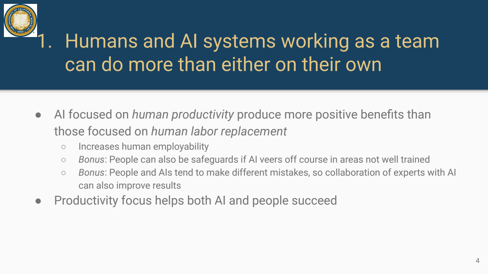
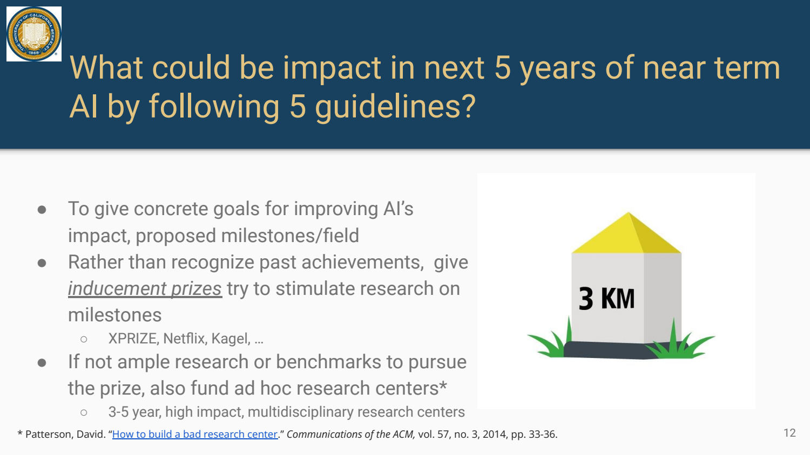
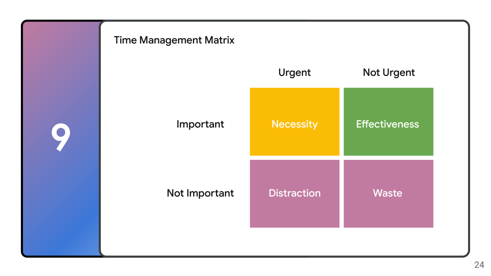

- AI 的影响：讲者提出的设计议程，不是确定预测
	- [Slides 1–11](../Slides/A%20Pragmatic%20View%20of%20the%20Impact%20of%20AI.pdf#page=1)
	- David Patterson 从近中期 AI 的生产力与社会影响出发，强调不能只问“能替代谁”，也要问“怎样让人完成更多有价值工作”。
	- 五条思路：人机协作、关注会创造需求/就业的领域、先减少繁琐任务、考虑地区差异、采用适当的效果衡量工具。
	- 这些是专题中的观点与研究议程；讲义案例有时间和场景边界，不能外推成任何行业必然增员/减员的结论。
	- 

- Evaluation：效果取决于真实任务与代价
	- [Slides 7–11](../Slides/A%20Pragmatic%20View%20of%20the%20Impact%20of%20AI.pdf#page=7)
	- 局部任务变快不一定等于整体工作效果变好；需看错误、人工验证、长期学习和组织流程变化。
	- 对高风险场景，单纯市场采用率或漂亮 demo 不足以证明质量；应有与实际用途匹配的独立评估与监督。

- 用里程碑推动研究：目标要可验证
	- [Slides 12–19](../Slides/A%20Pragmatic%20View%20of%20the%20Impact%20of%20AI.pdf#page=12)
	- 讲义提出就业信息、教育 tutor、公民对话、记者辅助、科学助手等方向，尝试把抽象“AI 有益”变成具体可检查目标。
	- 激励机制与跨学科研究组织也很重要；不只是追逐单项 benchmark，而是让完整系统帮助真实用户。
	- 

- Life Lessons：时间、团队与重要问题
	- [Slides 21–38](../Slides/A%20Pragmatic%20View%20of%20the%20Impact%20of%20AI.pdf#page=21)
	- 讲者强调家庭与关系、区分重要/紧急、对问题保持热情、团队协作、以身作则、愿景与文化。
	- 时间管理矩阵把工作分成重要/不重要、紧急/不紧急；长期研究往往需要主动保护“重要但不紧急”的投入。
	- 这些是个人经验，不是对所有人的唯一职业路径或成功保证。
	- 

- 完成、修正与合作：连接回工程方法
	- [Slides 39–43](../Slides/A%20Pragmatic%20View%20of%20the%20Impact%20of%20AI.pdf#page=39)
	- 少开项目、重视完成，寻找正向机会，并能承认自己错误；与课程“先验证再下结论”的实践态度相通。
	- 本 PDF 没有可确认的 Lecture 编号，因此保留为补充专题，不仅凭主题把它强行填为 Lecture36。
