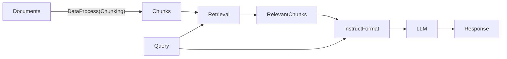

## 提要

RAG

- 本次作业采用 25年秋季 的RAG 作业

- 整个RAG系统的流程


- ==另外补充== 
	- 随着 Agent 的进一步发展，本次作业的 RAG流程 其实已经被称为 Naive RAG 了，现在比较流行的是 Agentic RAG，就是 RAG as a Tool ，而不是一个固定的 pipeline了
	- 但是 RAG 系统本身不会过时，过时的只是固定的 Pipeline 罢了
		- 也就是说 Chunking、Embedding 、BM25、RFF 等 RAG 系统内部的方式不会过时，而是外部的编排层发生了改变(从被动的提示词注入变成Agent主动工具调用)
	-  [RAGMore](RAGMore.md) 中介绍了如何在大量文档中建立高效的RAG系统


- DataProcess
	- 将 Documents 切分成 很多 chunks，方便进行 Retrieval
	- chunk size
		- 大 Chunk Size 有更多上下文可能获得更好的语义表达
		- 小 Chunk Size 有更高的准确性
	- stride
		- 大 Stride Chunk 更少更高效
		- 小 Stride Overlap 更多更容易将关键语义包含
	- Context Window Size
		- 给多少个 Chunk 给 Context Windows 也需要抉择

- Retrieval (本质是Rank)
	- Sparse Retrieval 
		- 将 Query 与 Chunks 分词为各种词单元(仍然是文字)
		- 进行 词单元 的匹配，进而Rank
		- 比如 BM25
	- Dense Retrieval
		- 将 Query 与 Chunks 通过 Embedding Model 将其变成 Embedding 向量
		- 比较 Embedding 的相似度，进行 Rank，比如采用 CosineSimilarity
		- 这里大家可能很疑惑，chunk 的 tokens 数量和 Query 的 tokens 数量都不一致，怎么进行统一的embedding呢❓✅
			- 其实它依然是对所有token进行embedding，然后使用 pooling 技术(或者取[CLS]token)把它们变成一维的
			- Pooling 使得 $R^{n*d}$ -> $R^d$
		- 往往 Dense Retrieval 会将文档构成一个 Embedding DB
	- 多种 Retrieval 可以结合
		- 通过 RFF 将多个 Retrieval 的分数综合，然后得到最终的综合分数
		- $RFF(c)=\sum \frac{1}{k+rank(c)}$
			- c 是 chunk
			- k 是常数(通常60)


## 实践

- 本次作业的所有代码其实都已经提供好了，你只需要调整部分的超参数，和理解实践过程，其实在服务器上配环境很崩溃，Embedding model 和 Generation Model 都有点大，需要下载很久

- 我们就不追求一直调超参了，而是梳理清楚完整的RAG系统

- 首先梳理清楚需要用到的组件
	```python
	import json # 处理json / Standard JSON library
	
	import torch # PyTorch / PyTorch deep learning framework
	
	from typing import List # python 的 list 类型 / Type annotation for list
	
	from transformers import ( # Transformers  模型相关的库(常用来加载和使用模型) / HuggingFace Transformers library
	AutoModelForCausalLM, # 自動載入因果語言模型 / Auto loader for causal language models
	AutoTokenizer, # 自動載入對應的 tokenizer / Auto loader for tokenizer
	BitsAndBytesConfig, # 用來設定量化模型的參數 / Configuration for model quantization
	pipeline # 提供簡單的模型推論介面 / Easy interface for model inference
	)
	from tqdm.autonotebook import tqdm # 显示进度条（适用于 Jupyter Notebook） / Progress bar in Jupyter
	import jieba # 中文断词工具 / Chinese word segmentation
	from rank_bm25 import BM25Okapi # BM25 搜索模型 / BM25 retrieval model
	from sentence_transformers import SentenceTransformer # 向量模型 / Sentence embedding model
	```

- 进行 文档的 Chunking
	- 就是很常规的将 Document 读进string变量，然后使用 list 和 切片技术将Document切成 chunks List

- 进行 Retrieval 的准备
	- BM25
		- 利用 jieba 将 Chunk 再分词为 词单元(这里依然是文字)
			- `tokenized_chunks = [list(jieba.cut(chunk)) for chunk in chunks]`
		- 将已经转换为词单元的chunks初始化bm25
			- `bm25 = BM25Okapi(tokenized_chunks) # 建立 BM25 檢索模型 / Build BM25 retrieval object`

	- Embedding
		- 加载Embedding Model
			- `embedding_model = SentenceTransformer("/data1/xds/models/multilingual-e5-large")`
		- 将所有的chunks进行encode
			- `chunks_embeddings = embedding_model.encode(chunks, show_progress_bar=True)`


- Retrieval 过程实现
	- BM25
		- 将 query 也切分为词单元
			- `tokenized_query = list(jieba.cut(query)) # 對查詢進行斷詞 / Tokenize the query`
		- 利用上述 bm25 计算每个 chunk 的得分
			- `scores = bm25.get_scores(tokenized_query) # 計算每段文字的分數 / Get relevance scores`
		- 按照分数排序
			- `rank = sorted(zip(chunks, scores), key=lambda x: x[1], reverse=True) # 依分數排序 / Rank by score`
		- 得到排序后的chunks
			- `[chunk for chunk, _ in rank]`
	- Embedding
		- 先编码 query 为 embedding
			- `query_embeddings = embedding_model.encode(query, prompt_name="query") # 取得查詢的向量表示 / Encode query`
		- 计算得分
			- `scores = list(embedding_model.similarity(query_embeddings, chunks_embeddings)[0]) # 計算相似度 / Compute similarities`
		- 按分数排序
			- `rank = sorted(zip(chunks, scores), key=lambda x: x[1], reverse=True)`
		- 得到排序后的chunks
			- `[chunk for chunk, _ in rank]`
	- RFF 进行排序综合
		- `scores[doc_id] = scores.get(doc_id, 0.0) + 1.0 / (k + rank)`
		- `doc_id` 是 chunk 本身

- 最后就是构成format输入给llm pipeline 得到最后的结果
	- `chats = [{'role': "system", 'content': SYSTEM_PROMPT},{'role': "user", 'content': USER_PROMPT.format(query=query, relevant_chunks=relevant_chunks)},]`
	- `llm_pipe(chats)[0]['generated_text'][-1]['content'].strip()`


