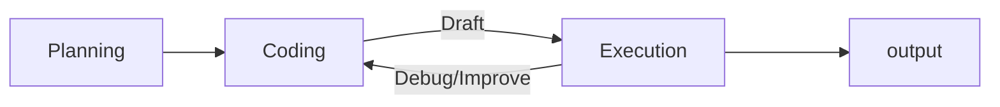

## 提要
Agent as Engineer

- 本次作业 采用 26年春机器学习，是设计 Code Agent 帮我设计实验、写代码并完成任务

- 本次作业的代码基于 AIDE --- AI-Driven Exploration

- 整体流程


- 在 Agent 的执行过程中，最重要的其实是 上下文的管理 context is everything
	- v1 运行到一定程度 --> 压缩总结为 progress.md 文档
		- 将到目前为止我们所做的一切写入progress.md，确保注明我们采取的方法、迄今为止所采取的步骤，以及我们正在努力解决的当前失败情况
		- Write everything we have done so far into progress.md, ensuring that we note the methods we have adopted, the steps taken so far, and the current failure situations we are striving to resolve.
	- v2 使用 subagent 去处理任务，让上下文更加干净
		- 指派 subagent 去处理任务，hostagent 只需要分派任务获得返回结果，hostagent上下文更干净
	- v3 pipeline + subagents 固定pipeline 与 subagents 协作
		- 多个 HostAgent 负责 多个 大任务，比如 Research -> Planning -> Implement
		- HostAgent 处理大任务时，委派多个 subagents 处理小任务

- 在 指派 Agent 中
	- 重要性排序
		- AGENT.md > SPEC.md > RESEARCH.md > PLAN.md > Code
		- AGENT.md：定义 Agent 的角色、行为规范、工作边界与全局指令。
		- SPEC.md：定义任务/系统必须满足的功能、接口、约束与验收标准。
		- RESEARCH.md：记录背景调研、技术选型、参考资料与关键结论。
		- PLAN.md：描述具体实施步骤、任务拆分、优先级与推进顺序。
		- Code：最终实现上述规范与计划的实际代码。
	- 最重要的其实是 Markdown 文件，而非 Code


## 实践

- 代码整体上是完整的，只需要更改部分提示词+利用API接口让模型输出评估结果，梳理梳理做法好了，不再实际操作了

- 本次实践 采用 `from llama_cpp import Llama` 加载量化模型 `.gguf`

- Interpreter 解释器
	- 实现了一个**独立子进程中的 Python 解释器**：主进程把代码发送给 Worker 子进程执行，并收集输出、异常和执行时间，同时支持超时控制

	- 子进程启动
		- `import subprocess`
		- `self.process = subprocess.Popen([sys.executable, _WORKER_SCRIPT_PATH, self.agent_file_name],stdin=subprocess.PIPE,stdout=subprocess.PIPE,)`
			- `sys.executable` 就是当前的 python 解释器(地址)
			- `_WORKER_SCRIPT_PATH` 指定子进程需要执行的 python 代码位置
			- `self.agent_file_name` 提供给子进程 启动文件的参数之一，后续还可以写更多参数，子进程通过 `sys.argv` 读取
		- 子进程代码逻辑是接受 code 将其先写入 python 文件，然后编译执行

	- `_recv` 与 `_send` 是 主进程与子进程 通信的手段，类似于非常简单的网络通信
		- `_send` 先 pickle序列化 成 bytes ，再构成 bytes长度(4字节)+bytes 的包发过去
		- `_recv` 先读 bytes长度并解包得到整数长度，再分chunk读后续的bytes(流的特性)，最后pickle反序列化为python对象
		- `data = pickle.dumps(obj)` 将python对象序列化为字节流，同时能够保留类型信息，方便反序列化

- Nodes 节点
	- 表示**解题/代码搜索树中的一个节点**。每个节点保存当前代码、执行结果、评估结果，以及它和父子节点之间的关系
	- 使用 `dataclass` 和 `filed` 并继承自 `dataclasses_json.DataClassJsonMixin` 
		- `dataclass` 修饰器，方便定义类的数据
		- `filed` 搭配 `dataclass` 使用，指定 类的数据的特殊性质
			- `default_factory=func` 指定函数，默认是该函数返回值
			- `default=value` 默认值
			- `kw_only=bool` 是否必须关键字传参数
		- `DataClassJsonMixin` 赋予 json 序列化 和 反序列化能力
	- 它主要记录 code、plan 以及 analysis
		- code 它负责生成的 代码
		- plan 它生成代码时的计划
		- analysis 执行后由评估agent生成的评估
	- 同时保持节点的子父关系以及各种执行信息info等等

- Tree 树
	- `Journal` 维护整个 Agent 解题过程中产生的所有 `Node`，并提供查询、筛选、选最优解和生成总结的功能
	- 很简单，就是把所有 Nodes 放进 List 并且管理它们


- Agent 智能体
	- 核心控制器决定下一步是“重新起草、调试旧方案还是改进已有好方案”，调用 LLM 生成代码，再执行代码并把结果写入 `Journal`

		```text
		Agent.step()
		   ↓
		更新数据预览
		   ↓
		search_policy()
		   ↓
		┌──────────┬──────────┬──────────┐
		│ Draft    │ Debug    │ Improve  │
		│ 新方案    │ 修 Bug    │ 改进方案  │
		└──────────┴──────────┴──────────┘
		   ↓
		LLM 生成 plan + code
		   ↓
		Interpreter 执行代码
		   ↓
		parse_exec_result() [除了提取记录执行结果外还会调用评估Agent获得评估结果]
		   ↓
		评估结果
		   ↓
		Journal.append()
		```
	- Agent 每执行一个 step 就会创建新的 Node，同时保留所有好的 node 的 code 并依据评估结果得到 最好的 code

- Data Preview
	- 扫描数据目录里的 `.json` 文件，并生成一份给 LLM 看的数据结构预览文本，即自动生成数据集 schema + example 的工具


