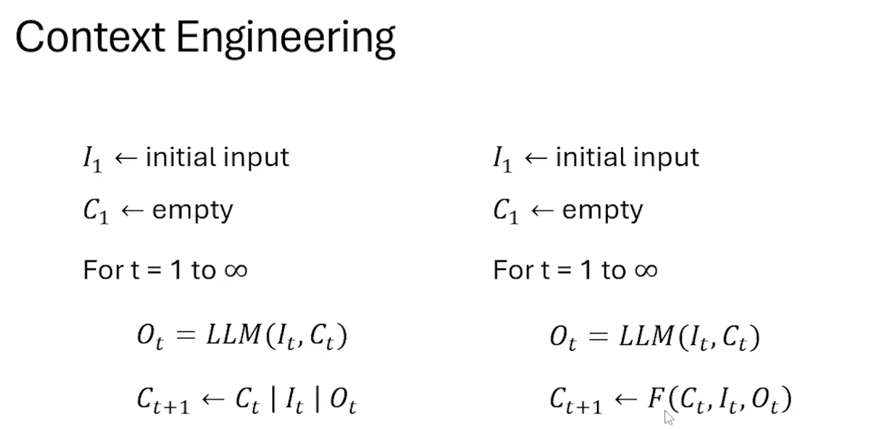
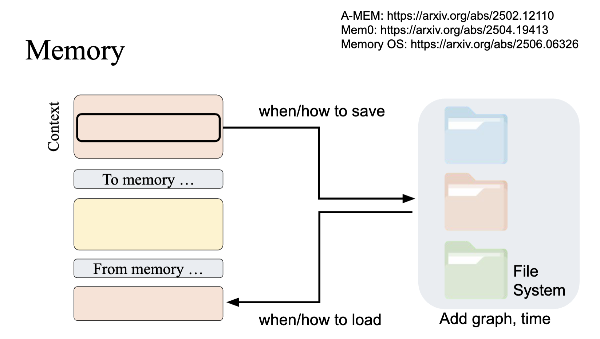
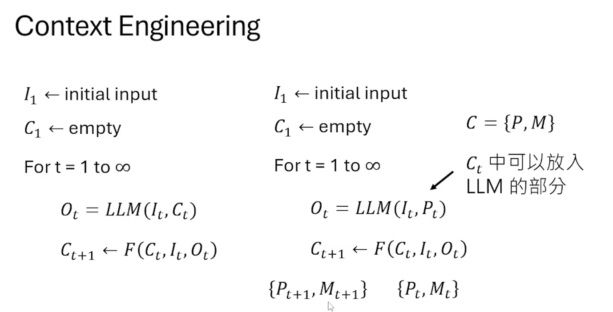
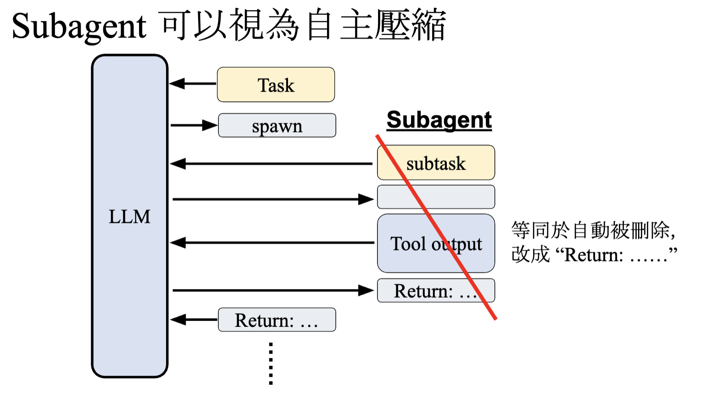
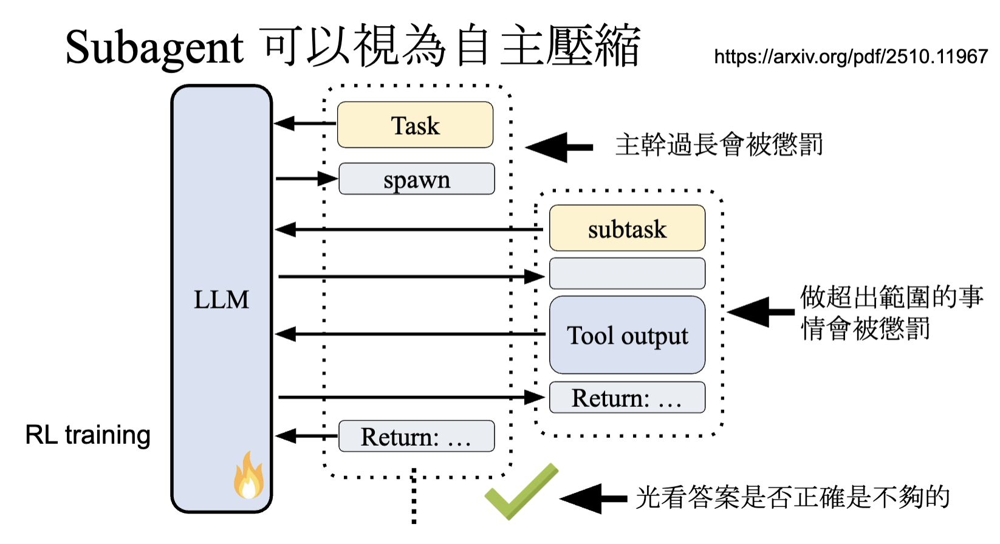
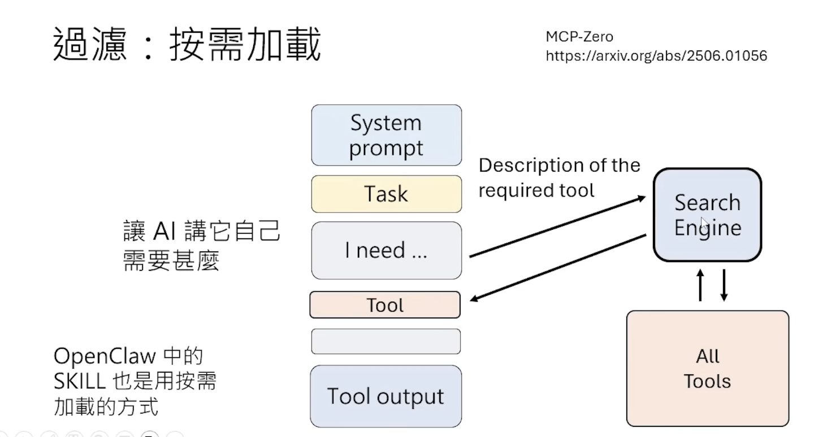
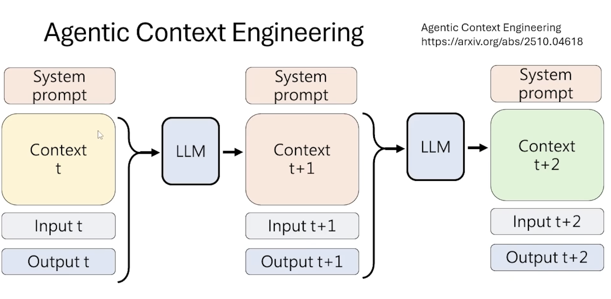

- Context Engineering 形式化
	- 右侧 `F` 就是 Context Engineering
	- 

- Context Engineering --- 压缩
	- LLM summary
		- 将 较旧 的信息给 LLM，让它生成 summary 实现压缩
	- Hard Clear
		- 将 工具详细输出 替换成 `这里有工具输出`
		- [Improve-1](https://arxiv.org/abs/2511.22729)
			- 将 工具详细输出 替换为 `详见 log1.txt`
			- log1.txt 中记录工具详细输出
	- [好的实践](https://arxiv.org/abs/2508.21433)
		- 平常压缩通过 Hard Clear，最终压缩通过 LLM summary
	- 直接利用 Memory 实现压缩
		- 做法类似于 上述的 Improve-1 ，但是作用的对象不止是工具详细输出，可以是所有的上下文信息
		-   
		
		- 利用 Memory 时 Context Engineering 的范式发生了改变
			- 上下文 C 划分为两部分，给 LLM 的 P 和 存入 Memory 的 M
			

- Context Collapse 内容崩溃
	- 定义: 利用 LLM summary 后，原先能做对的任务无法做对了
	- [ACON](https://arxiv.org/abs/2510.00615)
		- 收集 经过 LLM summary 之后失败的，原 context 和 压缩后的 context
		- 给另一个 LLM 上述两个 context，让它分析失败原因写成 Feedback
		- 收集一系列 Feedbacks，用这些 Feedback 指导 LLM summary，再测试 新压缩后的 context 能否改善，找到改善最好的 Feedback 用于实际使用
	- [SUPO](https://arxiv.org/abs/2510.06727)
		- ACON 没有训练模型
		- 而 SUPO 则是训练模型做 LLM summary 任务，由于我们没有 压缩后的 context 的 gold truth，因此采用 强化学习 的方式训练

- 压缩的时机
	- 模型不喜欢压缩上下文，即使你给模型提供了压缩上下文的工具，它可能也不会主动去调用，因此大多数 Harness 都是当上下文达到固定长度时强制执行压缩
		- [论文](https://arxiv.org/abs/2509.23586)
	- [AgentFold](https://arxiv.org/abs/2510.24699)
		- 训练模型去 使用压缩工具
		- 这个不违背上面的发现，本文也披露只通过 prompt 是很难让模型压缩，通过微调训练后，模型才能相对稳定地使用 压缩工具
	- [Subagent](https://arxiv.org/pdf/2510.11967) 可以视作一种自主压缩
		- 

		- 但是使用 subagent 的能力也需要通过训练
		- 

- 过滤
	- 目的：让模型的上下文本身就不要过长
	- 模型上下文中占绝大多数的内容是 Observation
		- [论文](https://arxiv.org/abs/2508.21433)
		- [论文](https://arxiv.org/abs/2601.16746)
	- 一些方法
		- 更好的 读工具(read tool)，只返回重要的信息
		- 按需加载
			- [MCP-Zero](https://arxiv.org/abs/2506.01056)
			- 

- Agentic Context Engineering
	- 

	- [Dynamic Cheatsheet](https://arxiv.org/abs/2504.07952)
	- [Agentic Context Engineering](https://arxiv.org/abs/2510.04618)
	- [Recursive Language Models](https://arxiv.org/abs/2512.24601)

