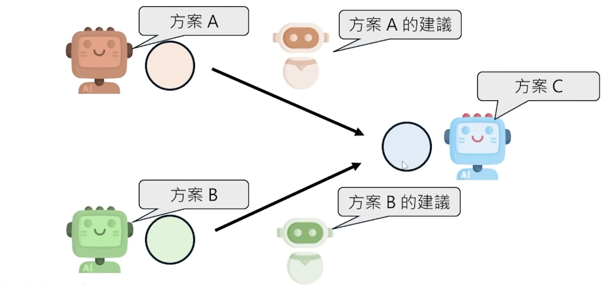
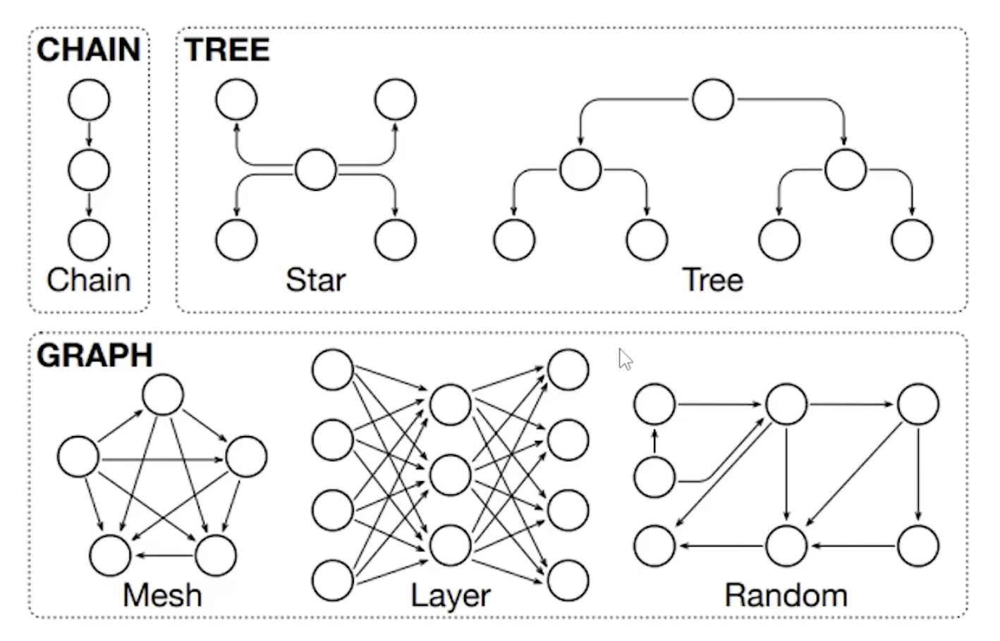
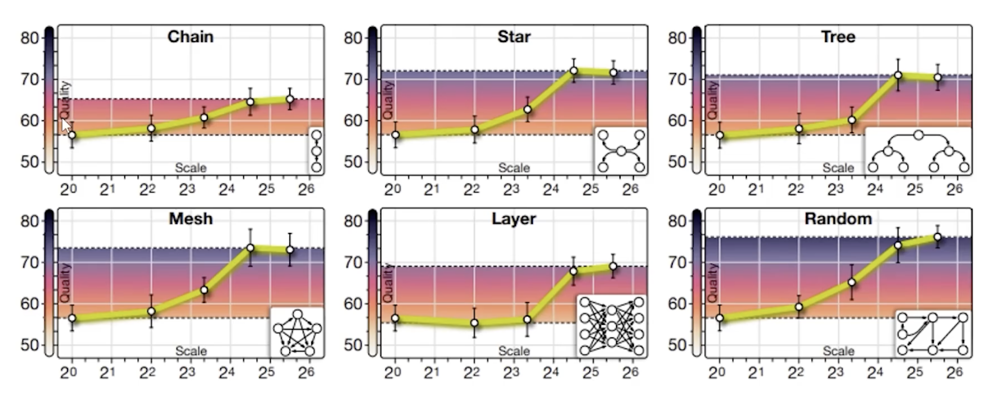

- Agent 协作
	- [早期论文](https://arxiv.org/abs/2406.07155)
		- 连接方式
		- 连接拓扑，注意 Tree 的所有叶节点最终其实还会汇集到一个节点进行汇总的
		- 不同连接拓扑的性能，可以看到连接稠密和随机连接的效果是最好的，但是同时披露不同任务的最优协作方式往往有差别

- Agent Game 博弈
	- [AI狼人杀](https://werewolf.foaster.ai/)
	- [AI剧本杀MIRAGE](https://arxiv.org/abs/2501.01652)
	- [AI社群moltbook](https://www.moltbook.com/)