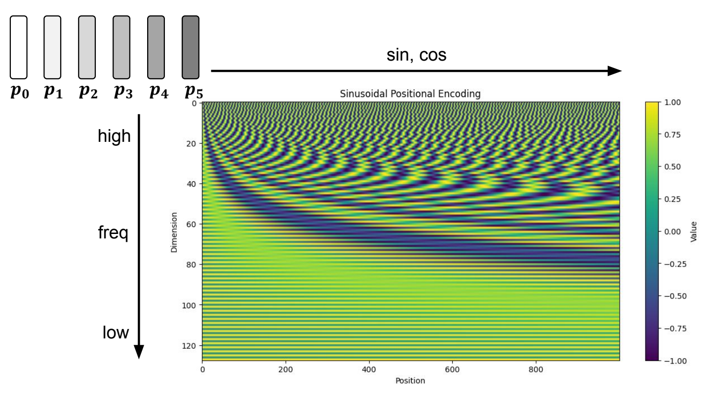
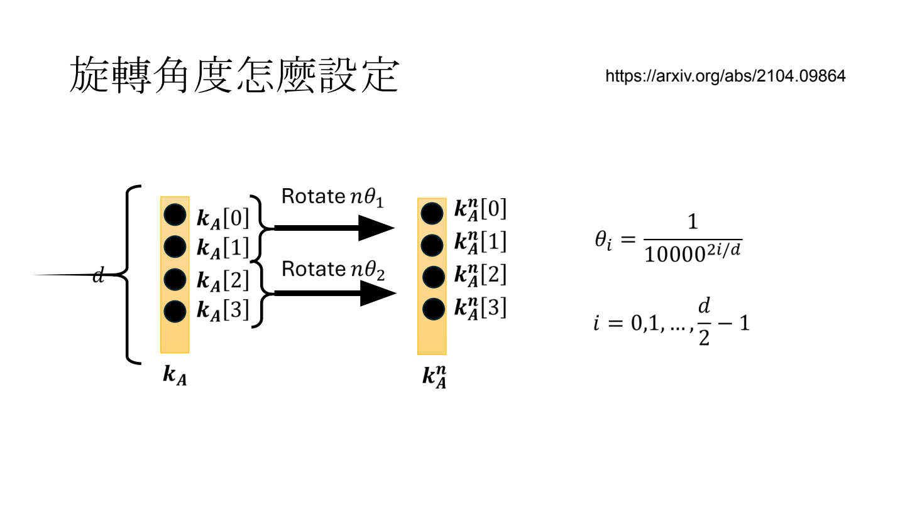
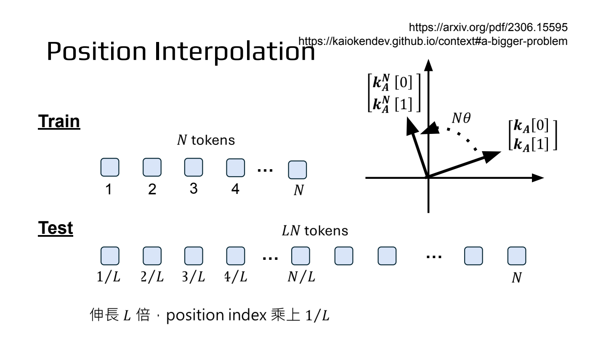
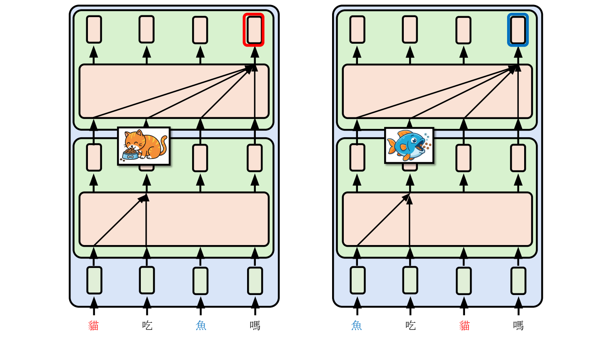

- 为什么需要位置信息？
	- [Slides 2–4](../../Slides/Unit3/pos.pdf#page=2)
	- 不加位置编码、也没有 causal mask 时，self-attention 本身不区分顺序：调换 K、V 的排列，不改变同一个 query 的输出；但“你打我”和“我打你”的意思不同。
	- 目标：让模型知道 token 的**绝对位置**或 token 之间的**相对距离**；Causal Attention 的例外见最后的 NoPE。

- Absolute Positional Embedding：把位置向量加到输入
	- [Slides 6–22](../../Slides/Unit3/pos.pdf#page=6)
	- 输入变为 $x_m+p_m$；$p_m$ 可以是可学习参数，也可以用固定的 **Sinusoidal Encoding**：
		- $p_m[2i]=\sin(m/10000^{2i/d})$，$p_m[2i+1]=\cos(m/10000^{2i/d})$，其中 $d$ 为编码维度。
	- 每两维组成一组 sin/cos，不同组频率不同，像秒针、分针、时针一起表示时间：高频刻画细微位置变化，低频覆盖较长范围。
	- 由三角恒等式可得 $p_{m+r}=M_rp_m$，其中 $M_r$ 只依赖位移 $r$，所以这种编码具备表达相对位移的结构。
	- 但把 $p_m$ 加到输入后，attention 分数会混合内容项、位置项及交叉项，**不自动保证只依赖相对位置**；公式能算到更长位置，也不代表模型一定能泛化。
	- 

- Relative Positional Embedding：直接在 attention score 中加入距离信息
	- [Slides 24–26](../../Slides/Unit3/pos.pdf#page=24)
	- **ALiBi（Attention with Linear Biases）**：在 softmax 前的分数上减去 $b_h(m-n)$（causal 情况下 $n\le m$）；各 head 使用不同的固定斜率 $b_h$，距离越远，惩罚越大。
		- ALiBi 的效果其实挺好的，只是会有人为设置的偏置，而且在计算 attention score 时会有额外计算不够美妙
	- **T5 Relative Bias**：使用按相对距离索引的可学习 bias，而不是手动设置线性惩罚。
		- 这篇其实早于 ALiBi 但是效果不如 ALiBi
	- 共同点：位置关系通过距离进入 score；ALiBi 增加远距离惩罚，但不代表远处 token 的最终 attention 一定小于近处 token，仍要看内容分数。

- RoPE（Rotary Position Embedding）：通过旋转 Q、K 表示位置
	- [原理与推导：Slides 27–40](../../Slides/Unit3/pos.pdf#page=27)
	- 先从内容计算 Q、K，再将每两维视为一个二维向量：位置 $m$ 的旋转角为 $m\theta_i$，不同维度对使用不同频率 $\theta_i=10000^{-2i/d}$；**V 不旋转**。
	- 设旋转后的 query 为 $\tilde q_m=R_mq_m$，key 为 $\tilde k_n=R_nk_n$，则
		- $\tilde k_n^T\tilde q_m=k_n^TR_n^TR_mq_m=k_n^TR_{m-n}q_m$。
	- **用绝对位置做旋转，内积中的位置因素却只依赖相对位移 $m-n$**；内容不变时，两个位置一起平移，分数不变。
	- 与 [KVCache](../Unit2-Inference/Lecture6 KVCache.md) 配合：固定频率和位置编号时，历史 K 旋转后即可缓存，不必每次为新 query 重新旋转历史 K；attention 仍是 QK 内积。
	- **RoPE 不保证 attention 随距离单调减小**：旋转后的内积还取决于 Q、K 的方向与内容，不能简单理解为“越远越不重要”。
	- **RoPE** 和 ALiBi 是同时期的产物，**RoPE** 更加美观与 KV cache 配合完美，因此现在往往会用 RoPE
	- 

- Train Short, Test Long：怎样扩展上下文？
	- [Slides 41–57](../../Slides/Unit3/pos.pdf#page=41)
	- 问题：训练只见过长度 $N$，直接推理到 $sN$ 时，会遇到未充分训练的位置/相对距离及旋转相位组合；RoPE 也不能天然保证长文本外推。
	- **Position Interpolation（PI）**：把位置索引从 $m$ 改成 $m/s$，让长序列的位置落回训练范围；代价是相邻位置也被压近，通常仍需微调适应。
	- **按频率缩放**：高频维度尽量保留局部位置分辨率，低频维度压缩以覆盖更长距离。**NTK-Aware Scaling**、**YaRN** 都采用非均匀缩放思路，而不是所有频率统一除以 $s$。
		- **RoPE + YaRN 是非常常见的做法**
	- **Dynamic Scaling**：根据当前序列长度决定缩放量；短序列不必压缩，避免为了扩展长文本而损伤短文本效果。
		- 有效，但是影响 KV Cache
	- **LongRoPE**：进一步结合不同频率、不同位置区间的非均匀缩放，用进化搜索寻找缩放配置
		- 频率缩放 + Dynamic Scaling
	- 

- NoPE：不显式加位置编码，也可能知道顺序
	- [Slides 58–63](../../Slides/Unit3/pos.pdf#page=58)
	- **Causal mask 本身打破了对称性**：不同位置能看到的前缀不同；第一层得到的上下文表示不同，多层叠加后，即使不加显式位置编码，也可能区分顺序。
	- 所以“self-attention 完全没有位置信息”需要前提，不能直接套在多层 causal Transformer 上。
	- 课件还展示 **DroPE** ：先用 RoPE 训练，再移除 RoPE 并继续训练；直接移除会导致性能骤降，需要适应。相关实验说明这是一条可行路线，不代表所有任务都不需要位置编码
		- **DroPE** 的效果似乎能够胜过 **RoPE+YaRN**
	- 
