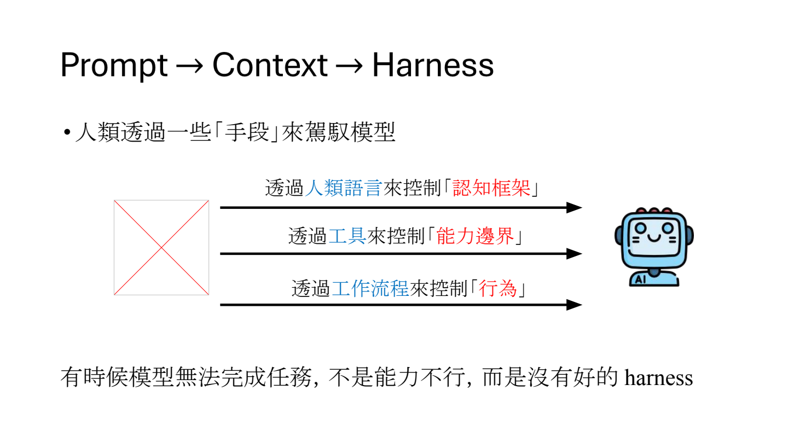
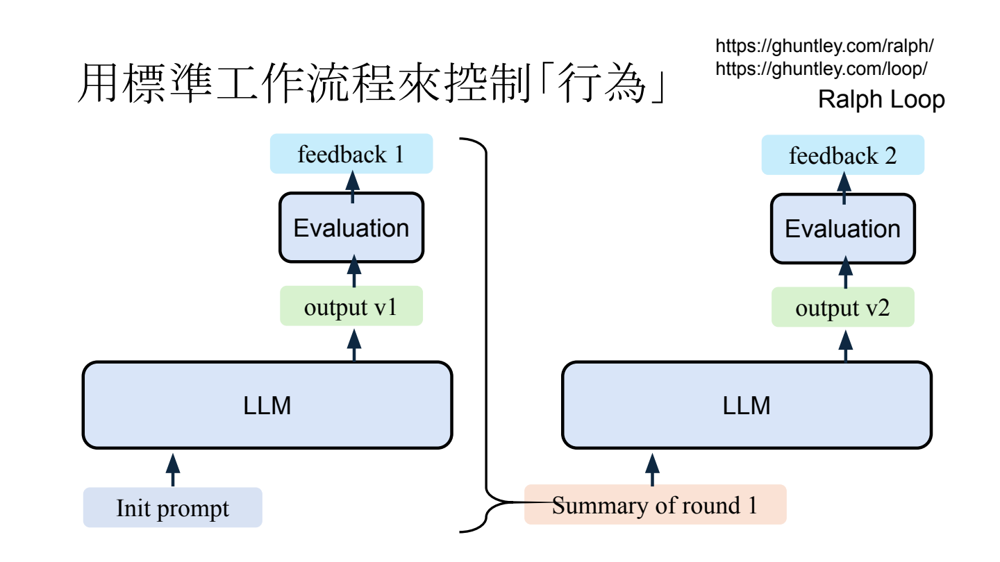
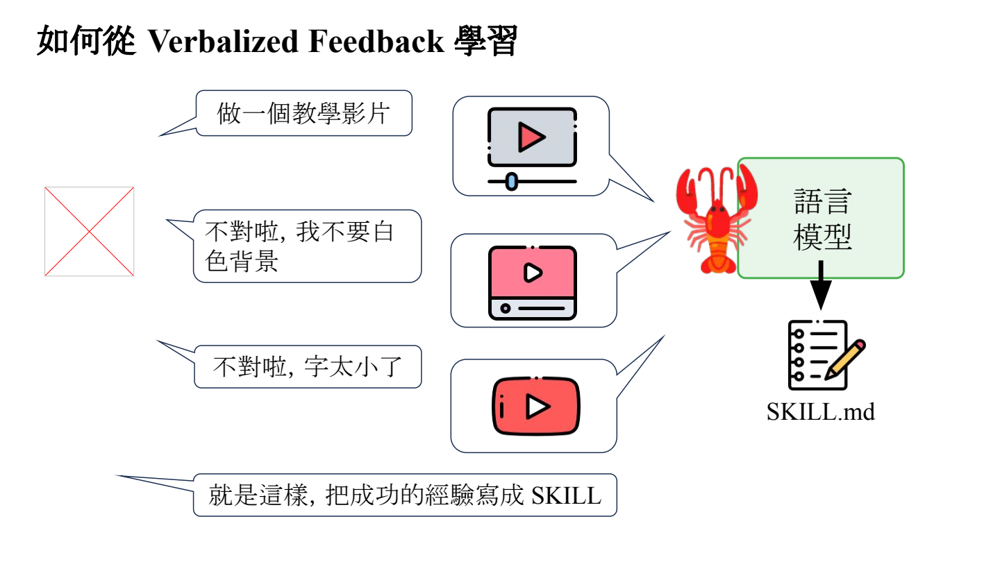
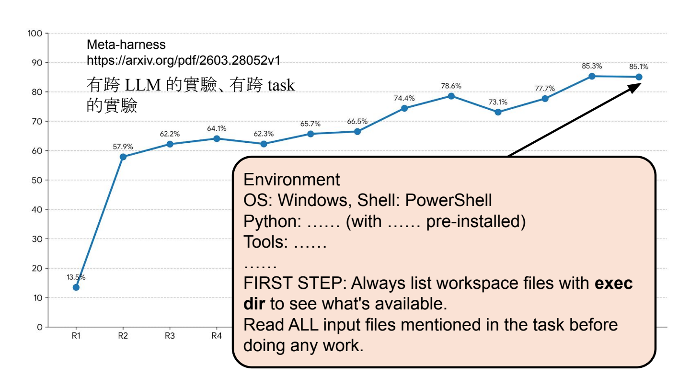

- Harness Engineering：不只让模型更聪明，也让它更会做事
	- [概念与例子：Slides 3–17](../../Slides/Unit3/harness.pdf#page=3)
	- **Harness（马具）**：包在 LLM 外面的规则、工具和执行流程，用来引导模型完成任务；Agent 的表现取决于模型，也取决于 Harness。
	- **Prompt → Context → Harness**：从写好指令，到组织上下文，再到管理工具调用、反馈及多轮执行；不只是换一段 system prompt。
	- 课件修 bug 的例子：模型原本没读文件就自己编写答案；加入**环境说明、先检查再修改的流程、明确的完成标准**后，才会读取文件、修改并运行测试。
	- 

- 用自然语言控制「认知框架」
	- [Slides 18–22](../../Slides/Unit3/harness.pdf#page=18)
	- 用 `AGENTS.md`、`CLAUDE.md` 等工作手册，把项目约定、环境、操作步骤及验收标准放进模型上下文。
	- **给地图，不是堆百科全书**：说明重要文件在哪里、如何测试、何时算完成，需要细节时再查对应文档。
	- 有规则不代表一定更好：课件实验中，不同模型、人工/LLM生成的说明，效果并不一致，应按实际任务验证。
		- 甚至有时候发现没有 AGENT.md 甚至可能有更好的 Success Rate
		- 有 AGENT.md 往往能让任务更快完成，主要是让 worst case 变好

- 用工具控制「能力边界」
	- [Slides 23–26](../../Slides/Unit3/harness.pdf#page=23)
	- 工具与权限决定 Agent **实际能读什么、能改什么**；限制访问目录、要求授权，比只在 prompt 中说“不要乱动”更直接。
	- **ACI（Agent-Computer Interface）**：工具接口也要为 Agent 设计，而不只是把人类的终端原样交给模型。例如：
		- **搜索先给摘要、结果过多时提示缩小范围；**
		- **编辑后自动 lint、立即返回错误**
		- **清晰、结构化的工具反馈能减少无效操作**

- 用标准工作流程控制「行为」
	- [Slides 27–34](../../Slides/Unit3/harness.pdf#page=27)
	- **Planner → Generator → Evaluator**：拆解任务、生成结果、独立检查，再根据反馈修改；不要把模型自称“完成”当作验收。 [A\\](https://www.anthropic.com/engineering/harness-design-longrunning-apps)
		- 往往 Generator 和 Evaluator 会在任务之初共同定义好验收标准再做，避免先做的结果 Evaluator 不认可
	- **Ralph Loop**：生成 → 评估 → 反馈 → 再生成；长任务也可以总结上一轮状态，再开启新上下文继续，避免历史不断膨胀。
	- 不同模型可能适合不同的上下文策略，不能假设同一套 Harness 对所有模型都最优。
	- 通过文字反馈改进下一轮输出，可类比“文字梯度 Texture Gradient”，但**没有做梯度下降，模型参数并未更新**
		- [Text2Grad](https://arxiv.org/abs/2505.22338) 这篇文章其实是执行了梯度更新的，与上面所说的 Texture Gradient 概念并不一致
		- 以下几篇论文的思想和更符合上述的Texture Gradient
			- [Reflexion](https://www.alphaxiv.org/abs/2303.11366)
			- [TextGrad](https://www.alphaxiv.org/abs/2406.07496?utm_source=extension&utm_medium=abstract-page) 
			-  [NLPG](https://arxiv.org/abs/2609.33379?utm_source=chatgpt.com) 
	
	- 

- 反馈要具体，不是越严厉越好
	- [Slides 35–42](../../Slides/Unit3/harness.pdf#page=35)
	- 课件展示情绪相关表征及 steering 实验：“desperate”方向可能增加 reward hacking，“calm”方向可能减少这类行为；这不等于模型具有人的主观情绪。
	- 实践启示：指出 **哪里错、有什么证据、应该如何修正**，不要只辱骂或施压；也不能把上述实验简单等同于“骂一次必然作弊”。

- Life-long Agent：把交互经验留下来
	- [Slides 43–53](../../Slides/Unit3/harness.pdf#page=43)
		- AutoDream --- Agent 在空闲的时候整理自己的记忆
	- 反馈可以是标准答案、数值奖励、用户的文字纠正，或程序报错等环境反馈；真实任务中，标准答案往往难取得。
	- **更新外部经验**：把成功做法与用户偏好整理成 `SKILL.md`，下次按需加载；这改变了上下文/Harness，不需要改模型参数。
	- **更新模型参数**：先利用后续反馈修正旧回答，再用修正结果作为训练目标，让模型不依赖当次反馈也能生成更好的结果；这才涉及梯度更新。
	- 

- Meta-harness：让 Agent 自动改进 Harness
	- [Slides 58–62](../../Slides/Unit3/harness.pdf#page=58)
	- 让一个 Agent 根据另一个 Agent 的测试结果，反复修改工作手册、提示与流程，而不只是人工调 prompt。
	- 课件中的有效改进很基础：**说明 OS / Shell / Python 环境，要求先列出工作区文件、读完任务输入，再开始工作**。
	- 要检查改进是否能迁移到其他模型、任务，不能只在反复调试的同一份测验上看分数。
	- 

- 评量 Agent 也有难度
	- [Slides 54–57](../../Slides/Unit3/harness.pdf#page=54)
	- 如 τ-bench，让 Agent 调用工具、遵守业务规则，并与模拟用户互动；评量的不只是单轮回答。
	- **Sim2Real Gap**：LLM 模拟用户可能比真人更配合、提供更多信息，互动方式也不同；模拟测试成绩不等于真实使用效果。
	- 总结：**语言给规则，工具定边界，流程管执行，反馈促改进**；最终仍需可靠验收及真实场景验证。
