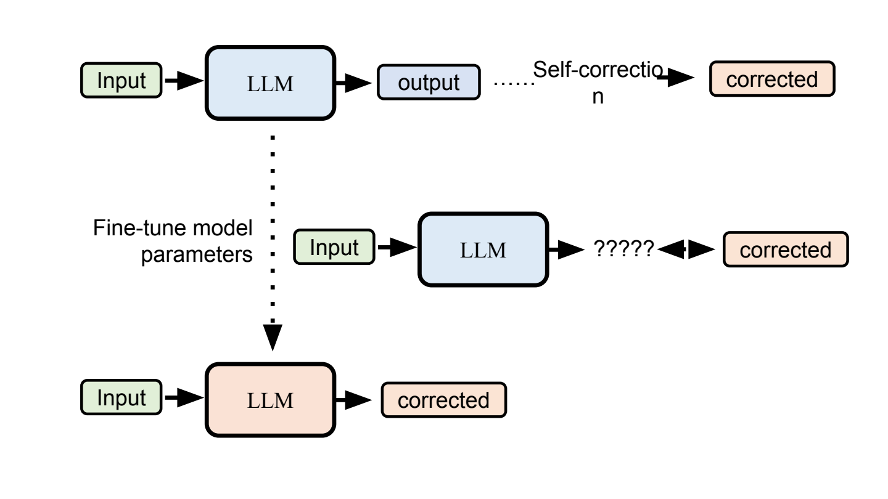
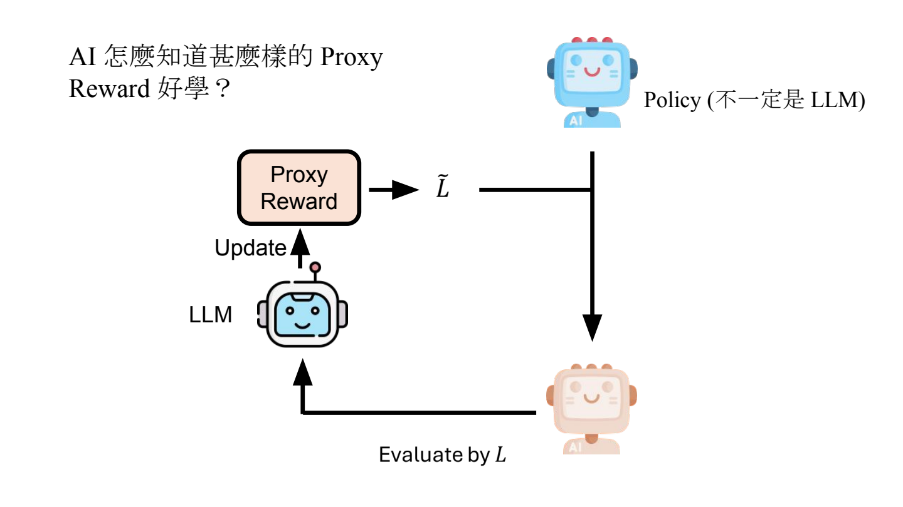
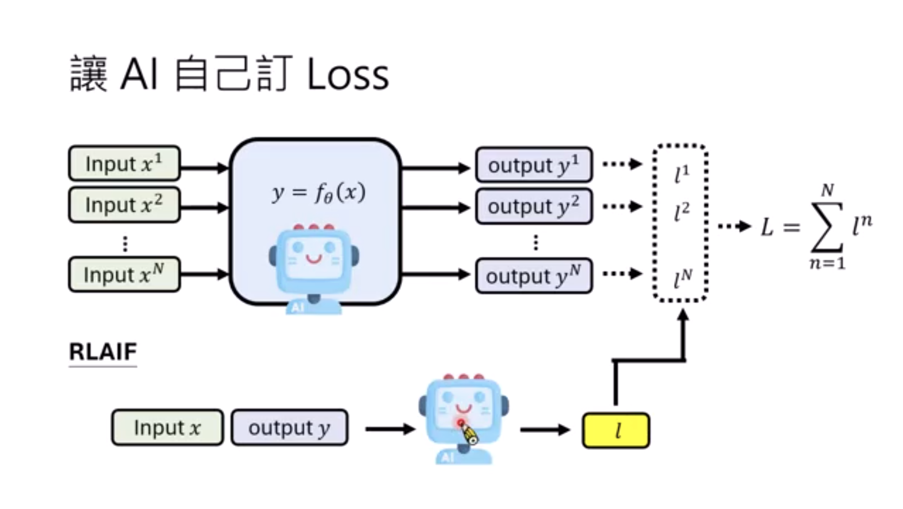
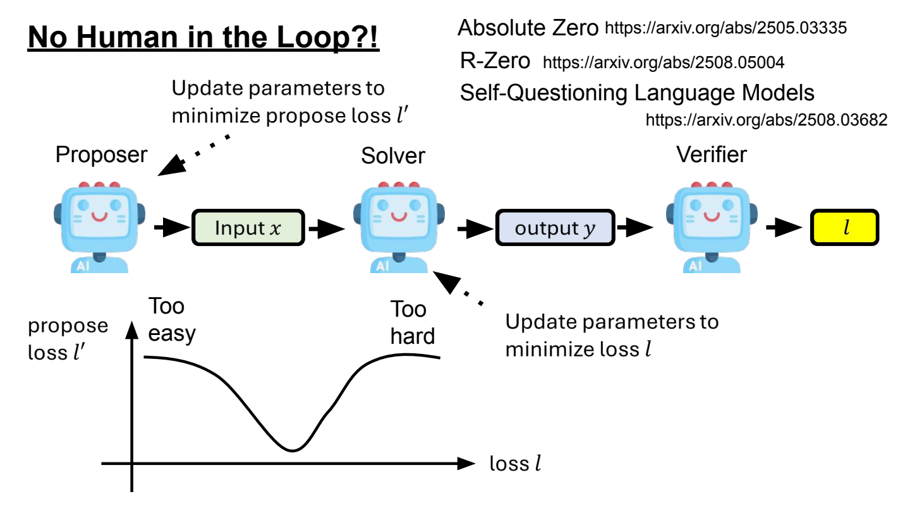

- Self-Improving：逐步把训练环节交给 AI
	- [Slides 2–10](../../Slides/Unit4/Self-Improving.pdf#page=2)
	- “AI 自我成长”没有统一边界，更像是**人类逐步放手**：答案、奖励、题目乃至训练方案，分别由谁提供？不能把部分自动化等同于完全无人参与。
	- 学习仍需要目标、可选择的模型/策略，以及选择或优化的方法；关键是哪些环节能由 AI 接手，又如何确认真的进步。

- 自己生成训练答案：把 Self-Correction 的结果留下来
	- [Slides 9–14](../../Slides/Unit4/Self-Improving.pdf#page=9)
	- 强模型生成答案、弱模型模仿，是 **Knowledge Distillation**；用自身生成并修正后的答案训练自己，才进一步走向**自训练**
	- Self-correction 与 Self-Improving对比
		- 仅在一次推理中修正答案，模型参数不会因此改变，下次仍可能重犯(self-correction)；把修正结果当监督目标微调，才把当次经验内化为参数(self-improving)
		- 自生成答案不自动等于正确标签，仍需筛选、验证；否则可能强化原本的错误。
	- 

- AI 做 Reward Shaping：让稀疏目标变得容易学习
	- [Slides 15–23](../../Slides/Unit4/Self-Improving.pdf#page=15)
	- 例如开门任务只在成功时给奖励，探索很难；可以给“接近门把、碰到门把”等中间进展设置 **Proxy Reward**。
	- AI Reward Shaping 的实践
		- **内层**用代理奖励训练 policy；**外层**用真实任务表现评价训练后的 policy，再让 LLM 修改代理奖励。Policy 不一定是语言模型。
		- 区分**优化用的代理目标**与**最终评量的真实目标**，避免只把代理分数做高，却没有真正完成任务。
	- [论文](https://arxiv.org/abs/2602.23876](https://arxiv.org/abs/2602.23876) 研究 Reward Shaping，自动寻找 Reward Function
	- 

- AI 自己提供评分 / Loss
	- [Slides 24–35](../../Slides/Unit4/Self-Improving.pdf#page=24)
	- **RLAIF**：用 AI 反馈替代部分人工反馈。
	- 三种主要方式
		- 可让模型直接打分（verbalized）
		- 多次生成后用多数答案形成伪标签（ensemble）
		- 用预测确定性构造信号（certainty）
			- **Entropy Minimization**：[论文](https://arxiv.org/abs/2505.15134)最小化 $H(Y\mid x)=-\sum_y p_\theta(y\mid x)\log p_\theta(y\mid x)$，让分布更集中，确实能够提升模型的表现；但“更确定”不等于“更正确”，多数共识也可能一起答错。
	- [AI 自己定损失分析论文](https://arxiv.org/pdf/2603.08660)
	- **Test-time Training（TTT）**：在测试样本或 batch 上构造无需真标签的 loss，更新模型参数后再作答
	- 课件的无监督训练实验并非一直进步，代理信号长期优化可能停滞或退化，需要外部评估
	- 

- 自回归熵最小化的数学原理
	- [Slides 36–43](../../Slides/Unit4/Self-Improving.pdf#page=36)
	- 序列熵可写成“沿生成路径累加各步条件熵”的期望；实际常只对采样到的一条路径上的 token 熵求梯度
		- $l(y)=E_{y\sim p_{\theta}(y|x)}[-log(p_{\theta}(y|x))]$
		- $\hat{l}(y)=\sum H(y_{1:i})$
		- $l(y)=E_{y\sim p_{\theta}(y|x)}(\hat{l}(y))$
		- $\nabla l=E_{y\sim p_{\theta}(y|x)}(\nabla\hat{l}) + E_{y\sim p_{\theta}(y|x)}(\hat{l}\nabla p_{\theta}(y|x))$
	- **期望中的路径采样分布依赖参数**：只对固定采样路径反传，会遗漏路径概率变化对应的梯度项，因此不等于完整序列熵的梯度，正常的序列熵梯度即最后一行公式分别表示 “让当前路径更确定”和“提高低熵路径的概率”

- 连题目也自己出：Proposer → Solver → Verifier
	- [Slides 44–50](../../Slides/Unit4/Self-Improving.pdf#page=44)
	- **Proposer** 出题，**Solver** 解题，**Verifier** 给训练信号；出题者也更新，倾向提供不太简单、也不至于完全不会的题，形成自动课程。
	- 课件例子包括 Absolute Zero、R-Zero、Self-Questioning；但 verifier 的可靠性、任务定义与环境仍是关键，不能直接等同于“无需任何外部信息”。
	- 长期自循环可能达到瓶颈或退化；引入外部资料、少量真实数据等，是进一步改善的方向
		- [论文](https://arxiv.org/abs/2510.24684)
		- [论文](https://arxiv.org/abs/2512.02472)
	- 

- 自动化训练研究：有进展，也要防止刷分
	- [Slides 51–61](../../Slides/Unit4/Self-Improving.pdf#page=51)
	- **PostTrainBench / FT-Dojo**：让 Agent 自动找数据、设计方案、训练和评估另一个模型；这与“自己无限递归升级”不是同一件事。
		- 风险包括用测试数据训练、违规调用其他模型、直接下载现成模型；分数提升不必然代表研究或学习真的成功。
	- **Weak-to-Strong Alignment**：研究较弱监督如何引导更强模型(人类比模型更弱，怎么给更强的模型提供监督)，[blog](https://cdn.openai.com/papers/weak-to-strong-generalization.pdf)发现不能简单假设教师能力决定学生上限，强学生可以超过弱老师，但是更好的监督信号往往能激发更强的效果
