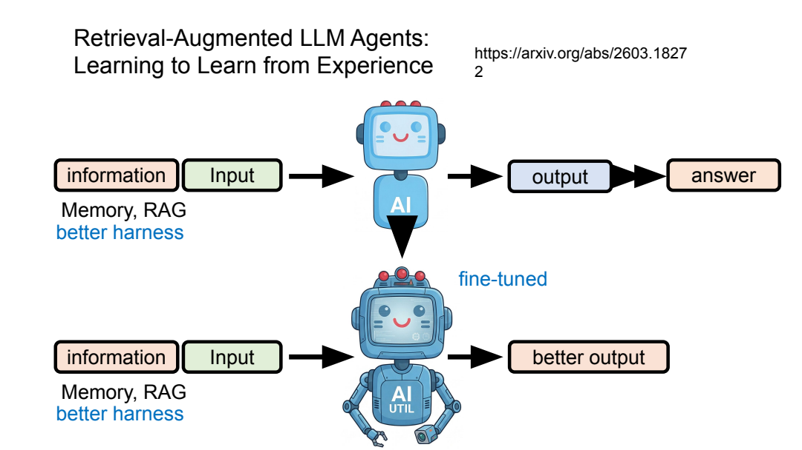
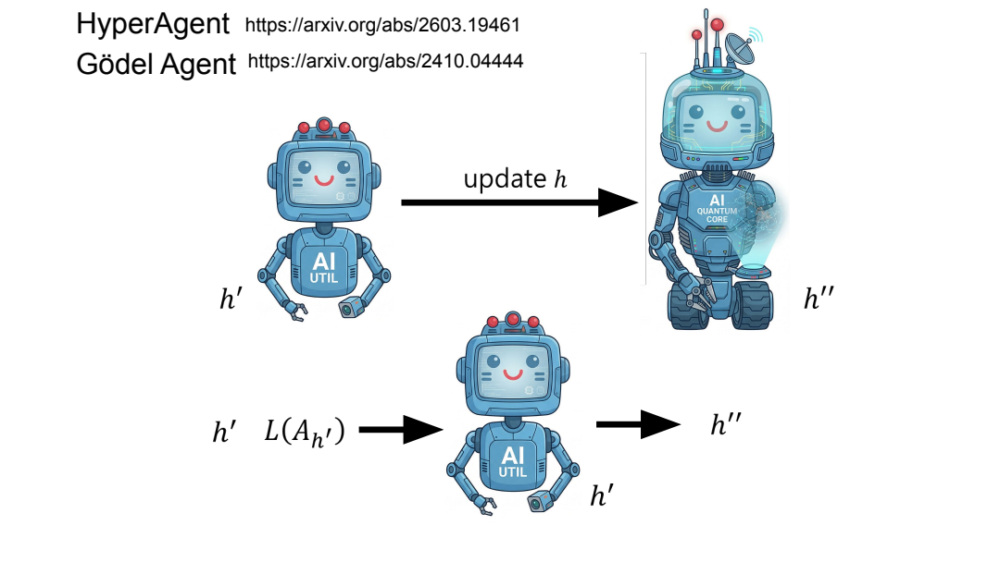
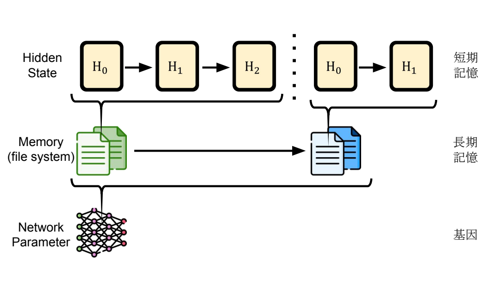
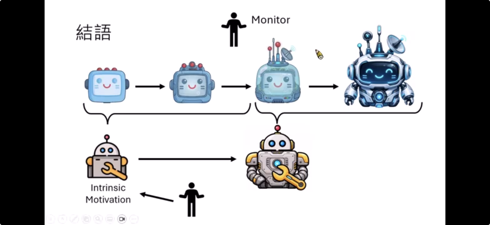

- Self-Evolving Agent：成长的不只是模型参数
	- [Slides 3–10](../../Slides/Unit4/self-evolving-agent.pdf#page=3)
	- **Agent = Harness + LLM**：记为 $A_{\theta,h}$，$\theta$ 是模型参数，$h$ 是 prompt、记忆管理、工具与工作流等外部机制。
	- 上一讲 主要讨论自动生成训练数据与信号；这一讲扩展到**改进 Harness，以及改进“如何改进”**。
	- Harness 常由文字、代码和流程组成，不能把课件中的“对 $h$ 求梯度”示意直接理解为普通反向传播，通常要靠生成、搜索与评估。

- 如何优化 Harness：生成候选 → 执行评估 → 保留有效改动
	- [Slides 11–18](../../Slides/Unit4/self-evolving-agent.pdf#page=11)
	- **Prompt Optimization**：根据已有提示与得分生成新提示
	- **GEPA 等方法**：结合执行反馈、反思与候选搜索(进化算法)，而不只是手工找一句“咒语”
	- 优化对象也可扩展到**记忆管理、工具代码及完整工作流**
	- 保留候选档案，从不同历史版本继续探索，而不是只沿一条路径反复修改
	- [DSPy](https://github.com/stanfordnlp/dspy) 和 [GEPA](https://arxiv.org/abs/2507.19457) 提供了框架能够直接做Agent的自进化，主要还是聚焦在 prompt optimization 上
- Harness 与参数可以协同改进
	- [Slides 19–24](../../Slides/Unit4/self-evolving-agent.pdf#page=19)
	- 协同进化
		- **Memory / RAG** 提供外部事实与经验（declarative knowledge）
		- **Fine-tuning** 可训练如何利用这些信息、如何行动（procedural knowledge），二者协同进化可能会得到更好的结果
		- [论文](https://arxiv.org/abs/2407.10930) 说明了这一点
	- 例如在检索信息辅助下得到好答案，再用相关输入和答案训练模型，让它更会利用同类信息
	- 

- 目标不断改变：适应新任务，也要避免遗忘
	- [Slides 25–32](../../Slides/Unit4/self-evolving-agent.pdf#page=25)
	- 旧任务的最佳 Agent 不一定适合新目标：全部重置太浪费，全部保留又可能过重，需要在复用与适应之间取舍
	- 两种极端做法
		- **逐样本重置的 TTT**：每次从基础模型适应新任务
		- **持续更新**：把在某个任务上适应后的模型直接适应新任务，而不重置
		- 两种做法的平衡[论文](https://arxiv.org/abs/2406.11064)
	- 遗忘不只发生在模型权重中，修改 Harness 也可能破坏旧能力；不能只测新任务提升，还应检查旧任务是否退化

- 改进“改进器”：从 Self-Improvement 到 Meta-Learning
	- [Slides 33–50](../../Slides/Unit4/self-evolving-agent.pdf#page=33)
	- **Improvement module** 决定如何修改 Agent；若它始终固定，成长仍受这套更新规则限制
	- **HyperAgent / Gödel Agent**：允许改进自身 Harness，连负责自我改进的部分也可修改
	- [Learning to Self-Evolve](https://arxiv.org/abs/2603.18620)是根据修改前后的效果，训练一个更会提出改动的模型
	- **自动化参数训练研究**：Agent 可以设计训练目标、数据与算法；SEAL 进一步用“自生成学习材料后，适应效果有没有变好”来训练生成材料的能力。
	- 可抽象为 $\theta_{t+1}=F(\theta_t;\phi)$：内层更新任务参数 $\theta$，外层学习更新机制 $\phi$，即 **Learn to Learn**，不是无限套娃就必然成功。
	- 

- 学习可以发生在不同载体与时间尺度
	- [Slides 49–56](../../Slides/Unit4/self-evolving-agent.pdf#page=49)
	- **Hidden state / 上下文状态**：快速、会随会话或状态重置；**Memory / 文件系统**：跨任务保存经验；**Network parameters**：通过训练内化能力。
	- 学习到的更新规则也可用于测试时的神经记忆；课件以 TTT layers、Titans、Nested Learning 等说明，“记忆”与“参数更新”不总是截然分开的概念。
	- 因此“参数没更新”不代表 Agent 没有积累经验；但要说明到底改变了什么、能保留多久，而不是笼统宣称模型变聪明了。
	- 

- Intrinsic Motivation：不只执行目标，也探索下一步学什么
	- [Slides 57–60](../../Slides/Unit4/self-evolving-agent.pdf#page=57)
	- [AlphaEvolve](https://arxiv.org/abs/2506.13131)
		- 从“整理材料、执行实验”到“主动寻找研究问题”，自主性还包括选择探索目标，而不只是优化给定任务
	- **Curiosity-driven** 用新颖性或预测误差等内在信号鼓励探索；**Empowerment** 关注行动影响未来状态的能力。它们是可设计的优化目标，不等于证明 AI 有人的主观欲望。

- 能力提升不等于目标对齐
	- [Slides 61–64](../../Slides/Unit4/self-evolving-agent.pdf#page=61)
	- 训练目标 $L(A,H)$、benchmark 等代理评价 $\hat L(A)$，都未必完整表达人的真实期望；持续自我优化可能把代理目标越做越极端
	- 课件用孔雀尾巴的演化作比喻：原本相关的指标，过度优化后可能偏离真正目的；更会优化，也可能更会钻评价漏洞
	- 总结：**同时检查能力、遗忘、泛化与对齐**；Self-Evolving 是研究方向，不等于已经实现无边界、可靠的自主成长

	- 