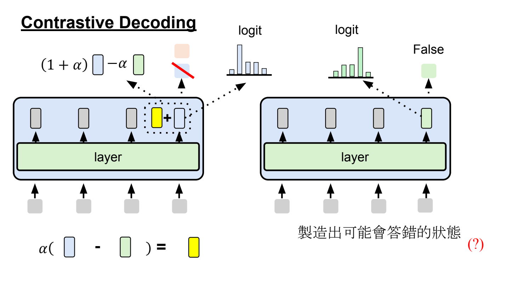
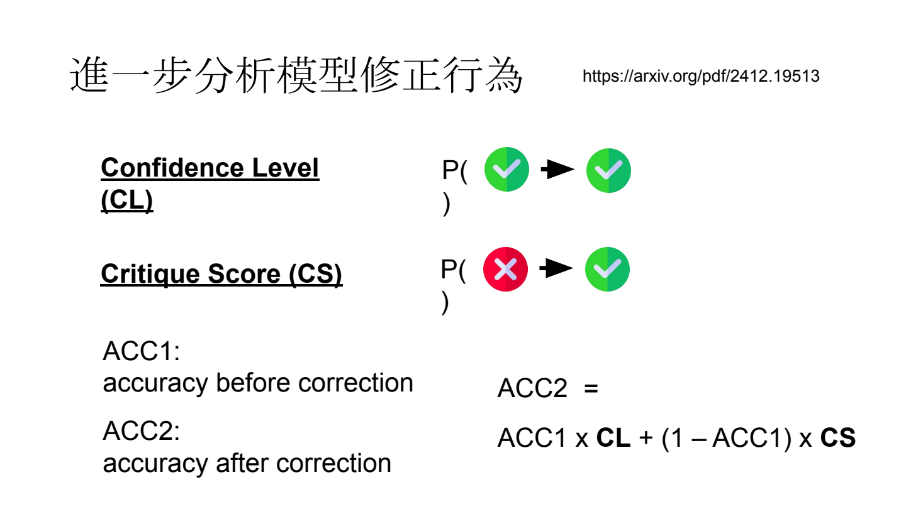
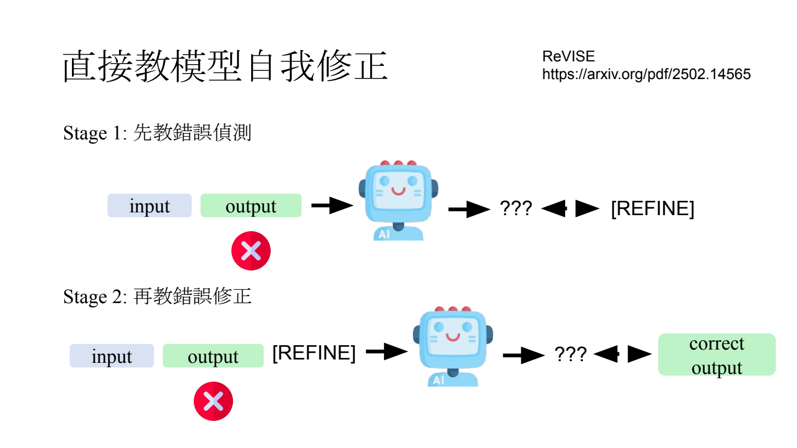

- Self-Correction：先发现错误，再修正当前答案
	- [概念与三条路线：Slides 2–7](../../Slides/Unit4/Self-Correction.pdf#page=2)
	- 三种方法重点是**让当前输出变好**:
		- 可以修改推理时的计算 --- Contrastive Decoding(强弱提强)
		- Harness 工作流 --- Reflection
		- 训练模型内化修正能力 --- REVISE&RLVR
	- 知道正确知识，不代表会发现自己答错；“能生成答案”和“能检验答案”也是不同能力。

- 修改 Inference：远离容易出错的预测
	- [Slides 8–30](../../Slides/Unit4/Self-Correction.pdf#page=8)
	- 从正确和错误样本的 hidden states 提取方向并干预（如 TruthX），但需要额外数据，且需要训练 error detection 头
	- 另一条路线是 **Contrastive Decoding**。
		- **基本思想**：构造正常分支与较弱的分支，对 logits 做对比；课件中的常见形式为 $z'=(1+\alpha)z_{\text{normal}}-\alpha z_{\text{weak}}$，再做 softmax。
		- **Contrastive Decoding**：对比大、小模型最后的 logits，大模型更强，小模型较弱，以此提高大模型的表现
		- **DoLa**：DoLa 用 logit lens 将中间层表示转成词表分数，这样它通过深浅层之间做对比就好(深层比浅层更强，但是具体是哪一层被选这个具体看论文) ，以此提高模型最终的表现
		- **ICD / CAD**：分别用误导指令、移除检索文档构造对比分支；
		- **VCD / AAD** 则破坏或移除图像、声音，抑制只靠语言先验的幻觉。
		- **MTI**：只在高熵、低置信度等关键位置介入，并用短负面提示与共享前缀 KV Cache 降低开销；
		- **上述方法** 基本都是改在最后的 logits 上(除了DoLa)，但也有其他方法改 hidden states 或 attention，而不只改 logits
		- 优点是不必更新模型权重；代价是额外计算，而且对比分支与强度要选好。
	- 

- 修改 Harness：生成 → 检查 → 修正，不保证越改越好
	- [Slides 32–43](../../Slides/Unit4/Self-Correction.pdf#page=32)
	- 在初答后加入“再检查一下”等 reflection instruction，给模型重新生成答案的机会；
	- **仅靠内部反思**与**获得外部反馈**的效果应分开评量，[论文]([https://arxiv.org/pdf/2510.16062](https://arxiv.org/pdf/2510.16062))发现 **外部反馈** 往往能对修正答案起到更大作用
	- 既要把错的改对，也要避免把对的改错；这里的 CL 是正确答案保留率
		- 同时关注两种转移：$CL=P(\text{修正后对}\mid\text{原本对})$，$CS=P(\text{修正后对}\mid\text{原本错})$。
		- 修正后准确率：$ACC_2=ACC_1\cdot CL+(1-ACC_1)\cdot CS$。
	- 不同的 Reflect Instruction 对于最终的效果也有影响
		- “你应该是对的”偏向保留答案
		- “你确定吗”偏向修改，可能在 CL 与 CS 之间产生取舍；
		- 明确指出修正方向，往往比泛泛要求反思更有帮助。
	- 检查也花算力，应在**相同计算预算**下，与多次独立生成、majority vote 等基线比较，不能只看修正后的分数。
	- 

- 修改模型参数：直接教会“何时改、怎样改”
	- [Slides 45–50](../../Slides/Unit4/Self-Correction.pdf#page=45)
	- 把外部工作流内化为模型的 reasoning：不再只靠程序插入“请反思”，这样模型能够在需要反思的时候才反思，一定程度上可以节省测试时开销
	- **ReVISE**：先训练错误检测，决定输出 `[REFINE]` 还是 `[END]`；再训练遇到错误时生成正确修订。
	- 难点是**训练与推理的状态分布不同**：模型升级后，自己产生的错误也会改变，只在旧错误上训练，未必能修正新错误。
	- 

- RLVR：通过最终答案奖励，学会尝试、验证与换思路
	- [Slides 52–64](../../Slides/Unit4/Self-Correction.pdf#page=52)
	- **Reinforcement Learning with Verifiable Reward**：用可自动验证的最终结果给奖励，不必逐步标注完整推理；生成过程中可能学会 propose → verify → refine。
	- 中间步骤给模型更多计算机会，也能把复杂映射拆成较简单的步骤
	- RL 究竟是提高已有正确路径的采样概率，还是学出新思路，[论文](https://arxiv.org/abs/2510.04028) 提到，可能前期是在学习提高已有路径，后期会学新思路
		- 它们的验证方式是 结合 pass@k 等结果看能力覆盖，即让RL前和RL后的采样多条，看采样够多的时候二者是否表现一致
	- 总结：**纠错需要可靠信号，也需要控制误改与计算成本**；