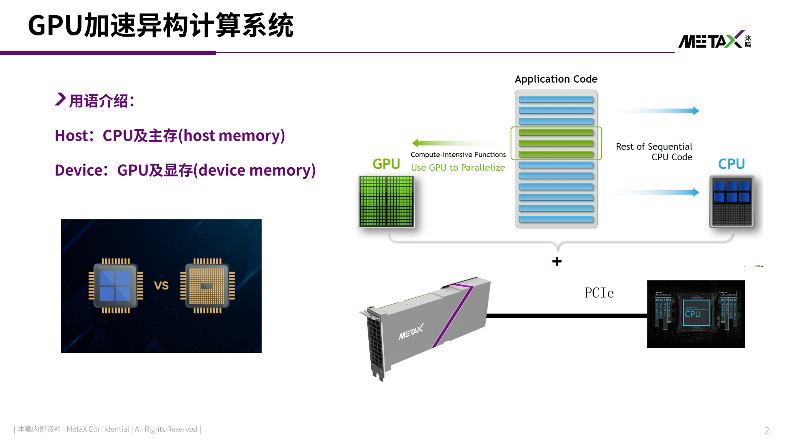
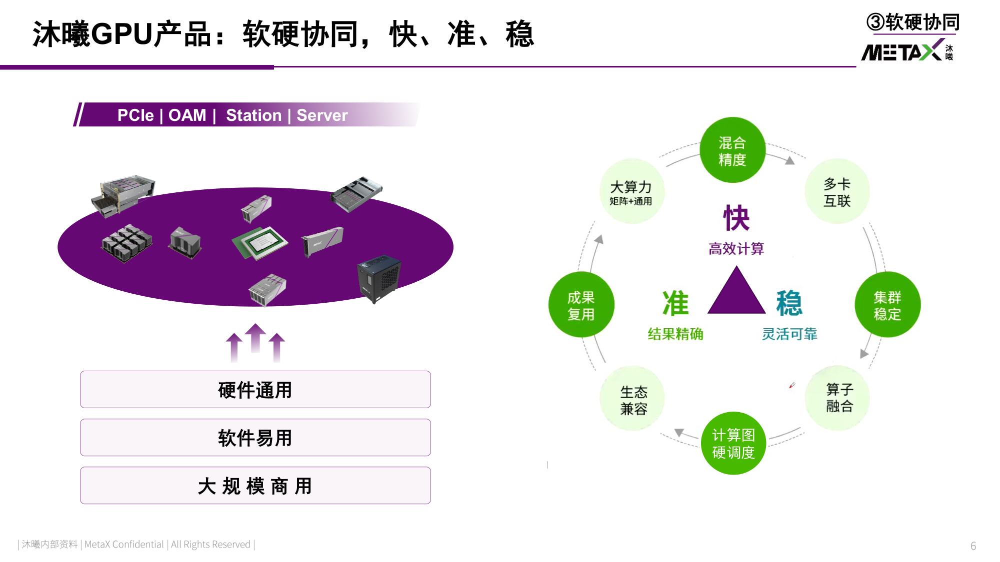
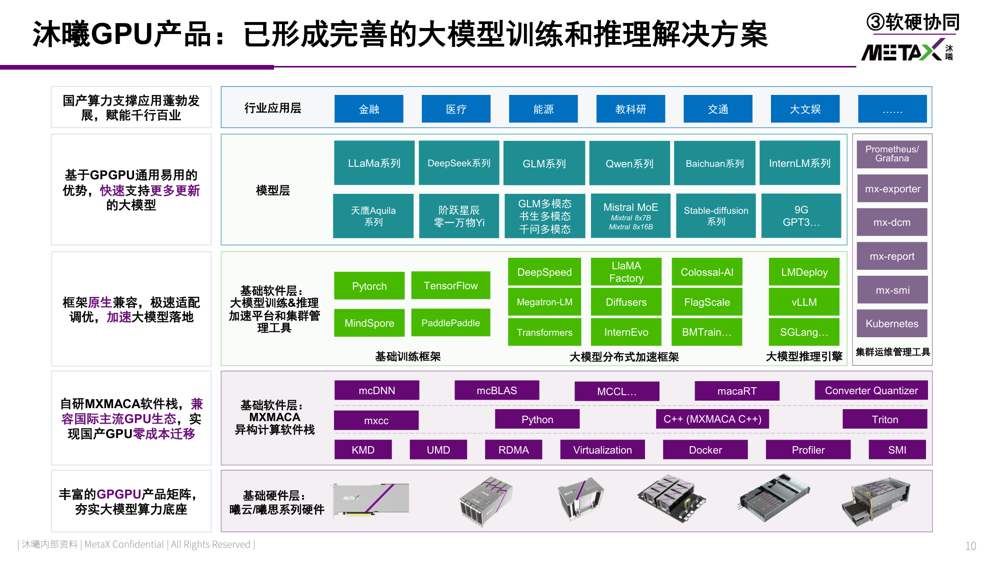
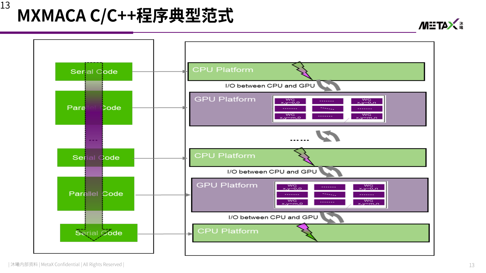
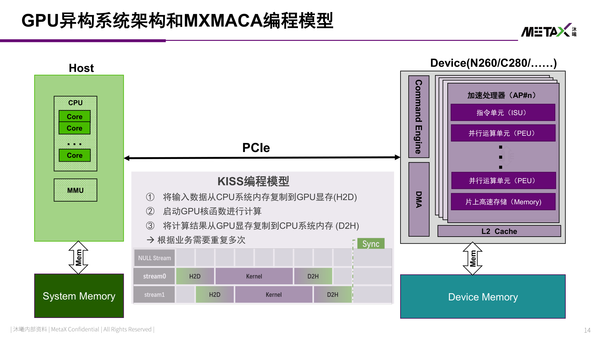
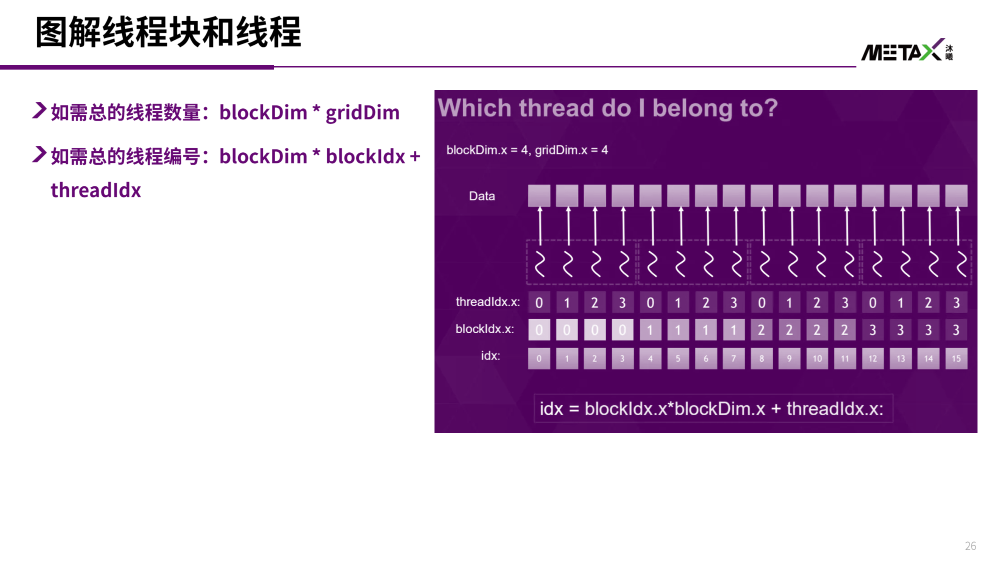
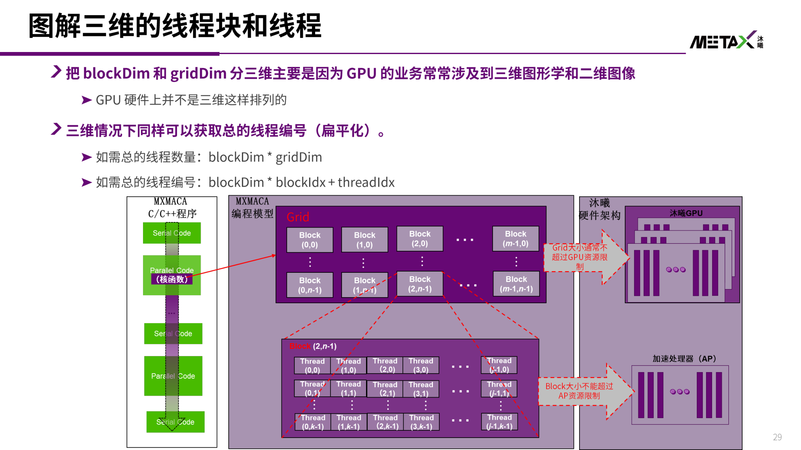
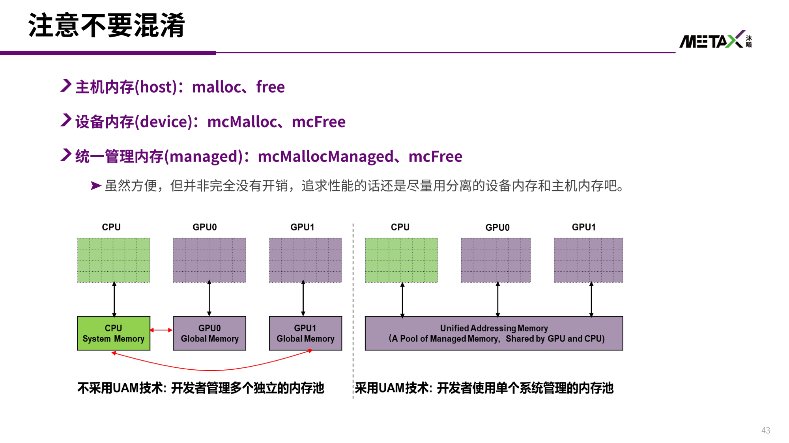
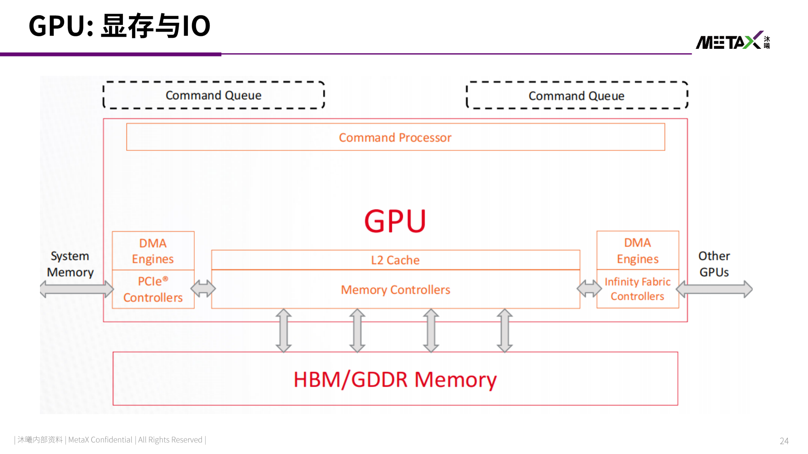
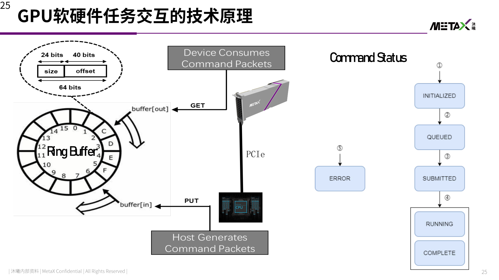

>[!notice] 本节重点
>- 从 CUDA 视角迁移到国产 GPU：理解 **MXMACA** 的定位（兼容 CUDA 生态 + 开源开放）
>- 掌握 GPU 异构系统的 **Host/Device** 分工与 **KISS 编程模型**
>- 掌握 MXMACA C/C++ 的核心语法：函数修饰符、线程层次、内存模型
>- 与 L3(MUSA)、L4(CUDA) 对照，理解国产 GPU 生态"兼容 + 自研"的统一思路

> [!info] 参考材料
> - 《【第3节】曦云GPU产品和MXMACA编程基础》
> - 《【课前预习2】MXMACA编程基础》（另有英文版 *GPU Programming with MXMACA Part 1*）
> - 沐曦官方：Gitee 示例代码 `mxmaca-courses-zju`、Web 实验平台 `compiler.metax-tech.com`、电子教材 `maca-school.metax-tech.com`

## 异构系统与国产 GPU 生态

### 为什么会有异构系统

CPU 只擅长串行逻辑，面临"三重复杂性"，需要 GPU 分担算力密集的计算：

| 问题 | 对应环节 |
| ------------ | ------------------- |
| 难开发 | 程序员直面复杂性（函数库 / 汇编） |
| 低性能 | 编译器 / 运行时的性能损失 |
| 不兼容 | ISA / Hardware API 特化（架构师） |
| 复杂的硬件机制 | 并行性 Parallelism、定制化 Specialization、分布式 Distribution（硬件设计） |

- ==GPU 异构系统 = CPU 多核 + GPU 众核的并行计算加速系统==
- CPU 为**串行任务**优化（x86 / ARM / PowerPC），GPU 为**并行任务**优化
- 典型收益：**10+ 倍性能提升，5+ 倍能耗节约**



- 术语约定（贯穿全课）
	- **Host**：CPU 及其内存（host memory / 主机内存）
	- **Device**：GPU 及其内存（device memory / 显存）
	- 二者通过 **PCIe** 连接

### NVIDIA 提升算力的四条路线

> 理解 NVIDIA 的演进方向，就能理解国产 GPU 需要追赶什么

- **工艺制程演进**：14/16nm → 7nm → 4nm
- **面向 AI 优化的架构**：单纯堆 CUDA Core → 加入 Tensor Core
- **领域定制加速单元**：为特定算子做专用硬件
- **高带宽域 GPU 互联**：NVLink / NVSwitch，多卡像一颗芯片
- 配套 **软件工具链支持**（CUDA 生态）—— 这才是真正的护城河

> [!quote] GPU 护城河
> 各种应用均能充分发挥硬件能力的**软件生态**。芯片可以追，生态最难追。

### 路线之争：A / B / C 三种体系

- 一是追赶兼容美国主导的 **A 体系**
- 二是构建专用封闭的 **B 体系**
- 三是全球共建开源开放的 **C 体系**

沐曦产品软件设计选择了 **"兼容 + 自主 + 开放"** 的组合：

| 模式 | 类比 | 含义 |
| ---------- | ---- | --------------------------- |
| 兼容 | 高铁模式 | 兼容 CUDA，促进技术交流，加速创新，同时保持与现有技术兼容 |
| 自主 | 北斗模式 | 自主可控、确保安全，但生态相对较弱，注重技术独立性 |
| 开放 | 5G 模式 | 开源开放，通过产学研共建生态，强调合作和广泛的生态系统建设 |

### 沐曦 GPU 产品与软件栈

- **曦云 (Xiyun)** 系列：通用计算 GPU（训练/科学计算）；**曦思 (Xisi)** 系列：面向推理
- 产品形态：**PCIe | OAM | Station | Server**，从板卡到整机全覆盖
- 关键词：**硬件通用、软件易用、大规模商用**；**快**（大算力、混合精度、多卡互联）、**准**（结果精确、算子融合）、**稳**（灵活可靠、集群稳定、生态兼容）



软件栈自下而上（大模型训练与推理全栈方案）：

| 层次 | 主要内容 |
| ---------- | ------------------------------------------------------------------------------------------------- |
| 模型层 | LLaMA、Qwen、Baichuan、GLM、DeepSeek、Mixtral、InternLM、Stable-Diffusion、多模态模型 |
| 框架层 | PyTorch / TensorFlow / PaddlePaddle / MindSpore；DeepSpeed / Megatron-LM / Colossal-AI / BMTrain；vLLM / LMDeploy / SGLang / LLaMA-Factory |
| 基础软件层 | 加速平台与集群管理工具（mx-dcm、Kubernetes、Prometheus/Grafana、mx-smi） |
| **异构计算软件栈 MXMACA** | 编译器 `mxcc`、math 库 `mcBLAS`、DNN 库 `mcDNN`、通信库 `MCCL`、运行库 `macaRT`、`Converter` / `Quantizer`、多语言前端（MXMACA C++ / Triton / Python） |
| 底座 | KMD / UMD / RDMA / Profiler / Virtualization / Docker / SMI |
| 硬件层 | 曦云 / 曦思系列硬件 |



- ==自研 MXMACA 软件栈，兼容国际主流 GPU 生态，实现国产 GPU 零成本迁移==
- 迁移手段：`cu-bridge` / `cucc` 把 CUDA 源码/API 映射到 MACA（与 L3 中 MUSA 的 `musify` 思路一致）

## GPU 异构系统架构与 MXMACA 编程模型

### MXMACA 是什么

**MXMACA = MetaX Advanced Compute Architecture**

- **MXMACA Architecture**：GPU 异构并行计算系统原理 + GPU 加速通用计算编程模型
- **MXMACA C++**：
	- 编程接口：基于行业标准接口（CUDA）进行扩展
	- 异构编程：支持标准 C++ 语言并进行拓展
	- 简洁的 API：用于管理设备、内存等
- 学习前置条件：学过 C/C++；理解 `malloc/free` 等概念；使用过 Linux 环境与基本命令

### 程序典型范式：串行与并行交替

一个 MXMACA 程序 = CPU 串行代码与 GPU 并行代码交替执行的多段结构，中间穿插 CPU↔GPU 的 I/O：

```text
   串行化源码                        执行端
 ┌──────────────┐
 │ Serial Code  │ ────►  CPU Platform  ─┐
 ├──────────────┤                       │ I/O between CPU and GPU
 │ Parallel Code│ ────►  GPU Platform  ─┘  (内核 grid/block/thread)
 ├──────────────┤
 │ Serial Code  │ ────►  CPU Platform
 ├──────────────┤              ⋮  重复多次
 │ Parallel Code│ ────►  GPU Platform
 ├──────────────┤
 │ Serial Code  │ ────►  CPU Platform
 └──────────────┘
```



### 硬件结构与 KISS 编程模型



- Device 侧硬件（以 N260/C280 为例）：
	- **Command Engine**（指令引擎）+ **DMA**：接收并搬运命令/数据
	- 多个 **加速处理器 AP#n**：每个含 **指令单元 ISU** + 多个 **并行运算单元 PEU** + **片上高速存储 Memory**
	- **L2 Cache**：多 AP 共享；再往下是 Device Memory
- Host 侧：CPU（多 Core）+ **MMU** + System Memory

> [!tip] KISS 编程模型
> **K**eep **I**t **S**imple and **S**tupid —— 三步走：
> 1. 将输入数据从 CPU 系统内存复制到 GPU 显存（**H2D**，Host to Device）
> 2. 启动 GPU 核函数进行计算（Kernel）
> 3. 将计算结果从 GPU 显存复制回 CPU 系统内存（**D2H**，Device to Host）
>
> → 根据业务需要重复多次；用 **Stream + Sync** 组织异步流水。

### C++ 到 MXMACA C++：一个向量加法

CPU 版本（串行 for 循环）：

```cpp
void add(int n, float *x, float *y, float *z) {
    for (int i = 0; i < n; i++)
        z[i] = x[i] + y[i];
}
```

移植到 GPU 的核心思想：**One thread per vector element**（每个线程负责一个元素），把 `for` 循环"展开"到硬件线程上。

GPU 版本（徒步蜗牛版，只开 1 个线程，串行）：

```cpp
__global__ void add(int n, float *x, float *y, float *z) {
    for (int i = 0; i < n; i++)
        z[i] = x[i] + y[i];
}

int main(void) {
    int array_size = 1 << 20;   // 1M elements
    float *x, *y, *z;
    mcMallocHost(&x, array_size * sizeof(float));   // 申请内存
    mcMallocHost(&y, array_size * sizeof(float));
    mcMallocHost(&z, array_size * sizeof(float));
    for (int i = 0; i < array_size; i++) { x[i] = 1.0f; y[i] = 2.0f; }

    add<<<1, 1>>>(array_size, x, y, z);   // 计算
    mcDeviceSynchronize();               // 等待 GPU 执行完毕

    mcFreeHost(x); mcFreeHost(y); mcFreeHost(z);   // 释放内存
}
```

- `mcMallocHost` 分配的内存位于 CPU 侧，**CPU 与 GPU 都可访问**（`mc***` 系列都调用 METAX MACA 驱动）
- `__global__` 表明该函数在 GPU 上运行，且可由 CPU 调用
- `<<<1, 1>>>` 表示只启动 1 个线程块、1 个线程
- `mxcc` 编译器负责编译带 `__global__` 标记的函数

### CPU 异步调用 GPU

> [!warning] 异步调用是理解 MXMACA 的第一道坎
> GPU 上的 kernel 调用是**异步**的：CPU 发出 `kernel<<<...>>>()` 后**立即返回**，只是把任务推入 GPU 执行队列，并不会等它算完。

```text
CPU:  cudaMallocHost(...)  vector_add   cudaDeviceSynchronize()   读 z[0]   cudaFreeHost(...)
                              │                ▲
                              ▼ (异步下发)      │ (同步等待)
GPU:  ────────────────────[ vector_add ]───────┘────────────────────────► 时间
```

- **同步函数调用**：程序等待函数返回后再向下执行（CPU 上所有 C++ 函数都是同步调用）
- **异步函数调用**：程序不等待函数返回，直接向下执行（`vector_add<<<1,1>>>`）
- 如果去掉 `mcDeviceSynchronize()`：`vector_add` 还没在 GPU 上算完，CPU 就会去读 `z[0]`，读到错误数据
- 好处：**CPU 和 GPU 可以并发执行不同任务**（CPU 做串行逻辑，GPU 做并行计算）

## MXMACA 编程基础

### 第 0 章：Hello, world!

MXMACA 编译器**完全兼容 C++17**（含新特性），MXMACA 与 C++ 的关系就像 C++ 与 C 的关系：

- 可以方便地重用现有 C++ 代码库、引用 C++ 头文件
- **host 代码和 device 代码可以写在同一个文件内，也可以拆到不同文件**

```cpp
#include <cstdio>
#include <mc_runtime.h>

__global__ void kernel() {
    printf("Hello, world!\n");
}

int main() {
    kernel<<<1, 1>>>();       // 三重尖括号语法
    mcDeviceSynchronize();     // 不写这句就不会打印
    return 0;
}
```

> [!warning] 没有反应？同步一下！
> `kernel<<<1,1>>>()` 只是把任务推入 GPU 队列就立即返回，`printf` 可能还没执行程序就退出了。
> 因此要调用 `mcDeviceSynchronize()`，让 CPU 陷入等待，直到 GPU 完成队列中所有任务再返回。

### 函数修饰符：谁在哪里运行

| 修饰符 | 运行位置 | 由谁调用 | 调用语法 | 返回值 |
| -------------------------- | ------- | -------- | ---------------- | -------- |
| `__global__` | GPU（核函数） | CPU | `kernel<<<grid, block>>>()` | **必须 void** |
| `__device__` | GPU | GPU | 普通函数调用 | 可有 |
| `__host__` | CPU | CPU | 普通函数调用 | 可有 |
| 无修饰符 | 默认等于 `__host__` | CPU | 普通函数调用 | 可有 |
| `__host__ __device__` | 两者都可 | 两者都可 | 视上下文 | 可有 |

- **调用关系**：host 可以调用 `__global__`；`__global__` 可以调用 `__device__`；`__device__` 可以互相调用
- 不写修饰符默认就是 `__host__`，即 CPU 上的函数

```cpp
__device__ void say_hello() { printf("Hello, world from GPU!\n"); }
__host__   void say_hello_host() { printf("Hello, world from CPU!\n"); }

__global__ void kernel() { say_hello(); }

int main() {
    kernel<<<1, 1>>>();
    mcDeviceSynchronize();
    say_hello_host();
}
```

- **双重修饰 `__host__ __device__`**：同一个函数既能在 CPU、也能在 GPU 上运行，两边都能调用

### 内联函数

> [!note] 澄清 `inline`
> 现代 C++ 中 `inline` 的效果是声明一个 **weak 符号**，与"性能优化意义上的内联"（把函数体直接塞到调用处）**无关**。

MXMACA 编译器提供的关键字：

| 关键字 | 作用 | GCC 对应 |
| ---------------- | ---------------------- | --------------------------- |
| `__inline__` | 声明为内联（不保证一定内联） | `__attribute__((inline))` |
| `__forceinline__` | **强制**内联 | `__attribute__((always_inline))` |
| `__noinline__` | 禁止内联优化 | — |

### constexpr 函数自动变成 CPU+GPU 都能用

- 加上编译选项 `--expt-relaxed-constexpr` 后，`constexpr` 函数相当于自动带上了 `__host__ __device__`
- 动机：`constexpr` 通常是一批可内联的小函数（数学计算等），一个个加修饰符太累
- 用 CMake 生成器表达式只对 `.cpp` 开启（否则传给 gcc 会报错）：

```cmake
target_compile_options(main PUBLIC $<$<COMPILE_LANGUAGE:CPP>:--expt-relaxed-constexpr>)
```

> [!warning] 不能完全替代 `__host__` / `__device__`
> `constexpr` 里不能调用 `printf`，也不能用 `__syncthreads` 之类的 GPU 特有函数。

### 多段编译与 `__MACA_ARCH__`

> [!tip] MXMACA 编译器具有**多段编译**特点
> 同一段代码会被**预处理很多次**：
> 1. 先送给 CPU 上的编译器（通常是系统 gcc）生成 **CPU 部分**指令码
> 2. 再送给真正的 GPU 编译器生成 **GPU 指令码**
> 3. 最后链接成一个文件，看起来好像只编译了一次

- 在 GPU 编译模式下会定义 `__MACA_ARCH__` 宏，用 `#ifdef` 即可让同一函数针对 CPU/GPU 生成**两份源码级不同**的代码：

```cpp
__host__ __device__ void say_hello() {
#ifdef __MACA_ARCH__
    printf("Hello, world from GPU!\n");
#else
    printf("Hello, world from CPU!\n");
#endif
}
```

- ==`__MACA_ARCH__` 是一个整数的架构版本号==，**编译时**指定，而非运行时检测
	- 默认值为 `1000`，对应 `xcore1000`，可兼容**所有曦云系列 GPU**
	- 其它版本：`1010` → `xcore1010`，`1020` → `xcore1020` …

```cpp
#if   __MACA_ARCH__ == 1000
    printf("Device code path for xcore1000!\n");
#elif __MACA_ARCH__ == 1010
    printf("Device code path for xcore1010!\n");
#elif !defined(__MACA_ARCH__)
    printf("Host code path!\n");   // CPU 编译时
#endif
```

### 第 1 章：线程与线程块

#### 三重尖括号里的数字

- 把 `<<<1,1>>>` 改成 `<<<1,3>>>`，`Hello, world!` 会打印 **3 遍**
- ==三重尖括号里的**第二个参数**决定启动 kernel 时所用的 GPU **线程数量**==
- GPU 为并行而生，可以开启大量线程处理大吞吐量数据

#### 内置变量

| 变量 | 含义 |
| --------------- | ------------------------- |
| `threadIdx` | 当前线程在**线程块内**的编号（从 0 开始） |
| `blockDim` | 当前线程块中的**线程数量** |
| `blockIdx` | 当前**线程块的编号** |
| `gridDim` | **线程块总数** |

```cpp
__global__ void kernel() {
    printf("Block %d of %d, Thread %d of %d\n",
           blockIdx.x, gridDim.x, threadIdx.x, blockDim.x);
}
int main() { kernel<<<2, 3>>>(); mcDeviceSynchronize(); return 0; }
```

- 启动 2 个线程块、每块 3 个线程 → 共 2×3 = 6 个线程
- ==线程块之间高度并行，不保证执行先后顺序==（可能 Block 1 先于 Block 0 执行）
- 线程之间同样不保证顺序（输出看起来"乱"）

#### 概念层级

```text
网格 Grid  ── 指整个任务，包含若干线程块
   └── 线程块 Block ── 包含若干线程；1 个 Block 只能装进 1 个 SM
          └── 线程 Thread ── 并行的最小单位
```

- 调用语法：`kernel<<<gridDim, blockDim>>>()`
- 从属关系：**线程 < 线程块 < 网格**
- 类比（不完全等同）：GPU 的**线程块** ≈ CPU 的**线程**；GPU 的**线程** ≈ CPU 的 **SIMD**

#### 扁平化（Flatten）索引

- 总线程数量：`blockDim * gridDim`
- 全局线程编号：`blockDim * blockIdx + threadIdx`

```cpp
__global__ void kernel() {
    unsigned int tid  = blockDim.x * blockIdx.x + threadIdx.x;
    unsigned int tnum = blockDim.x * gridDim.x;
    printf("Flattened Thread %d of %d\n", tid, tnum);
}
```



- 还有 `threadIdx.y / .z`、`blockIdx.y / .z` 等成员，即"扁平化"只是把多维下标折算成一维

#### 三维线程块

- 靠 `dim3(x, y, z)` 指定，构造函数接受 3 个 `unsigned int`：

```cpp
kernel<<<dim3(2, 1, 1), dim3(2, 1, 1)>>>();
```

- **二维**：把 `dim3` 最后一位（z）设为 1 即可，相当于 `<<<m, n>>>` 就是 `<<<dim3(m,1,1), dim3(n,1,1)>>>` 的简写，不会有性能损失
- 为何分三维：GPU 业务常涉及三维图形学和二维图像；==但 GPU 硬件上并不是三维排列的==，所以逻辑上仍可扁平化
- 三维下同样：总线程数 `blockDim * gridDim`，总编号 `blockDim * blockIdx + threadIdx`



#### 分离 `__device__` 函数的声明与定义 → 出错

> [!warning] GPU 函数必须定义在同一个文件里
> 试图把 `__device__` / `__global__` 的声明与定义拆到不同文件会报 **undefined symbol**（可以理解为默认不做跨文件链接）。
> 建议把相互调用的 `__device__` 函数放在同一个文件，也方便编译器自动内联优化。

#### 进一步：核函数调用核函数（动态并行）

- `__global__` 可以调用另一个 `__global__`，且**三重尖括号里的线程块和线程数可以动态指定**，无需先回传到 CPU
- 这叫 ==MXMACA 动态并行==（GPU 编程特有）
- 常用于：需要从 GPU 端动态计算 `blockDim` / `gridDim`，又不想回传 CPU 导致强制同步、影响性能
- 类比 OpenGL 的 `glDispatchComputeIndirect`，但 MACA 直接在核函数里调用更简洁

```cpp
__global__ void another() {
    printf("called another with %d threads\n", blockDim.x * gridDim.x);
}
__global__ void kernel() {
    int numthreads = threadIdx.x * threadIdx.x + 1;
    another<<<1, numthreads>>>();
}
```

### 第 2 章：内存管理

#### 为什么核函数不能返回值

> [!warning] 核函数的返回类型必须是 `void`
> 把 `kernel` 声明为返回 `int` 会在**编译期**报错。
> 原因是核函数调用是**异步**的：返回时 GPU 并没有真正执行完，必须 `mcDeviceSynchronize()` 等待（类似线程的 `join`）。
> 因此==不可能通过返回值从 GPU 拿数据==（返回值早已无效）。

#### 用指针传参？—— 地址错误

思路：把 CPU 变量地址作为指针传给 kernel，同步后再读。结果报**地址转换错误** —— 因为 CPU 上的栈/malloc 内存 GPU 访问不到。

#### 错误代码与 `checkMacaErrors`

- MXMACA 函数出错时**不终止程序、不抛异常**，而是返回错误码：类型 `mcError_t`（本质是 `enum`，相当于 `int`）
- 用 `mcGetErrorName` 拿到名字，例如：

```cpp
mcError_t err = mcDeviceSynchronize();
printf("error code: %d\n", err);       // error code: 700
printf("error name: %s\n", mcGetErrorName(err));  // mcErrorIllegalAddress
```

- `mcErrorIllegalAddress`（700）= 访问了非法地址，等价于 CPU 的 **Segmentation Fault**

- **封装好帮手**：`helper_maca.h`（在 `/opt/maca/samples/common/` 下，连同 `helper_string.h` 一起拷到工程头文件目录）
- 用宏 `checkMacaErrors(...)` 自动检查错误并打印**行号、函数名**后退出：

```cpp
checkMacaErrors(mcDeviceSynchronize());
// MACA error at main.cpp:12 code=700 (mcErrorIllegalAddress) "mcDeviceSynchronize()"
```

#### 独立显存：GPU 不能访问 CPU 内存

> [!important] GPU 与 CPU 使用**相互独立**的内存
> - CPU 的内存叫 **主机内存 host**（栈、`malloc` 分配的都在这）
> - GPU 的内存叫 **设备内存 device**（显卡板载，速度快，又称**显存**）
> - 两者互不可见：`*prt = 42` 若指向 host 内存 → GPU 报 `mcErrorIllegalAddress`；反过来 CPU 读 device 指针 → `Segmentation fault`

- 正确做法：用 `mcMalloc` 在显存上分配，结束时 `mcFree` 释放
- ==`mcMalloc` 的返回值已经用来表示错误码，所以指针只能通过 `&prt` 二级指针传出==

```cpp
int *prt;
checkMacaErrors(mcMalloc((void**)&prt, sizeof(int)));  // 分配显存
kernel<<<1, 1>>>(prt);
checkMacaErrors(mcDeviceSynchronize());
checkMacaErrors(mcFree(prt));
```

#### 跨地址空间拷贝：`mcMemcpy`

用 `mcMemcpy` 在 GPU / CPU 内存之间搬运数据，第四个参数指定方向：

| 方向 | 常量 |
| ---------------------- | ---------------------------- |
| 设备 → 主机（写回结果） | `mcMemcpyDeviceToHost` |
| 主机 → 设备（传输入） | `mcMemcpyHostToDevice` |
| 设备 → 设备 | `mcMemcpyDeviceToDevice` |

```cpp
int *pret, host;
checkMacaErrors(mcMalloc((void**)&pret, sizeof(int)));
kernel<<<1, 1>>>(pret);
checkMacaErrors(mcMemcpy(&host, pret, sizeof(int), mcMemcpyDeviceToHost));
printf("result: %d\n", host);   // result: 42
```

> [!tip] `mcMemcpy` 会自动同步！
> 它与 `mcDeviceSynchronize()` 等价，因此 kernel 后面紧跟 `mcMemcpy` 时，中间的 `mcDeviceSynchronize()` 可以删掉。

#### 统一寻址内存 UAM

- **统一管理内存（Unified Addressing Memory, managed memory）**：只需把 `mcMalloc` 换成 `mcMallocManaged`，释放仍用 `mcFree`
- 分配出来的地址在 CPU / GPU 上**完全一致**，两边都能直接访问；**拷贝自动按需进行**，无需手动 `mcMemcpy`
- 特别方便含指针的数据结构

```cpp
int *pret;
checkMacaErrors(mcMallocManaged((void**)&pret, sizeof(int)));
kernel<<<1, 1>>>(pret);
checkMacaErrors(mcDeviceSynchronize());
printf("result: %d\n", *pret);   // result: 42
mcFree(pret);
```

#### 三种内存对比

| 类型 | 分配 / 释放 | 说明 |
| ------------ | --------------------------- | ------------------- |
| 主机内存 host | `malloc` / `free` | 只在 CPU 上可用 |
| 设备内存 device | `mcMalloc` / `mcFree` | 显存；需手动 `mcMemcpy` |
| 统一内存 managed | `mcMallocManaged` / `mcFree` | 自动按需拷贝，**有开销** |



- 不采用 UAM：开发者要管理多个独立内存池；采用 UAM：开发者使用单个系统管理的内存池

> [!warning] 不要混淆
> UAM 虽然方便，但**并非没有开销**。追求性能时，还是尽量使用分离的设备内存与主机内存。

## GPU 显存与任务交互原理

### 显存与 I/O



- GPU 板卡上：核心 **GPU 芯片** + **VRAM（Video Memory / 显存）**，通过 **PCIe 金手指**通向 CPU
- 板卡内部结构：**Command Processor**（配合 Command Queue）+ **L2 Cache** + **Memory Controllers**（连 HBM/GDDR）
	- 两端是 **DMA Engines**：一端经 PCIe Controller 连 System Memory，另一端经 Infinity Fabric 连其它 GPU

### 软硬件任务交互的技术原理



- **Host 生成命令包（Command Packet）**，通过 PCIe 用 **PUT** 写入 Ring Buffer；**Device 消费命令包**，用 **GET** 从 Ring Buffer 取出 —— 即典型的**环形缓冲 + 生产/消费**模型
- 每个命令包 = `64 bit`：`size`(24 bit) + `offset`(40 bit)
- **Command Status 生命周期**：`INITIALIZED → QUEUED → SUBMITTED → RUNNING → COMPLETE`，出错则进入 `ERROR`

## 小结：与 CUDA / MUSA 的对照

| NVIDIA CUDA | 摩尔线程 MUSA | 沐曦 MXMACA |
| ------------------- | --------- | ------------------ |
| CUDA C/C++ | MUSA C/C++ | MXMACA C/C++ |
| `nvcc` | `mcc` / `mtcc` | `mxcc` |
| `cudaMalloc` / `cudaFree` | `musaMalloc` / `musaFree` | `mcMalloc` / `mcFree` |
| `cudaMemcpy` | `musaMemcpy` | `mcMemcpy` |
| `cudaDeviceSynchronize` | `musaDeviceSynchronize` | `mcDeviceSynchronize` |
| `cudaMallocManaged` | — | `mcMallocManaged` |
| `__global__` / `__device__` / `__host__` | 同名 | 同名 |

- 可见国产 GPU 在**编程模型层面几乎与 CUDA 一比一对应**，迁移成本极低（`cu-bridge` / `musify` 自动转换）
- 真正的差异在**编译器后端、算子库对硬件的利用、多卡通信**等底层部分（呼应 L3 结论）
