> [!notice] 本节重点
> - **编程进阶**：线程与数据映射、网格跨步循环、C++ 封装、数学函数、thrust、原子操作
> - **语言特性与运行时库**：函数/变量修饰符、内建变量、`mxcc` 编译流程、Runtime API（设备/内存/流/事件）、环境变量与日志
> - **分析与调试**：CPU/GPU 计时、GPU printf、mcTracer / mcProfiler / cycle-trace

> [!info] 参考材料
> - 《【课前预习3】MXMACA编程进阶》
> - 《【第5节】MXMACA编程语言特性和运行时库》
> - 《【第6节】MXMACA程序分析和调试工具》

## 一、MXMACA 编程进阶

### 1. 数组与线程映射

- 数组用 `mcMalloc` / `mcMallocManaged` + `n * sizeof(int)` 分配；若用**统一管理内存**，同步后 CPU 可直接读取
- 最直接并行化：**一个线程负责一个元素**，用 `threadIdx.x` 作为下标 `i`

> [!tip] 网格跨步循环（grid-stride loop）
> `for (int i = tid; i < n; i += stride)` —— 无论指定多少 `blockDim` / `gridDim`，都能自动覆盖 `[0, n)`，**不越界、不遗漏**，还能适配任意 `n`。

```cpp
__global__ void kernel(int n, int *arr) {
    // 线程粒度版本：stride = blockDim.x
    // 线程+线程块版本：stride = blockDim.x * gridDim.x
    for (int i = blockDim.x * blockIdx.x + threadIdx.x;
         i < n;
         i += blockDim.x * gridDim.x) {
        arr[i] = i;
    }
}
```

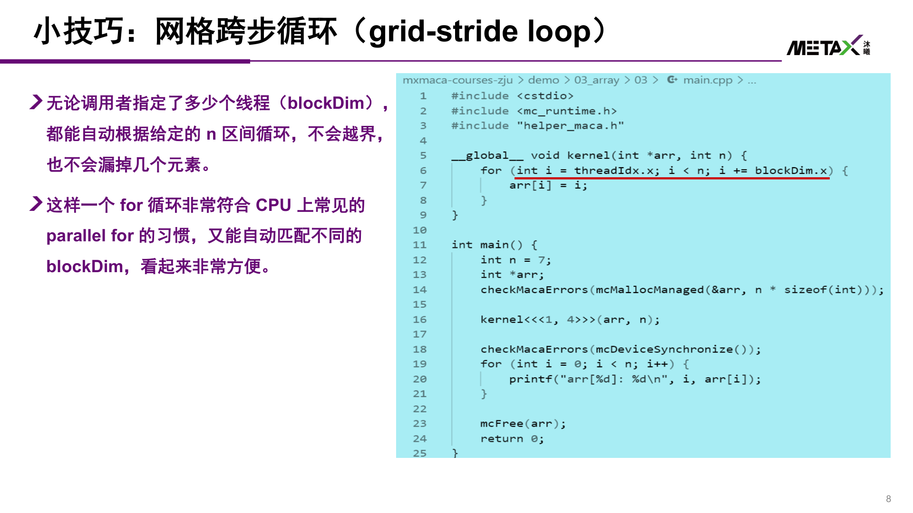

- 固定 `blockDim = 128`、`gridDim = n / 128` 时，C 整数除法向下取整，`n` 不是 128 的倍数会**漏掉尾部元素**
- 解决：向上取整 `(n + nthreads - 1) / nthreads`，并在 kernel 内判断 `if (i >= n) return;` 防止越界
- 网格跨步循环则同时兼容线程与线程块的动态大小，等价于 CPU 上常见的 `parallel for`

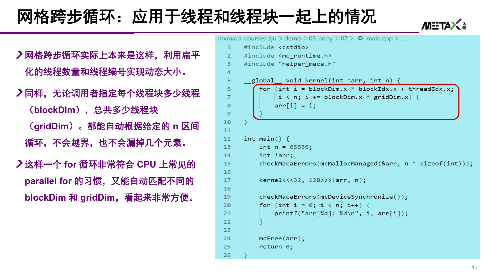

### 2. C++ 封装

- `std::vector<T>` 实际是 `std::vector<T, std::allocator<T>>`，第二个模板参数负责 `allocate` / `deallocate`
- 自定义 allocator（同名成员函数）即可"骗过" vector，让内存在 **MACA 统一管理内存**上分配 —— 这是现代 C++ concept 思想的体现，也为标准库允许
- vector 初始化/resize 会调用元素无参构造（如 int 零初始化）且发生在 CPU 上；可给 allocator 增加 `construct` 成员，对 **POD 类型跳过无参构造**，避免低效零初始化

```cpp
// 核函数本身可以是模板函数
template <typename T>
__global__ void kernel(T *arr, int n) { /* ... */ }

kernel<int><<<grid, block>>>(arr, n);   // 手动模板参数放在三重尖括号之前
```

- **函子（functor）**可作为核函数参数，实现函数式编程，但有三个前提：
	1. 按**值**传递（`Func` 而非 `Func const &`），否则会变成指向 CPU 内存的指针
	2. 必须是带 `operator()` 成员函数的类型，不能是普通函数
	3. 必须标记 `__device__`
- **lambda 表达式**：`[] __device__ (...) { ... }`，需开启 `--extended-lambda`
	- `[&]` 捕获到的是 CPU 栈上的 vector 对象，错误
	- `[=]` 会触发 vector **深拷贝**，整个拷到 GPU，错误
	- 正确：先 `arr.data()` 取出**原始指针**，再按值捕获该指针；或用自定义捕获 `arr = arr.data()`
	- CMake 生成器表达式可让该 flag 只对 `.maca` 源文件生效，混合编译其它 `.cpp` 时不会让 gcc 报错

```cpp
auto arr_data = arr.data();
kernel<<<grid, block>>>(n, [=] __device__ (int i) { arr_data[i] *= 2; });
```

### 3. 数学运算与 fast math

- 浮点数学函数要用 **`sinf` 而不是 `sin`**（后者是 double 版本，影响性能）
- 常用：`sqrtf`、`rsqrtf`、`cbrtf`、`powf`、`sinf/cosf/tanf`、`asinf/acosf/atanf`、`logf/log2f/log10f`、`expf/exp2f/exp10f`、`fmodf/fabsf/fminf/fmaxf` 等
- **GPU intrinsics**（低精度、高性能，图形学常用）：`__sinf`、`__cosf`、`__expf`、`__logf`、`__powf`
	- `__fdividef(x, y)` 浮点除法更快，但大指数区间会得到错误结果
- 编译选项 `--use_fast_math`：自动把 `sinf` 换成 `__sinf`，并开启
	- `--ftz=true`：极小数（denormal）退化为 0
	- `--prec-div=false` / `--prec-sqrt=false`：降低除法 / 开方精度换速度
	- `--fmad`：默认开启，把 `a * b + c` 优化成一条 **FMA** 乘加指令
- **SAXPY**（Scalar A times X Plus Y）= `A*x + y`，是 GPU 教材中的经典案例；Vector Add 即 `A = 1` 的特例

### 4. thrust 库

- MXMACA 官方提供 thrust，直接用它即可
- 容器：
	- `thrust::universal_vector`：统一管理内存，CPU / GPU 都可直接访问
	- `thrust::device_vector` / `thrust::host_vector`：分别在 GPU / CPU 上分配
	- 两者之间可用 `=` 拷贝，自动调用 `mcMemcpy`
- 常用算法：`generate`、`for_each`、`reduce`、`sort`、`find_if`、`count_if`、`reverse`、`inclusive_scan`
	- **根据容器/迭代器类型决定在 CPU 还是 GPU 执行**：`host_vector` 用普通 lambda，`device_vector` 的 lambda 要加 `__device__`
- 特殊迭代器：
	- `make_counting_iterator(num)`：表示整数区间
	- `make_zip_iterator(a, b)`：合并多个迭代器（类似 Python `zip`），用 `thrust::get<i>(tup)` 取元素

```cpp
thrust::device_vector<float> x_dev(n);
x_dev = x_host;                                  // 自动 mcMemcpy
thrust::for_each(x_dev.begin(), x_dev.end(),
                 [] __device__ (float &x) { x *= 2; });
```

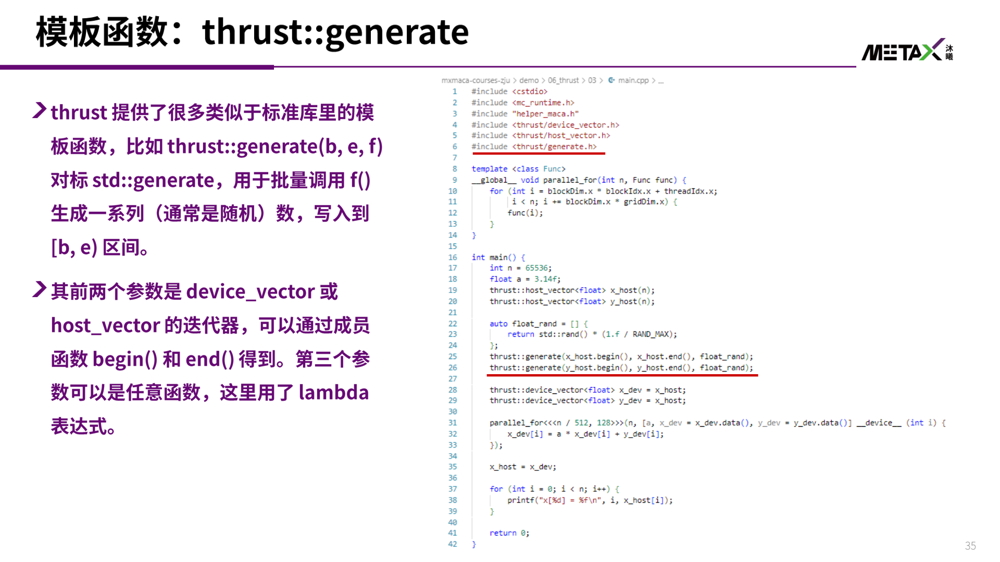

### 5. 原子操作

- 并行数组求和直接写 `sum[0] += arr[i]` 会出错：该语句被拆成 **读 → 加 → 写回** 四步，多线程交错导致更新丢失

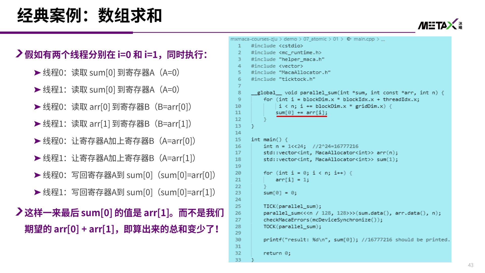

- `atomicAdd(dst, src)` ≡ **原子版** `*dst += src`，且**返回旧值**
- 代价：同一地址的原子操作必须串行"排队"
	- 2^24 个元素：不用原子操作 0.003108s（结果错）；用原子操作 0.022093s（结果对），**慢约 8 倍**
- 优化：每个线程先累加到**局部变量** `local_sum`，最后只做一次原子加；并让 `gridDim * blockDim` 远小于 `n`，可减少约 `4096/512 = 8` 倍的原子操作（类似 C++ 的 TLS）
- 利用"返回旧值"可实现 `push_back`：旧值就是当前"分配"到的写入位置

| 原子操作 | 等价语义 |
| -------------------------- | ------------------------------ |
| `atomicAdd(dst, src)` | `*dst += src` |
| `atomicSub/Or/And/Xor` | `*dst -= / \|= / &= / ^= src` |
| `atomicMax/Min` | `*dst = max/min(*dst, src)` |
| `atomicExch(dst, src)` | `old = *dst; *dst = src;` |
| `atomicCAS(dst, cmp, src)` | `old = *dst; if (old == cmp) *dst = src;` |

```cpp
// 用万能的 CAS 实现 MXMACA 未提供的原子乘
__device__ __inline__ int my_atomic_mul(int *dst, int src) {
    int old = *dst, expect;
    do {
        expect = old;
        old = atomicCAS(dst, expect, expect * src);
    } while (expect != old);
    return old;
}
```

- 上述原子操作（含 `atomicAdd`）**都会返回旧值**；`atomicCAS` 还可组合出**任意原子读-改-写**指令（如 `atomicMul`）
- 一些 GPU 语言不支持 float 版 `atomicAdd`，可用 CAS + `__float_as_int` / `__int_as_float` 位转换实现；**MXMACA 原生支持 float**，无需如此

## 二、MXMACA 语言特性与运行时库

### 1. 函数与变量修饰符

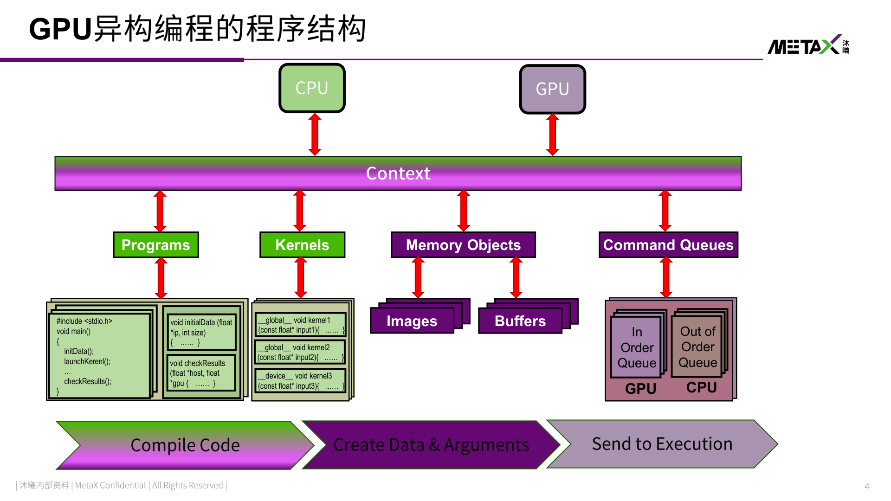

| 修饰符 | 运行位置 | 调用方 | 说明 |
| ---------------------- | ------ | ------ | ---------------------------------------- |
| `__global__` | device | host | 核函数（kernel），device 上并行执行，返回 `void` |
| `__device__` | device | device | 只能被 kernel 或其它 `__device__` 函数调用 |
| `__host__` | host | host | 默认修饰符；不能被 device 函数调用 |
| `__host__ __device__` | 两者 | 两者 | offload 到 host 和 device，两边都可调用 |

- kernel 启动语法 `<<<blocks, threads, shmem, stream>>>`，四个参数依次为：**线程块数量、每块线程数、动态共享内存大小、stream**
- 变量修饰符：
	- `__shared__`：线程块内共享的片上共享内存
	- `__constant__`：常量内存
	- `__managed__`：统一管理内存
	- 函数内未修饰的局部变量默认位于 **local memory**
- 内建变量：`gridDim`（Block 总数）、`blockIdx`（Block 索引）、`blockDim`（Block 内线程数）、`threadIdx`（线程索引）
	- 唯一线程编号：`blockDim.x * blockIdx.x + threadIdx.x`，配合 `if (id < N)` 定制每个线程的行为

### 2. 编译流程

```bash
mxcc add_vectors.maca -o a.out
```

`mxcc` 的四个阶段：

| 阶段 | 作用 |
| ---------------- | ---------------------------------------- |
| DevicePhase | device 文件 → device object |
| DlinkPhase | device relocatable object → **device ELF** |
| HostPhase | host 文件 → host object |
| HostLinkPhase | host relocatable object → **host ELF** |

- CMake 工程：`add_vectors.cpp`、`cube.cpp` + `CMakeLists.txt`，`cd build && cmake .. && make -j`

### 3. 运行时库 API

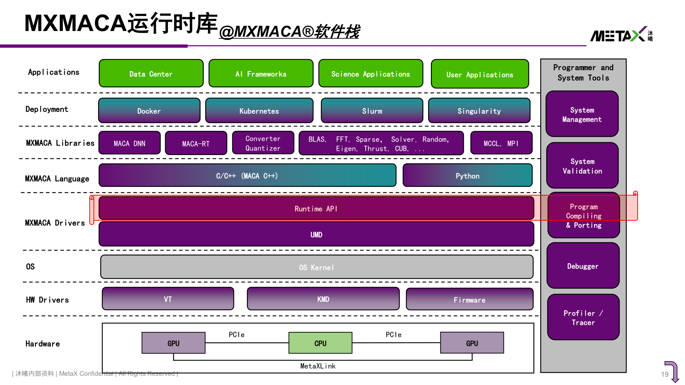

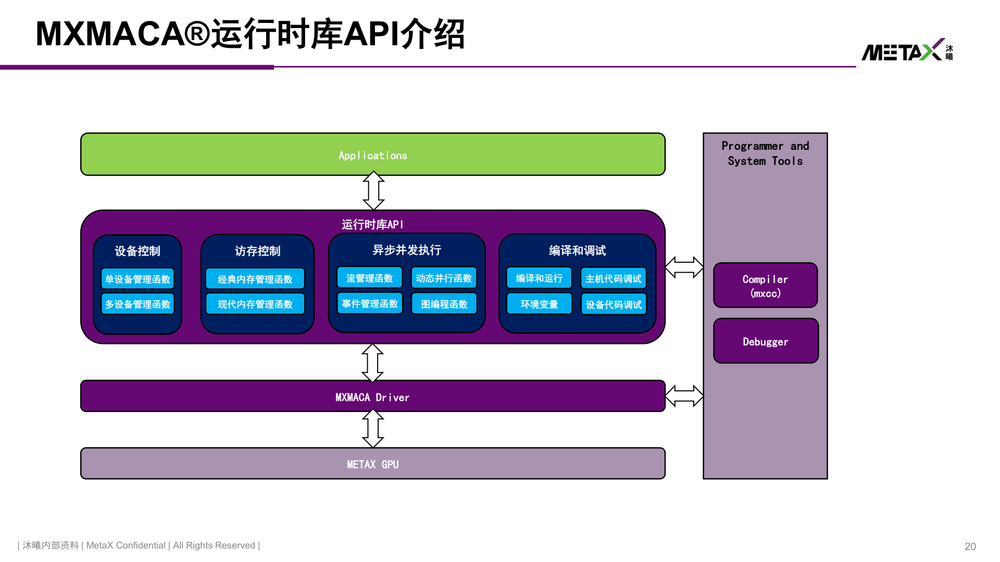

| 分类 | 主要函数 |
| -------------- | ------------------------------------------------------------------------------------------------------------------- |
| 设备管理 | `mcGetDeviceCount`、`mcGetDeviceProperties`、`mcSetDevice`、`mcDeviceReset` |
| 内存管理 | `mcMallocHost` / `mcFreeHost`、`mcMalloc` / `mcFree`、`mcMemcpy`（阻塞）、`mcMemcpyAsync`（需 stream） |
| 流管理 | `mcStreamCreate(-WithFlags/-WithPriority)`、`mcStreamDestroy`、`mcLaunchKernel`、`mcStreamQuery` / `Synchronize` / `WaitEvent` |
| 事件管理 | `mcEventCreate`、`mcEventRecord`、`mcEventSynchronize` / `Query`、`mcStreamWaitEvent`、`mcEventElapsedTime` |
| 其它 | 动态并行、图编程（Graph）API |

- **设备初始化**：隐式初始化（第一次调用任意 device 相关运行时函数）或显式 `mcDeviceReset`
- 设备属性 `mcDeviceProperties`：`name`、`waveSize`（一个 wave 的线程数）、`maxThreadsPerBlock`、`maxThreadsPerMultiProcessor`、`maxThreadsDim[3]`、`maxGridSize[3]`、`concurrentKernels`（是否支持同上下文并发执行多个 kernel）
- **流（stream）**：每个流内的任务顺序执行，多个流之间可并发；`mcLaunchKernel` 把 kernel 投递到指定流
- **事件（event）**：用于**跨流同步**和**计时**（见下文 mcEvent 计时）

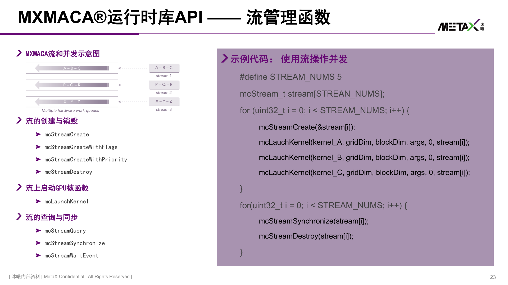

### 4. 运行控制：环境变量与日志

- `MACA_VISIBLE_DEVICES`：指定程序可见的 GPU
	- 可用 UUID：`export MACA_VISIBLE_DEVICES=GPU-ad2367dd-...`
	- 也可用索引列表：`export MACA_VISIBLE_DEVICES=0,2`
- 驱动日志 `MXLOG_LEVEL`，等级从低到高：
	- `off` → `error`（默认）→ `warning` → `info` → `debug`
	- 全局：`export MXLOG_LEVEL=debug`
	- 指定模块：`export MXLOG_LEVEL=error,MCR=debug`
	- 系统级默认配置：`/opt/maca/etc/log.ini`

## 三、程序分析与调试

### 1. 计时方法

- **非侵入式**：`time ./prog`，输出 `real`（墙上时间）、`user`（用户态 CPU 时间）、`sys`（内核态 CPU 时间）
	- 缺点：包含 `malloc` 等内核/初始化开销，测不准
- **侵入式**：只测感兴趣的代码段
	- Linux：`<sys/time.h>` 的 `gettimeofday()`
	- 跨平台：`std::chrono::high_resolution_clock`
- **GPU 计时注意**：kernel 调用是异步的，**必须同步后再停表**，否则测到的是"下发时间"而非执行时间
- 更准确：用 `mcEvent` 在 GPU 上打点

```cpp
mcEvent_t start, stop;
mcEventCreate(&start);
mcEventCreate(&stop);
mcEventRecord(start);
kernel<<<grid, block>>>(args);
mcEventRecord(stop);
mcEventSynchronize(stop);

float ms;
mcEventElapsedTime(&ms, start, stop);
mcEventDestroy(start);
mcEventDestroy(stop);
```

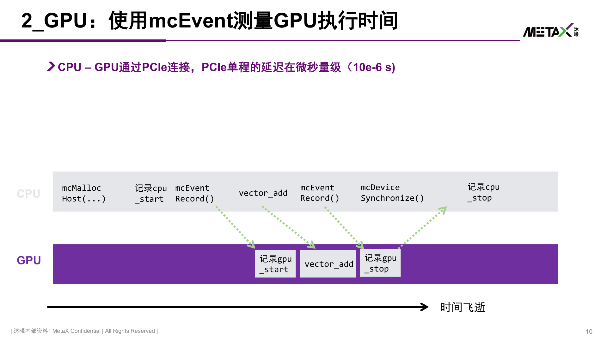

- CPU↔GPU 经 PCIe 连接，**单程延迟在微秒量级（约 10⁻⁶ s）**，因此 CPU 侧时间和 GPU 侧时间不能混为一谈；测 GPU 执行时间应用 event

### 2. 工具链总览

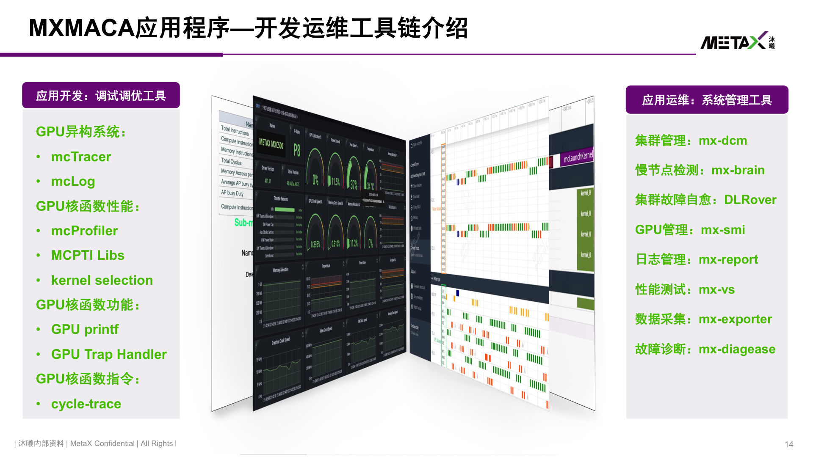

MXMACA 应用开发生命周期与配套工具：

| 层次 | 工具 |
| ------------------ | ---------------------------------------------------------------------------------------------------- |
| 应用开发 / 异构系统 | `mcTracer`、`mcLog` |
| GPU 核函数功能 | **GPU printf**、**GPU Trap Handler** |
| GPU 核函数性能 | `mcProfiler`、MCPTI Libs、kernel selection |
| GPU 核函数指令 | `cycle-trace` |
| 集群/运维 | `mx-dcm`（集群管理）、`mx-brain`（慢节点检测）、`DLRover`（故障自愈）、`mx-smi`（GPU 管理）、`mx-report`（日志）、`mx-vs`（性能测试）、`mx-exporter`（数据采集）、`mx-diag`（故障诊断） |

调试手段谱系：**Logging（日志）、Tracing（跟踪）、Profiling（性能分析）、MemDump（内存转储）**
- 四者各有侧重：Logging 贴近开发者语义，Tracing 记录活动时序，Profiling 汇总统计指标，MemDump 保留原始内存内容
- 越依赖加工数据的手段越"主观"、适用面越窄、工具开发也越复杂

### 3. 三个核心分析工具

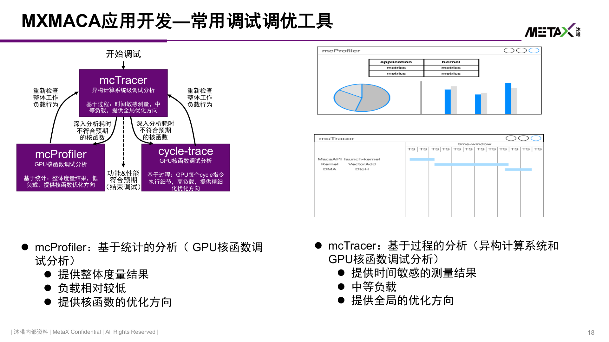

| 工具 | 粒度 | 方式 | 负载 | 适用 |
| ------------ | -------------- | ------ | ------ | ---------------------------------------------------------- |
| `mcTracer` | 应用级（CPU+GPU） | 基于过程 | 中等 | 看整体时间线：kernel 何时开始、间隔多久、CPU 调度还是 GPU 计算拖慢 |
| `mcProfiler` | 核函数级 | 基于统计 | 低 | 内存/缓存效率、计算单元利用率、RoofLine，定位 kernel 优化方向 |
| `cycle-trace` | 指令级 | 基于过程 | 高 | 每个 cycle 的指令执行细节，做精细化优化 |

- **mcTracer**：CPU 活动 + 事件 + MACA API 调用 + MCTX 自定义标签段；GPU 核函数 + 显存活动事件；提供 CPU/GPU 统一的观测视角和流关联
- **mcProfiler**：内存瓶颈（缓存效率、内存效率）、计算瓶颈（计算单元效率、指令调度效率）
- 推荐流程：**mcTracer 摸全局 → mcProfiler 分析热点 kernel → cycle-trace 抠指令细节**

### 4. 调试手段

- **GPU printf**：kernel 内直接 `printf`，是定位核函数逻辑最直接的手段（记得同步）
	- 也可在沐曦 Web 实验平台 `compiler.metax-tech.com` 上直接运行示例
- **GPU Trap Handler**：捕获核函数异常陷入
- **mcLog / 驱动日志**：日志分析器在 CPU 和 GPU 两端都提供规范化的 `printf`，通过**环形缓冲区**把两端日志串联成统一视图
	- 可按日志等级、模块过滤；日志文件数量/大小/存放目录均可配置；主机侧统一存储
	- 适合异构程序的行为分析和错误检查

> [!summary] 一句话总结
> 编程进阶解决"**如何把串行 C++ 高效映射到 GPU**"（映射、封装、thrust、原子操作）；运行时库解决"**如何管理设备、内存、流、事件**"；调试工具解决"**如何看清程序在 CPU/GPU 上到底做了什么、慢在哪**"（先 mcTracer 看全局，再 mcProfiler 看 kernel，最后 cycle-trace 看指令）。
