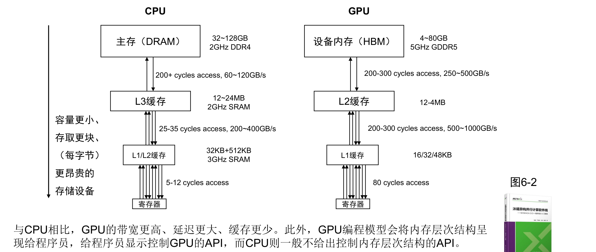
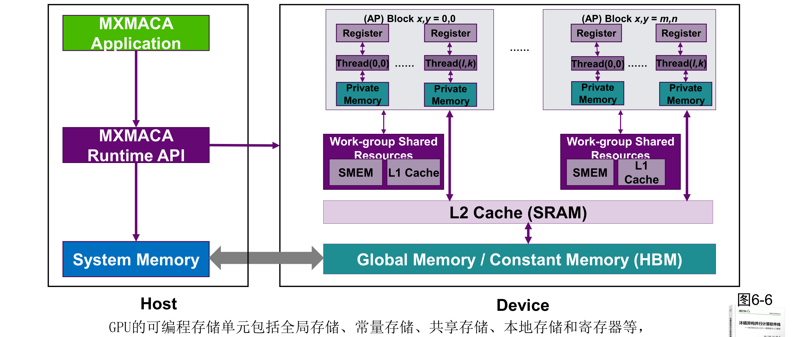
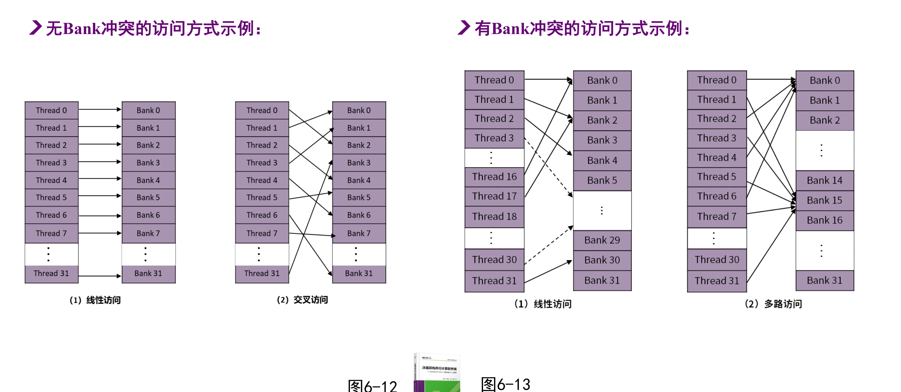
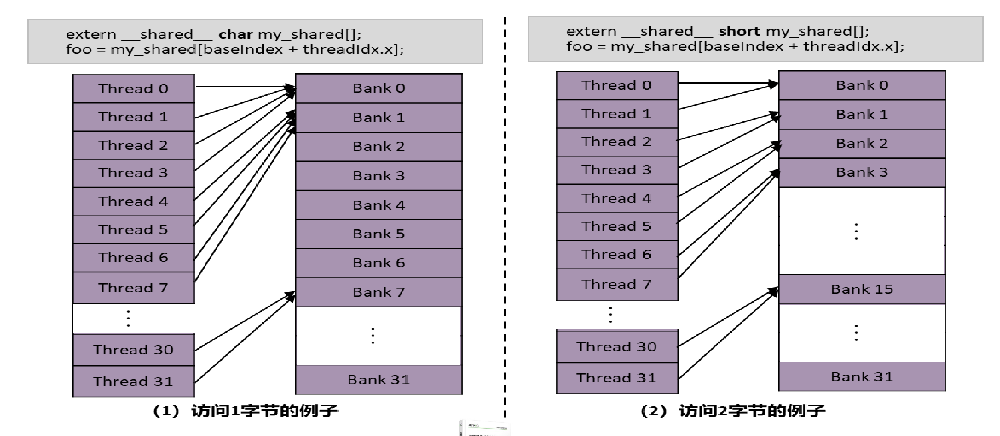
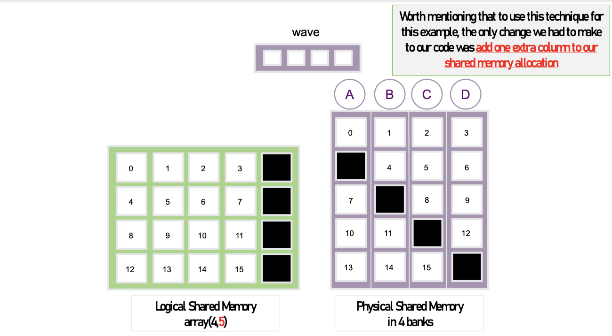
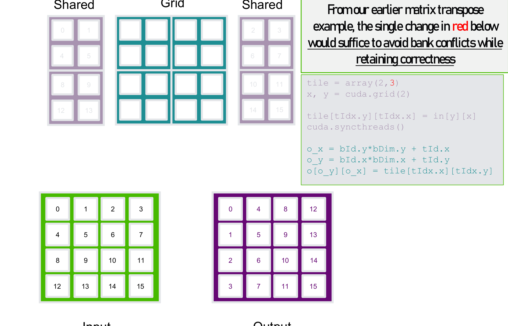
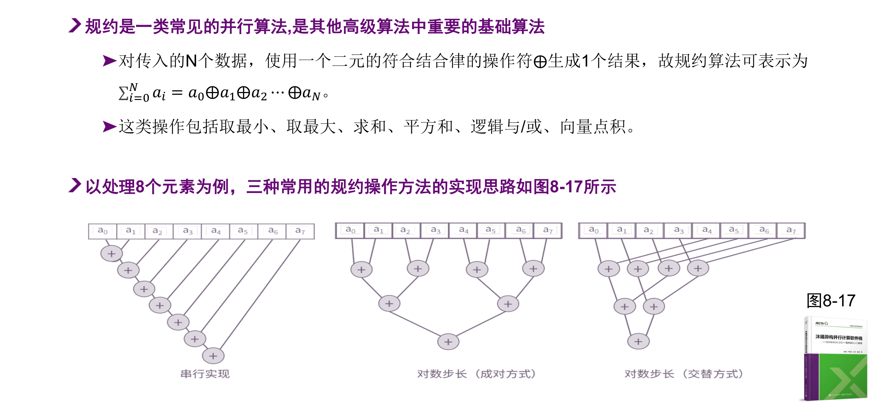

> [!notice] 本节重点
> - GPU 内存层次：**容量更小、带宽更高、延迟更大、缓存更少**
> - MXMACA 编程模型中的五类可编程存储单元与两级不可编程缓存
> - 内存管理 API 与七类内存管理技术（常规 / 零复制 / 统一寻址 / 2D-3D / 虚拟内存 / 流序）
> - 锁页内存与异步拷贝
> - 共享内存 **Bank 冲突**、padding 消除冲突
> - 共享内存上的**并行规约**及优化

> [!info] 参考材料
> - 《【第7节】MXMACA内存模型和内存管理》
> - 《【第8节】MXMACA程序的共享内存管理》

## 一、MXMACA 内存模型

### 1. 术语与硬件内存层次

- **Host**：CPU 及其主存（host memory）；**Device**：GPU 及其显存（device memory）；二者经 **PCIe** 连接
- 越靠近计算单元：容量越小、存取更快、每字节越昂贵



| 层次 | CPU | GPU |
| ---------- | ------------------------------------- | ---------------------------------------- |
| 寄存器 | — | — |
| L1 / L2 | 32KB+512KB，3GHz SRAM，5~12 cycles | 16/32/48KB，80 cycles |
| 末级缓存 | L3 12~24MB，2GHz SRAM，25~35 cycles，200~400GB/s | L2 1~4MB，200~300 cycles，500~1000GB/s |
| 主存 | DRAM 32~128GB，2GHz DDR4，200+ cycles，60~120GB/s | HBM 4~80GB，5GHz GDDR5，200~300 cycles，250~500GB/s |

> [!important] CPU 与 GPU 内存的关键差异
> GPU **带宽更高、延迟更大、缓存更少**。更本质的区别：GPU 编程模型把内存层次**显式暴露给程序员**（可用 API 控制），CPU 则一般不提供。

### 2. 编程模型中的存储层次



- **可编程存储单元**：全局存储、常量存储、共享存储、本地（私有）存储、寄存器
- **不可编程存储单元**：一级缓存、二级缓存
- 线程 → 寄存器 / 私有内存；线程块（work-group）→ 共享内存 + L1；整个 Grid → 全局内存 / 常量内存

### 3. 各类存储器的特征

| 存储器  | 位置  | 缓存    | 读写  | 作用范围      | 生命周期 | 速度          | 修饰符                       |
| ---- | --- | ----- | --- | --------- | ---- | ----------- | ------------------------- |
| 寄存器  | 芯片内 | 无     | 读/写 | 一个线程      | 线程   | 最快          | 默认标量变量                    |
| 私有内存 | 芯片外 | L1/L2 | 读/写 | 一个线程      | 线程   | 较慢          | 默认数组（如 `float a[100]`）    |
| 共享内存 | 芯片内 | 无     | 读/写 | 块内所有线程    | 线程块  | 无 Bank 冲突时快 | `__shared__`              |
| 全局内存 | 芯片外 | L1/L2 | 读/写 | 所有线程 + 主机 | 程序   | 较慢          | `__device__` / `mcMalloc` |
| 常量内存 | 芯片外 | L1/L2 | 只读  | 所有线程 + 主机 | 程序   | 较慢          | `__constant__`            |

## 二、MXMACA 内存管理

### 1. 常用 API

| 功能 | API |
| -------- | -------------------------------------- |
| 内存申请 | `mcMalloc`、`mcMallocHost`、`mcMallocManaged` |
| 内存拷贝 | `mcMemcpy`、`mcMemcpyAsync` |
| 内存初始化 | `mcMemset` |
| 内存释放 | `mcFree`、`mcFreeHost` |
| 内存注册/注销 | `mcHostRegister`、`mcHostUnregister` |

### 2. 内存分配与地址空间

- `malloc` / `new` **只能分配主机内存**；CPU **不能直接读写** GPU 内存
- `mcMallocHost`：分配**主机锁页内存**；`mcMalloc`：分配 **GPU 设备内存（HBM）**
- 两侧数据交互默认要显式 `mcMemcpy`，经 PCIe 传输

### 3. 锁页内存（Pinned Memory）

- 特点：
	- Host ↔ Device 拷贝**更快**
	- 可与 CPU 计算**异步**
	- 也可与 GPU 计算**异步**（配合 `mcMemcpyAsync` + stream）
- 用法：
	- `mcMallocHost` / `mcFreeHost` 替代 `malloc` / `free` / `new` / `delete`
	- `mcHostRegister` / `mcHostUnregister` 把**已分配的普通内存**注册为锁页
- 原理：**禁止 CPU 页交换**。普通可分页内存的传输要先拷到一块临时锁页缓冲区，因此多一次拷贝

### 4. 七类内存管理技术

| 技术 | 代表 API | 优点 | 缺点 |
| ---------------- | ---------------------------------------- | -------------------------------------------- | ---------------------------------- |
| 常规内存管理 | `mcMalloc(Free)Host`、`mcMalloc`、`mcFree`、`mcMemset`、`mcMemcpy(Peer)` | 分配最细致，效率可达最高 | 需手工相互复制，开发复杂 |
| 零复制内存 | `mcHostMalloc`、`mcHostRegister`、`mcHostGetFlags`、`mcHostGetDevicePointer` | 设备内存不足时可用主机内存，开发方便 | 设备经 PCIe 访问，速度慢 |
| 统一虚拟寻址 | `mcMallocHost`、`mcHostRegister`、`mcHostGetFlags` | 功能同零复制，且**无需 `mcMemcpy`**，主机/设备可直接读写 | — |
| 统一寻址内存 | `mcMallocManaged`、`mcMemPrefetchAsync`、`mcMemAdvise` | 统一编址，开发最方便；比零复制多性能优化逻辑 | 优化逻辑复杂 |
| 2D/3D 内存 | `mcMallocPitch` / `mcMalloc3D`、`mcMemcpy2D/3D`、`mcMemset2D/3D` | 适合二维/三维数据与图像 | 多用于建模分析（如 OpenCV） |
| 虚拟内存管理 | `mcMemAddressReserve/Free`、`mcMemCreate/Release`、`mcMemMap/Unmap`、`mcMemSetAccess` 等 | **地址与内存解耦**，可按需调整大小（类似 `realloc` / `vector`） | 需理解业务动态，按需分配与释放 |
| 流序内存管理 | `mcMallocAsync` / `mcFreeAsync`、内存池 `mcMemPool*` | 引入**内存池**实现复用，消除无关同步，性能更高 | 内存池管理复杂 |

## 三、共享内存管理

### 1. Bank 结构与 Bank 冲突

- 物理共享内存分 **32 个 bank，每个 4 字节宽**；连续的 4 字节字依次落入不同 bank
- 一个 **wave** 可**并行**访问每个 bank 的 4 字节：
	- 各线程访问**不同 bank** → 一次完成，无冲突
	- 多个线程访问**同一 bank 的不同地址** → 访问**串行化**，即 **Bank 冲突**；n 路冲突需 n 个周期



> [!tip] 两种特殊情况
> - **广播**：同一 wave 内所有线程访问**同一地址**时可直接广播，不算冲突
> - **图示约定**：实际是 32 bank，幻灯片为便于展示用 4 bank 示意

### 2. 数据类型与 Bank 冲突



- `char`（1 字节）：4 个线程共用同一个 4 字节 bank 字 → **4 路冲突**
- `short`（2 字节）：2 个线程共用一个 bank → **2 路冲突**
- `int` / `float`（4 字节）：一个线程恰好对应一个 bank → 天然无冲突
- 结论：共享内存数组**优先用 4 字节类型**，或通过打包/填充避免窄类型共享 bank

### 3. Padding 消除列访问冲突

- 场景：按**列**访问共享内存（如矩阵转置），列元素间隔 = 行宽，易落入同一 bank
- 方法：分配时**多加一列**（`tile[rows][cols+1]`），逻辑上仍按 `rows × cols` 使用
- 物理 bank 数固定，padding 只是改变每行起始 bank，使同列元素分散到不同 bank






```cpp
// 矩阵转置：只把 tile 的列数 +1 即可消除 bank 冲突
__shared__ float tile[BLOCK][BLOCK + 1];

tile[tIdx.y][tIdx.x] = in[y][x];
__syncthreads();
out[o_y][o_x] = tile[tIdx.x][tIdx.y];
```

### 4. 并行规约（Reduction）

- **规约**：用满足结合律的二元算子 ⊕ 把 N 个数据合成 1 个结果
- $\sigma_{i=0}^{N} a_i = a_0 \oplus a_1 \oplus a_2 \cdots \oplus a_N$
- 典型操作：最小值、最大值、求和、平方和、逻辑与/或、向量点积



| 方式 | 思路 | 特点 |
| -------------- | -------------------------- | ------------------------------ |
| 串行实现 | 一个线程线性累加 | 需 N−1 步，无并行度 |
| 对数步长（成对） | 相邻元素两两相加，步长逐��翻倍 | 树形规约，负载均衡 |
| 对数步长（交错） | 相隔半个区间的元素相加，区间逐轮减半 | 便于多线程共享内存实现 |

- GPU 实现：每个线程先算局部和 → 写入共享内存 → `__syncthreads()` → 树形规约（每轮减半活跃线程）
- 线程与数据比例 > 1 时，可让**每个线程处理多个元素**（如 2 个），进一步摊薄同步与启动开销


> [!summary] 总结
> 先理解 **GPU 的显式内存层次**（寄存器/私有/共享/全局/常量），再用合适的 **内存管理 API**（锁页、统一寻址、内存池等）解决"数据怎么放"；在片内则用**共享内存 + 无 Bank 冲突布局 + 树形规约**解决"数据怎么快"。
